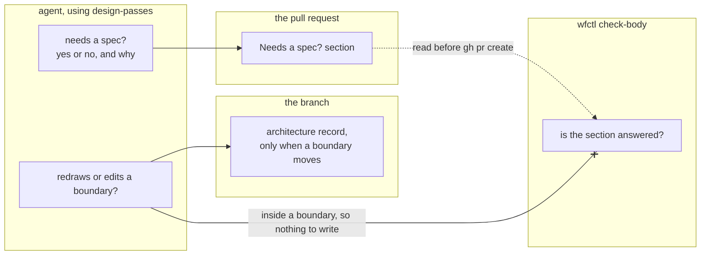

# Design passes on every change

## Problem statement

Every change, including those that bypass Spec Kit, runs through the design and
refactoring passes before opening a PR. It answers whether it needs a spec
before any code, and records that answer in the PR.

## Recommended direction

A new skill, `design-passes`, first asks whether the change needs a full
spec. That answer picks the route. If yes, the change goes through the Spec Kit
pipeline. If no, it runs the four passes Andre asked for, in his order:

1. Level 2 starts by reading the accepted records (`wfctl arch context`) and the
   domain model in `docs/architecture/domain/`. Without that, a small fix can
   redraw a line the model already settled, and nobody notices. Level 2 then
   checks whether the change redraws or edits a boundary. A change inside an
   existing boundary writes nothing. Redrawing or editing one may need an
   architecture record. A change to a modeled term's meaning goes to
   `model-the-domain` first.
2. Level 3 writes a design record for any structural choice with more than one
   credible option.
3. The agent commits a failing test first, then writes the code.
4. A behavior-preserving refactor runs `clean-code`, plus
   `python-pattern-selection` when a pattern name comes up. Each refactor is
   its own commit.

The skill adds no design method of its own. Each pass hands off to the skill
that already does that work.

The skill asks the spec question before any code, so the answer shapes the
work. The answer is recorded in one place. The PR template has a "Needs a
spec?" section, and `wfctl check-body` fails a PR body when that section is
missing, empty, or N/A. The answer describes one change, not the system, so it
lives with the change rather than in the architecture folder.

`wfctl verify` doesn't require an `arch none` file on every branch. That would
add a file to every one-line fix, and a change inside an existing boundary has
nothing to declare. The Spec Kit design step still requires a record or a
declaration.

The agent hits the skill when it picks a route, before writing any code. The
places that send a small change straight to implementation point to
`design-passes` instead:

1. The route line in every handoff, from `worktree-handoff`.
2. The "not for" lines in `design-levels` and `architecture-design`.
3. The paragraph in `AGENTS.md` that allows skipping the pipeline.

Andre decided against adding a step to `opening-a-change`. That skill runs
after the code exists, so a step there could only check the design, not shape
it.

## Two questions, kept apart

The boundary question and the spec question have separate answers, and neither
decides the other.

1. **Does the change redraw or edit a boundary?** A change inside an existing
   boundary needs nothing. Redrawing or editing one may need an architecture
   record.
2. **Does the change need a full spec?** A change that touches a boundary may
   need an architecture record but not a full spec. Andre decides where the
   spec line falls, and he hasn't yet.

Until then, each answer gives its own reason, and the reviewer judges it.

## What changes for the agent and the reviewer

Here are the strings each state renders.

A handoff for a small fix, where the route line used to say "straight to
implementation":

```
## Route

A bug fix or a copy edit runs `.agents/skills/design-passes` before any code is
written. That skill decides whether the change needs a spec.
```

True. The handoff names the skill, and the skill asks the spec question
before any code.

The PR section, filled in:

```
## Needs a spec?

No. The fix changes one check inside the worktree guard and adds no state.
```

True. A reviewer can disagree with the reason.

A PR body with the section left as N/A:

```
$ wfctl check-body /tmp/pr-body-604-release-note-fixes.md
⚠ "Needs a spec?" holds N/A. The template's comment under that heading says what to write.
```

True. N/A doesn't answer a yes-or-no question, and the template's comment says
what does.

A PR body with the section deleted:

```
$ wfctl check-body /tmp/pr-body-604-release-note-fixes.md
⚠ "Needs a spec?" is missing. This repository asks every pull request to answer it.
```

True. The agent deleted the section, so the message explains why it's required.

A PR body in a repo that lists no required sections:

```
$ wfctl check-body /tmp/pr-body.md
✓ /tmp/pr-body.md: the drawings look right
```

True. It prints the same line as today.

### What level 1 requires of level 3

1. For the deleted-section state, `check-body` has to know which sections are
   required without reading the body, so a repo lists them in `wfctl.json`.
2. For the silent state in other repos, wfctl has no built-in section names.
3. For the empty state, `check-body` strips the template's HTML comments
   before checking whether a section is empty.

## Boundary

The level-2 decision is in `every-change-answers-spec-question`. The PR owns
the answer a reviewer reads, and `check-body` makes sure it's there.
The check only confirms that the section has an answer, not that the answer is
right. That's enough, since the reviewer judges the answer. Nothing checks
the level-3 answer, test-first, or the refactor.

## Structure: checked and assumed

| Checked | Assumed |
|---|---|
| `design-levels:22`, `architecture-design:46`, and `worktree-handoff:70` each send a bug fix or copy edit straight to implementation. | The agent reads a handoff's route line before writing code. `start-session` reads the handoff first, which supports this. |
| `AGENTS.md:391` says "Not every change needs the spec pipeline" and quotes `design-levels`. | The first commit on a branch comes before the fix, since the test is committed first. |
| `check_body_cmd` (`cli.py:6439`) reads no body section by name today, and `opening-a-change` Step 5 already runs it before `gh pr create`. | `check-body` can find a section by its heading text. A renamed heading counts as missing, which fails safe. |
| `wfctl.json` already holds `change_check`, for the same reason a required-sections list would live there. | |
| `release.py` runs `gh pr create` itself and never runs `check-body`, so a release PR needs no exemption. | |

## Where this meets #622

#622 is redesigning `opening-a-change` and the review panel. This change doesn't
edit `opening-a-change`. The two overlap in three places:

1. `design-passes` finishes before the agent opens the PR, so the panel
   reviews the refactor commit with the rest of the change.
2. The new check runs inside `check-body`, which Step 5 of `opening-a-change`
   already calls. This change adds no line to the file #622 is editing.
3. The "Needs a spec?" section is the change's own explanation, not panel
   output, so #622's rule that keeps panel output out of the PR description
   doesn't apply.

## Where this meets #382

Right now, a change has to commit an `arch none` file to get #382's short
track. This design drops that file for one-line fixes, so #382's requirement
needs another look. #635 covers where per-branch answers such as `arch none`
belong, and #382 depends on its answer.

## Key assumptions to validate

- [ ] An agent given only a handoff with the new route line runs `design-passes`
      and answers the spec question before any code. Test it on a throwaway
      branch with a one-line fix.
- [ ] `check-body`'s message for N/A is clear enough that an agent writes a real
      answer, not "No." with no reason.

## MVP scope

In:

1. The `design-passes` skill, with the spec question first, then the four
   passes and what each one leaves behind.
2. The route line in `worktree-handoff`, the "not for" lines in `design-levels`
   and `architecture-design`, and the paragraph in `AGENTS.md`, each pointing to
   `design-passes`.
3. A `wfctl.json` key listing required PR sections, read by `check-body` and
   validated by `wfctl check config`.
4. A "Needs a spec?" section in this repo's PR template, listed in this repo's
   `wfctl.json`.
5. The same first step at level 2 of `design-levels`: read the accepted records
   and the domain model before choosing a method. The Spec Kit route skips this
   today too, so both routes start level 2 the same way.

## Not doing

- **A step in `opening-a-change`.** Andre decided against it, since that skill
  runs after the code exists.
- **Requiring an `arch none` file on every branch.** It adds a file to every
  one-line fix, and a change inside an existing boundary has nothing to declare.
- **Deciding where the spec line falls.** Andre decides that.
- **Recording the spec answer before the PR.** A `Needs-spec:` commit trailer
  was considered and rejected (`628-early-answer-in-commit-trailer`). Nothing
  read it, and git ignores one that isn't in the commit message's last
  paragraph.
- **Checking the level-3, test-first, or refactor passes.** Each would check a
  file only the agent vouches for.
- **Exempting docs-only changes.** Answering takes one sentence, and this repo's
  skills are Markdown files that control what an agent can do.
- **Per-task `clean-code` inside `/speckit.implement`.** That's #479, and it
  changes the full pipeline, not this route.

## Open questions

- Where the spec line falls: which changes need a full spec. Andre decides this,
  and `design-passes` can't spell out the rule until he does.

## Software design decisions

- docs/architecture/design/628-design-passes-own-skill.md — the four passes live in a `design-passes` skill, and the route to implementation points to it
- docs/architecture/design/628-early-answer-in-commit-trailer.md — rejected: the early spec answer as a `Needs-spec:` trailer on the branch's first commit
- docs/architecture/design/628-spec-answer-in-pr-body.md — `check-body` checks the "Needs a spec?" section, and each repo names required sections in `wfctl.json`

## The records in full

Each record is copied below as it stands on the branch, with its headings
moved down two levels. The file in `docs/architecture/` is the one that counts
if the two ever differ. The rejected trailer record isn't copied.

### Every change records in its PR whether it needs a spec

`docs/architecture/every-change-answers-spec-question.md`, proposed

#### Context

Right now, the agent decides on its own whether a change needs a full spec, and
nothing records that decision. The project instructions let bug fixes, copy
edits, and other small changes bypass the Spec Kit pipeline. Over the last 90
days, more than half of this repo's roughly 530 commits were `fix:`, `docs:`, or
`chore:` changes, so for most changes the reviewer never saw this decision.

Andre asked for four passes on every change that bypasses Spec Kit: the boundary
question at level 2, a design record at level 3 when a structural choice had
more than one credible option, a test that fails before the change, and a
behavior-preserving refactor. The `design-passes` skill runs them, and
`628-design-passes-own-skill` covers where the skill lives.

It's easy to treat these as one question, so this record keeps them apart:

1. Does the change redraw or edit a boundary? Working inside an existing
   boundary needs nothing written. Redrawing or editing one may need an
   architecture record.
2. Does the change need a full spec? Touching a boundary doesn't answer this.
   Andre decides where the line is, and he hasn't decided yet.

#### Direct baseline

Ask both questions in the `design-passes` skill and record nothing. The agent
answers in its head, and the reviewer sees only the code.

This is how the "not for trivial changes" exclusion has worked in four skills
since #161. Since the decision isn't written down, a reviewer can't check or
challenge it.

#### Decision

Every change answers whether it needs a spec, as a yes or no and a one-sentence
reason. The `design-passes` skill asks the question first, before any code, so
the answer shapes the work instead of describing it afterwards.

The answer is written down in one place, the PR. The PR template has a "Needs a
spec?" section, and `wfctl check-body` fails a PR body that leaves it empty or
N/A. `628-spec-answer-in-pr-body` covers how the check works.

The answer describes one change, not the system, so it lives with the change.
The architecture folder only gains a record when the architecture changes.

The boundary question gets its own answer. A change inside an existing boundary
writes nothing for it. A change that redraws or edits a boundary may add an
architecture record. `wfctl verify` doesn't require an `arch none` declaration
on every branch, since that would add a file to every one-line fix. The Spec Kit
design step still requires a record or a declaration, same as today.

#### Owns truth

The PR owns the answer a reviewer reads, and `wfctl check-body` checks that the
answer is there. We shouldn't take the agent's word that it answered, since it
would be grading its own work. The section is visible in the PR body, so wfctl
can check it without relying on anything the agent says.

The check only confirms the section has an answer, not that the answer is
right. That's enough here, since the reviewer judges the answer itself. A
reviewer who reads "no, the fix changes one check inside the worktree guard" can
disagree with it. The review panel's disposition table is different. It was
removed from `check-body` because it only claimed that a panel ran, and wfctl
can't verify that from text.

#### Boundary



The dotted edge is a file wfctl reads before the PR is opened. The crossed edge
is something `check-body` doesn't read: the boundary answer, because working
inside a boundary leaves nothing to check.

#### Considered

- **The direct baseline above.** It's free, but the reviewer never sees the
  decision. We didn't choose it because the answer fits in one sentence, and a
  PR section makes it reviewable at almost no cost.
- **`wfctl verify` requiring a committed `arch none` or record on every branch.**
  The first draft of this record proposed this. We didn't choose it because it
  adds a file to every one-line fix. It also asks the wrong question, since a
  change inside an existing boundary has nothing to declare.
- **One question: touching a boundary means needing a spec.** It's simpler,
  with one answer instead of two. We didn't choose it because a change that
  touches a boundary may need an architecture record but not a full spec.
  Andre hasn't decided where the spec line falls, and merging the questions
  would decide it for him.
- **A second copy before any code, as a `Needs-spec:` trailer on the branch's
  first commit.** The previous draft of this record did this
  (`628-early-answer-in-commit-trailer`). We didn't choose it because nothing
  reads the trailer, and git silently ignores one that isn't in the commit
  message's last paragraph. What shapes the decision is the skill asking the
  question before any code, and that happens whether or not the answer is
  stored.
- **A file in the feature's spec folder, written by a wfctl command.** wfctl
  could check it, and the spec store keeps it after the worktree is removed. We
  didn't choose it because the answer describes one change, and the PR already
  keeps it where the reviewer reads it.
- **A step in the `opening-a-change` skill.** Andre decided against it because
  it runs after the code is written.

#### Consequences

The PR template gets a section, and every PR in this repo fills it in.
Release PRs come from the release script and never run through `check-body`, so
they don't need an exemption.

Andre hasn't decided where the spec line falls yet. Until he does, each answer
gives its own reason, and the reviewer judges it.

Right now, the short pipeline in #382 requires a committed `arch none` to choose
the short track. This record drops that file from every fix, so #382's
requirement needs a second look. #635 covers where per-branch answers such as
`arch none` belong, and #382 depends on its answer.

#### Log

- 2026-10-22  proposed    — #628: whether a change needs a spec is decided by
  the agent alone and recorded nowhere
- 2026-10-22  proposed    — revised before review: Andre asked for the answer to
  be recorded twice, early and in the pull request, instead of an `arch none`
  file on every branch, and for the boundary and spec questions to stay apart
- 2026-10-23  proposed    — revised after plan review: the answer is recorded
  only in the PR. The early trailer was dropped because nothing read it and git
  ignores a misplaced one without warning

### The four passes live in their own skill, and the route to implementation points to it

`docs/architecture/design/628-design-passes-own-skill.md`, proposed

#### Context

A change that bypasses Spec Kit goes straight to implementation, and no skill
covers that route. Right now, three places tell a small change it can skip the
design passes:

1. The `design-levels` skill says it is not for "bug fixes, copy edits and other
   trivial changes that introduce no new state".
2. The `architecture-design` skill says those changes "go straight to
   implementation".
3. The `worktree-handoff` skill says a bug fix or a copy edit doesn't run through
   the pipeline, and the project instructions repeat it.

Andre asked for the four passes to run on these changes too, before any code is
written. The agent has to hit the passes when it picks the route, because a
description-triggered skill doesn't fire in an unattended run. That's why the
review panel became a numbered step in `opening-a-change`.

`every-change-answers-spec-question` decides what the passes record and what
wfctl checks. This record decides where the instructions for all four live.

#### Verified

- `.agents/skills/design-levels/SKILL.md:22` reads "Not for: bug fixes, copy
  edits and other trivial changes that introduce no new state".
- `.agents/skills/architecture-design/SKILL.md:46` reads "those go straight to
  implementation, and running this method over one costs more than the change".
- `.agents/skills/worktree-handoff/SKILL.md:66` makes every handoff state its
  route, "Straight to implementation, or through the spec pipeline", and line 70
  says "a bug fix or a copy edit does not".
- `AGENTS.md:391` reads "Not every change needs the spec pipeline", quoting the
  `design-levels` exclusion.
- `wfctl/agents/commands/speckit.implement.md:33` runs the refactor pass only
  inside `/speckit.implement`, after the last task.
- `docs/architecture/a-repo-concern-earns-a-step-hook-or-method.md` says a
  method "belongs inside the skill that performs the work".
- `docs/architecture/domain/wfctl.md` holds this repo's domain model, and
  `.agents/skills/model-the-domain/SKILL.md:104` says later questions start from
  it rather than asking again. `.agents/skills/design-levels/SKILL.md:174` lets
  level 2 skip its method when a record or spec settles the boundary, and says
  nothing about reading the domain model first.

#### Assumed

- The agent reads a handoff's route line before writing code. The
  `start-session` skill reads the handoff first, which backs this up. A session
  that starts without a handoff relies on the project instructions alone.
- #382's short track can use this skill as the command for its design step. If
  #382 needs the passes as separate steps, the skill splits along the four
  numbered passes it already has.

#### Direct baseline

Don't add a skill. Rewrite the three "not for" lines and the project
instructions to list the four passes, and point levels 2 and 3 at the skills
that already run them. Those lines would also list the test-first and refactor
passes, since no existing skill covers them outside `/speckit.implement`.

#### Decision

A new skill, `design-passes`, holds the four passes in order and says what each
one produces. Every place that currently sends a small change straight to
implementation points to this skill instead:

1. The route line in `worktree-handoff` names `design-passes` as the route for a
   change that bypasses Spec Kit.
2. The "not for" lines in `design-levels` and `architecture-design` say a small
   change skips Spec Kit, not the passes, and point to `design-passes`.
3. The project instructions say the same and point to the same skill.

The skill starts by asking whether the change needs a spec, before any code is
written. The answer goes in the PR's "Needs a spec?" section. If it does, the
change goes through the Spec Kit pipeline. If not, it continues with the four
passes.

The skill has no design method of its own. Each pass calls the skill that
already does that work: `architecture-design` at level 2,
`software-design-decisions` at level 3, and `clean-code` for the refactor, plus
`python-pattern-selection` when a pattern name comes up. At level 2, a change
inside an existing boundary writes nothing, and the skill says not to run
`wfctl arch none` on this route.

Level 2 starts by reading the accepted records and the domain model in the
`domain/` folder under the arch root. A small fix is the change least likely to
check either one. Without this step, it can redraw a boundary the model already
settled, and nobody notices. If a change shifts what a modeled term means, it
goes to `model-the-domain` before `architecture-design`, the same order
`design-levels` already uses. `design-levels` currently skips this step too, so
it gets the same first step at level 2. That way a change reads the domain
model on either route.

#### Diagram

```
                baseline                               decision

stable    ┌───────────────┐ ┌──────────────┐ ┌──────────┐ ┌───────────────┐ ┌──────────────┐ ┌──────────┐
          │architecture-  │ │software-     │ │clean-code│ │architecture-  │ │software-     │ │clean-code│
          │design         │ │design-       │ │          │ │design         │ │design-       │ │          │
          │               │ │decisions     │ │          │ │               │ │decisions     │ │          │
          └───────▲───────┘ └──────▲───────┘ └────▲─────┘ └───────▲───────┘ └──────▲───────┘ └────▲─────┘
                  │ names          │ names        │ names         └──────calls─────┼──────────────┘
                  │                │              │                         ┌───────┴────────┐
                  │                │              │                         │ design-passes  │ (new)
                  │                │              │                         └───────▲────────┘
                  │                │              │                                 │ names
════ the route to implementation ═╪══════════════╪═════════════════════════════════╪══════════════════
          ┌───────┴────────────────┴──────────────┴──┐               ┌──────────────┴───────────────────┐
volatile  │ handoff route, design-levels, arch-design,│               │ handoff route, design-levels,    │
          │ AGENTS.md: each lists all four passes     │               │ arch-design, AGENTS.md           │
          └───────────────────────────────────────────┘               └──────────────────────────────────┘
```

The two graphs differ by one component and by how many arrows cross the route
line. In the baseline, four places each name three skills, for 12 arrows. In
the decision, four places each name one skill, for 4 arrows, and
`design-passes` holds the remaining three. This design is meant to handle a
change to the passes, such as #479 moving the refactor to every task, or adding
a fifth pass. In the baseline, that change touches all four places. In the
decision, it touches only `design-passes`.

#### Considered

- **The direct baseline above.** It doesn't add a skill, and it reads fine in
  any one of the four places. We didn't choose it because the four copies drift apart.
  Four skills already carry the "not for trivial changes" line, each worded
  differently.
- **A step in `opening-a-change`, before the review panel.** Andre decided
  against it. It runs after the code is written, and the passes only pay off
  before that. It would also touch the file #622 is redesigning.
- **A section added to `design-levels`.** It already decides which level
  answers each question. We didn't choose it because its description matches
  designing "a feature, screen, or schema change", not a bug fix, so it
  wouldn't fire on the changes this is meant for. It also doesn't cover the
  test-first and refactor passes.

#### Consequences

Changing the passes means editing one skill. The cost is one more skill in the
tree, and four places that have to keep pointing to it. The suite's
cross-reference test catches a pointer to a missing skill, but not a place that
stops pointing to it.

`design-passes` doesn't touch `opening-a-change`. It ends before opening a PR,
so the review panel covers the refactor with the rest of the change.

#### Verification

- Run `uv run wfctl install-skills`, then run `design-passes` for real on a
  throwaway branch with a one-line fix. The run should ask the spec question
  before any code, and end with a failing test committed before the fix, no
  `arch none` file, and either a refactor commit or nothing to refactor.
- The skills that currently send a small change straight to implementation
  point to `design-passes` instead. A cross-reference test reads each of those
  sections and fails when one stops naming `.agents/skills/design-passes`.

#### Log

- 2026-10-22  proposed  — #628: the four passes need one home that a route
  without Spec Kit reaches before code is written
- 2026-10-22  proposed  — revised before review: the skill asks whether a spec
  is needed first, and writes no `arch none` for a change inside a boundary
- 2026-10-22  proposed  — revised before review: level 2 reads the accepted
  records and the domain model before answering the boundary question
- 2026-10-23  proposed  — revised after plan review: the skill asks the spec
  question first and writes no trailer, so the PR section is the only record

### `wfctl check-body` checks the spec answer in the PR, and each repo names the section in `wfctl.json`

`docs/architecture/design/628-spec-answer-in-pr-body.md`, proposed

#### Context

Under `every-change-answers-spec-question`, every PR says whether the change
needs a spec in a "Needs a spec?" section, and `wfctl check-body` fails a body
that leaves the section empty or N/A. This record decides how `check-body`
knows a repo requires that section.

`check-body` ships to every repo that uses wfctl, but each repo owns its PR
template. Most templates won't have this section. The check needs to fail a
body with no answer in a repo that asks for one, and stay quiet everywhere
else.

#### Verified

- `check_body_cmd` (`wfctl/cli.py:6439`) checks drawings against the "Choosing
  a drawing" rule and adds a verification finding. Today it doesn't look up any
  section of the body by name.
- Its docstring says it "gates nothing — nothing runs this but the author", and
  that it exits 1 so "the finding is hard to walk past".
- `opening-a-change` runs `wfctl check-body "$BODY"` in Step 5, before `gh pr
  create`, so the skill needs no new step for the check.
- `wfctl.json` already has a `change_check` list naming the fields `wfctl
  change check` requires on an open change. `AGENTS.md` says it lives there
  because `.agents/` is gitignored and `install-skills` rewrites it.
- `.github/scripts/release.py` calls `gh pr create` directly and never runs
  `check-body`.

#### Assumed

- `check-body` can find a template section in a body by its heading text. If a
  body renames the heading, `check-body` reports the section as missing. That
  errs on the safe side, since the check fails instead of passing.

#### Direct baseline

`check-body` looks for a "Needs a spec?" heading in every PR body. If the
heading is there and the section is empty or N/A, it reports a finding. If the
heading is missing, it says nothing.

#### Decision

A repo lists the sections every PR has to answer in `wfctl.json`, under a key
next to `change_check`. `check-body` reports a finding when a listed section is
missing from the body, has nothing but HTML comments, or only says N/A. wfctl
doesn't hardcode any section names. `wfctl check config` reports any listed
section that's missing from the repo's template.

This repo lists "Needs a spec?".

#### Diagram

```
                 baseline                                  decision

stable   ┌──────────────────────────────┐         ┌──────────────────────────────┐
         │ wfctl check-body             │         │ wfctl check-body             │
         │ (knows "Needs a spec?")      │         │ (knows no section names)     │
         └──────────────▲───────────────┘         └───────▲──────────────┬───────┘
                        │ reads                           │ reads        │ reads
════ wfctl / this repository ═════════════════════════════╪══════════════╪════════
                        │                                 │              │
volatile ┌──────────────┴───────────────┐         ┌───────┴──────┐ ┌─────▼──────────┐
         │ PR body                      │         │ PR body      │ │ wfctl.json     │
         └──────────────────────────────┘         └──────────────┘ │ sections (new) │
                                                                   └────────────────┘
```

The two graphs differ by one arrow and by where the section name lives. In the
baseline, wfctl hardcodes the name. In the decision, the repo holds it, and
wfctl reads it. The decision is built to handle a second required section, or a
repo that names the section differently. In the baseline, either change means
editing wfctl and cutting a release. In the decision, it's a one-line edit to
`wfctl.json`.

#### Considered

- **The direct baseline above.** It's the smallest change and needs no config.
  We didn't choose it because a body that deletes the heading passes, which
  defeats the point of the check. It also hardcodes one repo's template
  wording into a tool every repo runs.
- **Read the required sections from the template itself.** This keeps a single
  source of truth, since the template already has the heading. We didn't choose
  it because the template's own rule is "N/A over deletion" for every section,
  so the template can't mark which sections need a real answer. Templates also
  live in several places, and `check-body` would have to duplicate how
  `opening-a-change` finds one.
- **A separate command, run alongside `check-body`.** This keeps `check-body`'s
  scope unchanged. We didn't choose it because Step 5 of `opening-a-change`
  already runs `check-body` on every change, and a second command would mean
  adding a line to a file #622 is redesigning.

#### Consequences

Other repos opt into the check by adding one line to `wfctl.json`. A repo that
doesn't add it sees no change.

This is `check-body`'s first rule about what a section says. Its docstring says
a rule the command can't settle doesn't belong in it. This one does, because
the reviewer judges the answer in the section itself, not a report that some
other work happened.

#### Verification

- A test runs `check-body` on a body whose listed section says "N/A", one where
  the section holds only its HTML comment, and one with the heading deleted,
  and checks that each reports a finding.
- A test runs it on the same bodies with nothing listed in `wfctl.json`, and
  checks that none of them reports a finding.
- A test runs `wfctl check config` with a listed section that's missing from
  the template, and checks that it reports a finding.

#### Log

- 2026-10-22  proposed  — #628: the spec answer needs a check that fires in a
  repository that asks for it, and nowhere else
- 2026-10-22  proposed  — revised before review: this record first put a
  boundary check in `wfctl verify`, which Andre replaced with the pull request
  section
