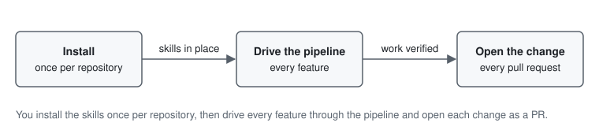
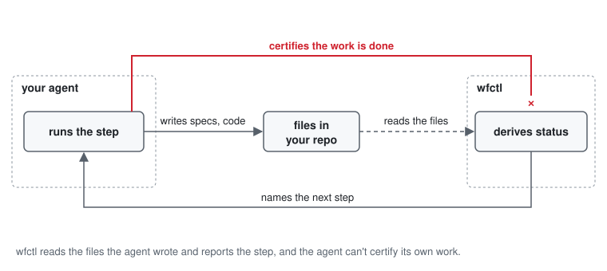
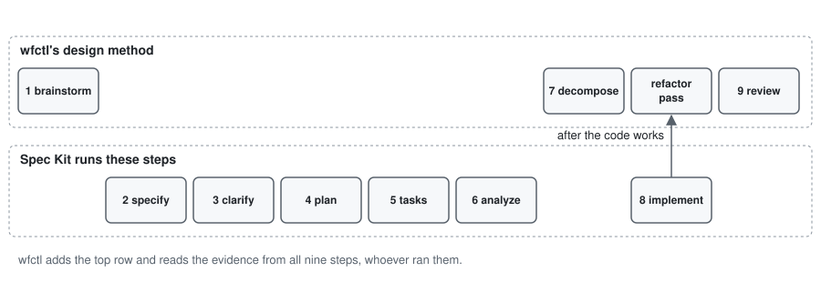

# wfctl

An opinionated software engineering system for CLI coding agents.

It combines structured development practices, evidence-based progress, and human oversight that carry across sessions and parallel worktrees.

*The agent can produce evidence, but it doesn't get to certify what that evidence proves.*

wfctl doesn't run your agents. It builds on [Spec Kit](https://github.com/github/spec-kit), [Superpowers](https://github.com/obra/superpowers), and [workmux](https://github.com/raine/workmux), and provides the engineering method, workflow obligations, and evidence checks that connect their work into one development process.

[](LICENSE)
[](https://www.python.org/downloads/)

## What wfctl is

wfctl is a command-line interface (CLI) for developers who build software with CLI coding agents, such as Claude Code or Codex, and who often run several of them at once. It does two things:

1. It installs the skills and slash commands that carry a design method into your project.
2. It reads the files that work leaves in your repository, and reports where each feature sits in a fixed pipeline of nine steps.

```text
brainstorm → specify → clarify → plan → tasks → analyze → decompose → implement → review
```

This is `wfctl status` on an open branch in this repository:

```
#473  473-steps-unreachable-by-model
will never merge, force-push, close an issue, or delete a branch
or worktree — those are yours, and no setting changes it
your agent decides which commands may run — wfctl can't see
its rules and says nothing about them
────────────────────────────────────
brainstorm   ▶  ← current
  architecture      ●
  software-design   ●
  design-doc        ▶  /speckit.brainstorm
specify      ○
clarify      ○
plan         ○
  plan-review       ○
  plan-walkthrough  ○
tasks        ○
analyze      ○
decompose    ○
implement    ○
────────────────────────────────────
artifacts written     ○  missing spec.md, plan.md, tasks.md
definition of done    ●  passed at 40eb0a2
architecture accepted ○  mirror-supersedes-the-wrapper (proposed)
records committed     ○  1 uncommitted: mirror-supersedes-the-wrapper.md
next: /speckit.brainstorm
```

● means done, ▶ means in progress, and ○ means pending. Nothing on that screen came from the agent. wfctl builds each row from the branch when you ask, using the spec files, the verdict that `wfctl verify` recorded, and the architecture records in force.

## Why it exists

An agent, Spec Kit, and workmux each solve part of the problem. Each leaves a gap that wfctl fills.

1. An agent working alone designs while it codes, reports its own work as done, and loses what it decided when its session ends. You find out whether the design was thought through, the tests passed, or the review covered the last commit by reading its transcript.
2. Spec Kit gives the agent the steps from specify to implement. It starts at the spec, so nothing makes the agent think through architecture first. It also records where a run is, not whether the work behind each step is finished.
3. workmux gives each feature its own worktree and tmux session, so agents can work in parallel. It doesn't know what any of those worktrees has produced.

wfctl connects the three, so you no longer read the agent's transcript to know whether design was done, tests passed, or the review covered the last commit.

wfctl is for developers who run several agents in parallel, whether the agents work on their own or with the developer closely involved. Its skills, steps, and sub-steps let you choose how involved you are in each feature. It matters most in three situations:

1. An agent's session restarts partway through its work, and the next session starts from what reached disk.
2. Several agents work in parallel worktrees, each on its own feature.
3. A session carries out a decision made in an earlier session, on one of several features in flight.

## What it adds

wfctl rests on four ideas.

1. **Design before code.** Agents brainstorm, model the domain, and record architecture decisions before Spec Kit writes a spec. They decompose the work into PRs before coding, and they refactor before verifying.
2. **Evidence, not claims.** wfctl reads each step's state from the files on disk. "Done" is a verdict that `wfctl verify` recorded, and a review counts only for the commits it covered.
3. **You keep the judgment calls.** Accepting an architecture record, signing off on unreviewed work, and approving new imports between wfctl's modules are yours. Anything skipped needs a written reason, such as `wfctl spec none --reason "…"` for a change that needs no spec.
4. **Work that survives sessions.** A restarted session picks up from a handoff and from state that wfctl re-derives from the files. A new commit reopens its review.

## How the tools fit together

| Who | What it owns |
|-----|--------------|
| Spec Kit | The steps from specify to analyze, plus implement, and the templates behind them. wfctl wraps them and doesn't fork them. |
| Upstream skills | Superpowers' brainstorming, finishing a branch, and requesting and receiving code review, with a few skills from other projects. Each is credited in [NOTICES.md](wfctl/agents/skills/NOTICES.md). |
| workmux and tmux | Creating and removing worktrees, and the tmux session for each one. |
| Your agent | Running the work, and deciding which commands may run through its own permission layer. |
| wfctl | The design method, the pipeline's step order, the checks on what each step left behind, the review panel, and the handoff between sessions. |
| You | Accepting records, signing off on unreviewed work, and acting on a block an agent reports. |

## How it works

You install the skills once per repository, and everything after that runs from inside your agent.



While a feature moves through the pipeline, both halves of wfctl work. The skills carry the design method into each step, and wfctl judges each step by what the step left on disk. wfctl names the next step, and the agent runs it. The orchestrate skill can carry the agent through all nine steps on its own, and it stops for a person when a step is blocked or stalls.



Spec Kit runs the steps in the lower row. The steps in the upper row are wfctl's design method, and they include the refactor pass that runs over the finished code before implement is done. wfctl reads the evidence from all nine steps, whoever ran them.



## A feature from start to finish

This follows one feature on issue 42.

1. `workmux add 42-manual-entry --base main` creates the worktree and installs the skills into it.
2. In the worktree, `/start-session` loads the accepted architecture records and reports where the branch stands. `/speckit.brainstorm` runs the design levels and proposes an architecture record. The record stays `proposed` until you accept it.
3. Spec Kit writes the spec, plan, and tasks. Clarify, plan review, and analyze each write a scan file recording what they covered and found. wfctl keeps a step open until its scan has a verdict line and a coverage row with a status.
4. Implement builds the tasks, and the agent refactors the result. `wfctl verify` then runs the repository's own checks and records a verdict against that tree.
5. When the context window fills, the restart hook has the agent write a handoff, clears the pane, and starts a new session. The new session re-derives where things stand from the files and reads the handoff for anything the files don't record.
6. The review panel runs on the branch. If the agent then commits again, `wfctl status` shows review as pending, because the new commit has no review covering it.
7. The worktree guard blocks `gh pr create` and `gh pr merge` until every review group has covered the newest commit or you've signed off. You accept the record with `wfctl arch accept`, sign off with `wfctl review sign-off`, or act on a block the agent reported with `wfctl report-block`.

## Install and quick start

You need Python 3.11+, Git, and [uv](https://docs.astral.sh/uv/) (or pip).

```bash
# Recommended: uv tool
uv tool install git+https://github.com/aamarin/wfctl.git

# Or pip
pip install git+https://github.com/aamarin/wfctl.git
```

These install from the default branch, which can include changes merged since the last release. To pin a release, append `@<tag>` to the URL. To upgrade a uv install, run `uv tool install --upgrade git+https://github.com/aamarin/wfctl.git`.

Then install the skills into your project. You run this once per repository:

```bash
cd your-project
wfctl install-skills --agent claude   # drop --agent if you are not on Claude Code
```

The first interactive run asks which issue tracker to wire up and where specs should live. It records both answers.

If you create worktrees with [workmux](https://github.com/raine/workmux), also run `wfctl install-config workmux` once. It seeds a `.workmux.yaml` whose `post_create` hook installs the skills into each new worktree, and `install-skills` alone doesn't create that file.

Drive the pipeline from inside your agent with slash commands:

```
/start-session                                        # session context + freshness check
/speckit.brainstorm  "add manual transaction entry"   # design, gated in four levels
/speckit.specify                                      # turn the design into a spec
/speckit.plan                                         # design the implementation
/plan-review                                          # review the plan against the spec
/speckit.tasks                                        # break into ordered tasks
/speckit.implement                                    # build it
/end-session                                          # summary + memory candidates
```

`wfctl status` shows your position, and `wfctl resume` says what to run next. They're the two commands you'll type by hand most.

A small change, such as a bug fix or a copy edit, takes a shorter route. Run `/start-session`, answer the spec question with `wfctl spec none --reason "…"` before any code, write the change, and open it with the `opening-a-change` skill. The review panel and the release note still apply.

## Limits

1. wfctl checks files. Some checks prove only that an artifact exists or is current, and none proves the software is correct. Qualitative judgment comes from the agent reviewers and from you.
2. `wfctl status` shows one branch. There's no view across worktrees yet, so finding the one that needs you means checking each (#487).
3. The review panel runs each group up to 3 times between sign-offs by default (`review.rounds` in `wfctl.json`). That caps how many runs happen, not how many tokens they use.
4. The restart hook works only in the Claude layer. Other agent hosts are untested.
5. wfctl gates one outward action, opening or merging a PR. Your agent's permission layer decides everything else, and wfctl records those actions without blocking them.
6. The guard refuses `wfctl review sign-off` and `wfctl arch approve-imports` when an agent runs them. It doesn't refuse `wfctl arch accept`, so accepting a record relies on the agent leaving it to you (#756).
7. The nine steps are fixed. A repository can add its own passes under any step except review.
8. The method is language-agnostic, and wfctl has been used on C++, firmware, and full-stack web apps. The only language-specific pattern catalog is Python's (#416).

## Reference

- [docs/reference.md](docs/reference.md) covers the pipeline model, every command, the environment variables, the issue tracker integration, and how `install-skills` writes files into your repo.
- [Review groups](docs/reference.md#review-groups-review) explains how a review runs and lists every setting under `review`.
- [The architectural contract](docs/reference.md#the-architectural-contract-arch-root-arch-context) explains how records are written and accepted.
- [Outward actions](docs/reference.md#outward-actions-report-action-report-block) explains `report-action` and `report-block`.
- [docs/architecture/domain/vision.md](docs/architecture/domain/vision.md) and [wfctl.md](docs/architecture/domain/wfctl.md) describe what wfctl owns and the seven contexts it divides into.

## Development

```bash
git clone https://github.com/aamarin/wfctl.git
cd wfctl
uv run pytest -q
```

Without uv, run `pip install -e ".[dev]"` and then `pytest`. See [AGENTS.md](AGENTS.md) for session state, worktrees, the import check against the Context Map, and release mechanics.

## Contributing

Issues and PRs are welcome. For significant changes, open an issue first.

## License

wfctl is MIT licensed. See [LICENSE](LICENSE).
