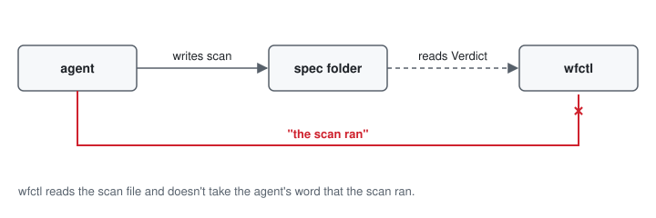
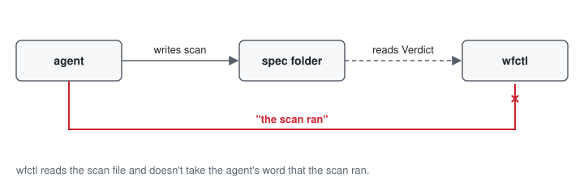

# SVG dark-mode test for #740

Two versions of the same drawing. Switch GitHub's theme, or your device's, and compare.

| A: switches colors with the device | B: white background |
|---|---|
|  |  |

## A, full width

## B, full width

