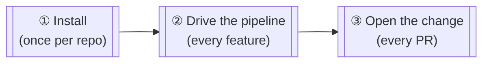
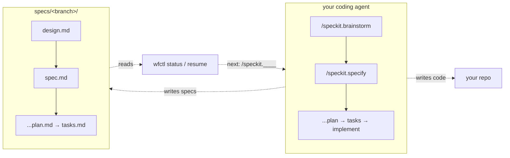
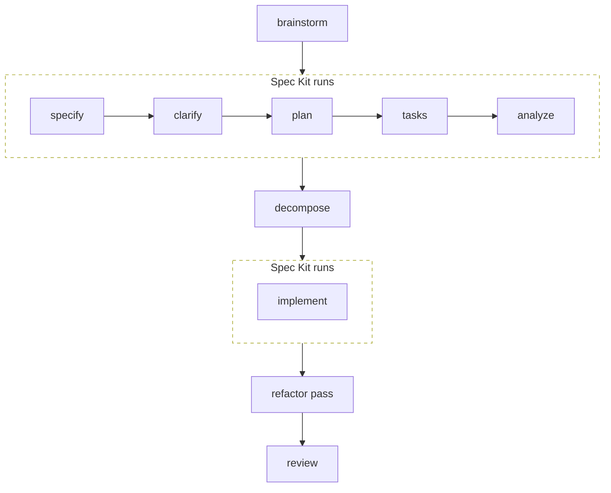

# wfctl

**wfctl makes agents think through the work, then independently governs what the durable evidence proves about that work.**

*The agent can produce evidence, but it doesn't get to certify what that evidence proves.*

wfctl is a command-line interface (CLI) for developers who build software with
AI coding agents, such as Claude Code, Codex, Copilot, or Bob. It's built for
running several of them in parallel. It installs the skills that carry the
design method into your project, works alongside
[Spec Kit](https://github.com/github/spec-kit), and reads each feature's state
from the files the work leaves in your repository.

[](LICENSE)
[](https://www.python.org/downloads/)

```text
wfctl design method
       │ shapes
       ▼
agent / workflow runner
       │ produces
       ▼
durable repository artifacts
       │ interpreted by
       ▼
     wfctl
       │
       ├── what is satisfied?
       ├── what remains?
       ├── what is not applicable?
       ├── what decisions constrain the work?
       └── what needs attention?
```

This is `wfctl status` on an open branch in this repository:

```
#473  473-steps-unreachable-by-model
will never merge, force-push, close an issue, or delete a branch
or worktree — those are yours, and no setting changes it
your agent decides which commands may run — wfctl can't see
its rules and says nothing about them
────────────────────────────────────
brainstorm   ▶  ← current
  architecture      ●
  software-design   ●
  design-doc        ▶  /speckit.brainstorm
specify      ○
clarify      ○
plan         ○
  plan-review       ○
  plan-walkthrough  ○
tasks        ○
analyze      ○
decompose    ○
implement    ○
────────────────────────────────────
artifacts written     ○  missing spec.md, plan.md, tasks.md
definition of done    ●  passed at 40eb0a2
architecture accepted ○  mirror-supersedes-the-wrapper (proposed)
records committed     ○  1 uncommitted: mirror-supersedes-the-wrapper.md
next: /speckit.brainstorm
```

In that output, ● means done, ▶ means in progress, and ○ means pending.
Nothing on that screen came from the agent. wfctl builds each row from the
branch when you ask, using the spec files, the verdict that `wfctl verify`
recorded, and the architecture records in force.

## Why wfctl

wfctl does two things:

1. It gives the agent a design method, so the agent thinks the work through
   before it writes code.
2. It reads what the work left behind and decides, independently of the agent,
   what that evidence proves.

wfctl is for developers running AI coding agents in parallel, whether those
agents run autonomously or with the developer heavily in the loop. Its skills,
steps, and sub-step controls let you decide how involved you want to be in
each feature. wfctl works out which step each feature is on from the files the
work leaves behind, so nobody has to keep track of it. That matters in three
places:

1. An agent's session restarts partway through its work, and the next session
   starts from what reached disk.
2. Several agents work in parallel worktrees, each on its own feature.
3. A session carries out a decision made in an earlier session, on one of
   several features the developer has in flight.

**The design method** makes the agent think before it codes, and clean up what
it built.

- Brainstorm, the four design levels, and domain modeling run before Spec Kit,
  so the agent decides who owns what before a spec or any code exists.
- Decompose is the last step before implement. It splits the tasks into PRs
  and tracker issues before any code is written.
- A refactor pass runs inside implement, after the code works and before
  `wfctl verify` runs.

**Evidence governance** means the agent doesn't decide when the work is done.

- wfctl tracks where each feature sits in the pipeline. It reads each step's
  state from the artifacts on disk, not from what the agent reports.

  ```text
  brainstorm → specify → clarify → plan → tasks → analyze → decompose → implement → review
  ```

- wfctl gates implement on a definition of done that it runs itself with
  `wfctl verify`, so "done" is a recorded verdict, not a claim.
- Review comes after implement. wfctl reports it done only once every review
  group has reviewed the newest commit, or a person has signed off on it. It
  reads the same state the PR guard checks, so the two can't disagree. A
  commit after a review reopens the review step.
- wfctl records what doesn't apply, with a reason, instead of skipping it
  silently. `wfctl spec none` records that a change needs no spec, which skips
  the seven spec steps and sends the branch to implement and review.
  `wfctl arch none` records that a change draws no architecture boundary.
  `wfctl step none` records that a pass doesn't apply to this change, whether
  it's wfctl's own or one a repository added in `wfctl.json`.
- wfctl reads architecture decisions as obligations on the work.
  `wfctl arch context` prints the ones in force.

wfctl also installs its slash commands alongside the skills. It records the
outward actions an agent takes, such as issue writes and pushes, but it doesn't
gate them. Your agent's own permission layer decides what may run. When that
layer refuses an action, `wfctl report-block` holds the step until the action
is taken ([details](docs/reference.md#outward-actions-report-action-report-block)).

## Requirements

- Python 3.11+
- [uv](https://docs.astral.sh/uv/) (recommended) or pip
- Git

## Installation

```bash
# Recommended: uv tool (isolated, always up-to-date)
uv tool install git+https://github.com/aamarin/wfctl.git

# Upgrade an existing install
uv tool install --upgrade git+https://github.com/aamarin/wfctl.git

# Or pip
pip install git+https://github.com/aamarin/wfctl.git
```

These commands install from the default branch, which can carry changes merged
since the last release. To pin a released version, append `@<tag>` to the URL
in any of them.

## Quick start

**1. Install wfctl** (see [Installation](#installation) for pip and pinning):

```bash
uv tool install git+https://github.com/aamarin/wfctl.git
```

**2. Install the skills into your project.** Run this once per repo:

```bash
cd your-project
wfctl install-skills --agent claude   # drop --agent if you are not on Claude Code
```

The first interactive run asks two questions: which issue tracker to wire up,
and where specs should live. It records both answers, so it never asks again.

**3. Drive the pipeline from inside your agent**, with slash commands:

```
/start-session                                        # session context + freshness check
/speckit.brainstorm  "add manual transaction entry"   # design, gated in four levels
/speckit.specify                                      # turn the design into a spec
/speckit.plan                                         # design the implementation
/plan-review                                          # review the plan against the spec
/speckit.tasks                                        # break into ordered tasks
/speckit.implement                                    # build it
/end-session                                          # summary + memory candidates
```

`wfctl status` shows your position, and `wfctl resume` says what to run next.
They're the two commands you'll type by hand most.

## How it works



You install the skills once per repository (①), and everything after that runs
from inside your agent. Both halves of wfctl work in ②. The skills carry the
design method into each step, and wfctl judges each step by what that step
left on disk.



wfctl names the next step, and the agent runs it. The orchestrate skill can
carry the agent through all nine steps on its own. It stops for a person when
a step is blocked or stalls, before each run of `/plan-review`, and before
`tasks`. It also stops after any pass a repository added in `wfctl.json`,
since that pass waits for review unless the repository says otherwise.

The nine steps are fixed. In its `wfctl.json`, a repository can add its own
passes under any step except `review`. Review work is set under the `review`
key instead, which names the review groups and their reviewers. Whether that
step order should move to Spec Kit's own workflow engine is still an open
question, and nothing has been decided yet.



Spec Kit runs the steps inside the dashed boxes. The steps outside them are
wfctl's design method. They include the refactor pass, which runs over the
finished code before implement is marked done, and the review panel after it.
wfctl reads the evidence from all nine steps, whoever ran them.

**[docs/reference.md](docs/reference.md)** covers the full pipeline model,
every command, the environment variables, how the issue tracker and
architecture records work, and how `install-skills`/`install-config` lay files
into your repo.

## Review and architecture checks

wfctl does three things once the code is written:

1. It reviews every change with a panel of review groups. By default these are
   `security` and `code`, with three reviewers each. Each reviewer starts with
   a fresh context. The `code` group follows every outside value the change adds
   or changes, such as a form field or a config file, through each layer that
   checks or stores it.
   When at least one reviewer in a group could run, and wfctl counts a report
   from each of them, wfctl usually records the review as a git note on the
   newest commit they reviewed and pushes it to `origin`. Any later commit
   needs a new review. A repository can add its own groups, or run
   reviewers on another model such as Codex, under the `review` key in
   `wfctl.json`.
2. It blocks opening or merging a PR until the review is done. The worktree
   guard is a hook wfctl installs into your agent. While any group has commits
   it hasn't reviewed, the guard refuses `gh pr create` and `gh pr merge` and
   lists those commits. The guard also refuses `wfctl review sign-off` from the
   agent, so only you can sign off on work no review covered.
   `wfctl check reviews` reads the git notes, so once your CI job fetches the
   notes from `origin`, it can fail a PR that skipped review.
3. It checks the change against your architecture decisions. Each decision is
   a record, stored under `docs/architecture/` by default. A record applies to
   the work only once a person accepts it with `wfctl arch accept`. At the
   start of each session, `wfctl arch context` prints the accepted records.
   When the branch's `design.md` lists the contexts it changes,
   `wfctl arch context` leaves out the records that govern only other
   contexts. The guard won't open or merge a PR while a record that the branch
   changes directly under the architecture folder has a status other than
   `accepted`, `rejected`, `superseded`, or `retired`, such as `proposed`.
   The guard reads only the status, not who set it, so it relies on the agent
   leaving `wfctl arch accept` to you.

**[docs/reference.md#review-groups-review](docs/reference.md#review-groups-review)**
explains how a review runs and lists every setting under `review`.
**[docs/reference.md#the-architectural-contract-arch-root-arch-context](docs/reference.md#the-architectural-contract-arch-root-arch-context)**
explains how records are written and accepted.

## Commands (most used)

| Command | Description |
|---------|-------------|
| `status` | Show pipeline progress inferred from spec artifacts |
| `resume` | Re-infer step from filesystem, write `next-step.md`, print current state |
| `install-skills` | Copy the skills, commands and speckit runtime into the current project |
| `doctor` | Check the installed skills against the ones this wfctl ships |
| `issue` | Run the active issue tracker for a verb (`list`/`view`/`close`/`comment`/…) |
| `change` | List/view/check code changes (PRs, patchsets) via the tracker's `changes` backend |
| `arch context` | Print the in-force architectural contract |

The full command reference, including `report-action`/`report-block` and the
`arch` lifecycle, is at **[docs/reference.md#commands](docs/reference.md#commands)**.
That table summarizes each command. Run `wfctl <command> --help` for its flags.

## Development

```bash
git clone https://github.com/aamarin/wfctl.git
cd wfctl
uv run pytest -q
```

Without uv, run `pip install -e ".[dev]"` and then `pytest`.

The skills, commands, and speckit runtime that `install-skills` writes are
committed here as package data under `wfctl/agents/` and `wfctl/specify/`.
Edit them in place, then run `wfctl install-skills` to try them in a repo.
They have no leading dot on purpose. `.gitignore` ignores
`.agents/` and `.specify/` unanchored, meaning at any depth, so git would
silently leave a dotted vendored copy untracked. The dotted directories at the
repo root are this repo's own install output, not the source.

wfctl's own code is moving into one Python package per context. A CI check
tests every import against the Context Map on
[docs/architecture/domain/wfctl.md](docs/architecture/domain/wfctl.md). A change
that widens what the check allows, such as a new arrow on the map, waits until
the maintainer approves it with `wfctl arch approve-imports`. The guard refuses
that command when an agent runs it. See
[AGENTS.md](AGENTS.md#imports-and-the-context-map).

See [AGENTS.md](AGENTS.md) for the fuller contributor context, which covers
session state, worktrees, architectural constraints, and release mechanics.

## Contributing

Issues and PRs are welcome. For significant changes, open an issue first.

## License

wfctl is MIT licensed. See [LICENSE](LICENSE).
