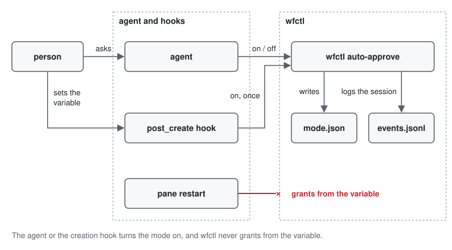

# The approval mode is stored intent, and the payload carries it beside inference

## Decision

wfctl stores the approval mode as a named value in the session state dir, and
`PipelineReport` carries it beside the inferred fields. A person turns the mode
on or off at any point in a session with `wfctl auto-approve on` and `wfctl
auto-approve off`, either by typing the command or by asking the agent to run
it. Each change also appends a `mode` event naming the session that made it.

The value records which mode the feature is in, and the event records when the
mode was granted and from which session. `wfctl auto-approve` with no argument
prints both:

```
auto-approve on — design gates answered into the record, review stops run through, approval moves to the PR
  turned on 2026-11-19 14:02 UTC by this session
```

It says "this session", "another session", or "an unknown session", never the
session's ID, the same way `wfctl status` reports who holds a branch.

`wfctl auto-approve on` is refused in two cases:

1. Another session holds the branch. The refusal names `/start-session`, which
   takes the branch over first.
2. `wfctl start` would refuse a session on the branch, such as when its issue is
   closed or the branch names no issue. The refusal is the one `start` prints,
   with its fix line.

`wfctl auto-approve off` is never refused. Turning the mode off raises the bar,
which #100 lets anyone do without a person.

A run that should start unattended gets the grant when its worktree is created.
The `.workmux.yaml` that wfctl ships has a `post_create` line that runs `wfctl
auto-approve on` once, only when `WFCTL_AUTO_APPROVE` is exactly `1` on the
`workmux add` command:

```bash
WFCTL_AUTO_APPROVE=1 workmux add 812-foo
```

wfctl's own commands never read the variable. Only the hook reads it, once,
when the worktree is created. A pane restart runs `wfctl start` again. If
`start` read the variable, the restart would turn the mode back on right after
the review cap turned it off.

`wfctl start --no-auto-approve` keeps working and turns the mode off. `wfctl
start --auto-approve` is refused, and the refusal names `wfctl auto-approve on`.
The agent's host asks the person before that command runs
(`auto-approve-grant-asks-first`), but it can't ask about a flag that can sit
anywhere in `start`'s arguments, so the flag would be a grant with no prompt.

`end` does not clear the mode. Symmetry with `start` suggests it should, but an
overnight run across eight small issues spans several sessions, and a mode that
disappears at `end` can't serve that run.

wfctl is the mode's second writer, and it only ever writes `false`. An
unattended run that keeps editing its plan and asking for another review would
otherwise loop until someone noticed, so wfctl counts the plan reviews and
sign-offs made since the last grant (#501). When the count reaches 3 and the
plan review is still outstanding, wfctl turns the mode off, writes the reason
into the mode file as `revoked`, and appends a `mode` event carrying
`by: "wfctl"` and the same reason. `status` and `resume` print that reason in
place of the auto-approve notice, so the person who granted the mode learns
that the run stopped on its own and why.

Only a new grant resets the count. The count starts at the last `mode` event
that granted the mode, and wfctl reads it from the event log on every call, so a
`/clear` and the `wfctl start` that follows it change neither the count nor the
mode. A person who grants the mode again after a revocation gets three more
reviews, and nothing else gives them.

The mode is the first per-feature setting, and the only one. No shape is built
for a second: per-feature configuration doesn't otherwise exist. The repo's
settings live in `.wf-skills-manifest.json`, and the six `WFCTL_*` overrides are
resolved before a state dir exists, so neither can move here. A format, a
precedence order, and a read path designed against a sample of one would be
guesses that the second setting would test.

The payload gains a field whose provenance differs from every other field on
it. That asymmetry is the decision, not an accident of it. A mode nothing can
infer still has to reach the same views, because
`pipeline-state-is-one-payload` (accepted) makes the payload the only route to
both `status` and `resume`.

## Boundary



A solid arrow is a command the sender waits on. The red edge is the claim wfctl
refuses: a pane restart granting the mode from the variable.

## Context

`wfctl status` reports one payload, and every field on it is computed from
artifacts at the moment of the read:

| Field | Where it comes from |
| --- | --- |
| `steps` | ten branches of `_infer_steps` over the spec artifacts |
| `current` | the same inference |
| `session_started` | folds `events.jsonl` |
| `next_command` | `_STEPS[step][0]`, a literal in the table |
| `auto` | `_STEPS[step][1]`, likewise |

#127 adds a per-feature switch that moves where design approval happens. With it
off, the agent stops at each `design-levels` gate. With it on, the agent states
the gate's answer into a record and descends, and the approval moves to the PR.
The value that switch sets is the first thing on that payload that no artifact
can produce. It is intent, and nothing on disk implies it.

`session-state-is-re-derived` (accepted) anticipates this and doesn't object to
storing it, since what a session file holds is what re-derivation can't reach.
But it names exactly one occupant of that carve-out, *"the handoff prose a human
or agent wrote deliberately."* A mode isn't prose. It is a short machine-read
value, which is the category that record was written to empty out: `current.json`
held the branch, the issue, and the step, every one of which git and the spec
tree answered live, and the file could disagree with all three.

#127's scope item 1 still names `current.json` as the home. That file no longer
exists, since `_remove_session_fossils` (`cli.py:99`) deletes it from any state
dir that still has one, on every command that resolves a state dir.

Previously, `wfctl start --auto-approve` was the only way to set the mode, and
`/start-session`, which runs `start`, can't pass the flag. So the grant happened
outside the workflow. In the #799 unattended run on 2026-11-18, the agent ran
`uv run wfctl start --auto-approve` a second time to get it. The grant worked,
and `start` then printed `ℹ Already initialized (use --force to reset)`, which
reads like a failure.

Currently, the user wants the agent able to turn the mode on during a session
when asked (#407), and a scripted run to start in the mode. Both are a person's
request. The agent turns the mode on because someone said "run the rest of this
unattended", or because someone started the run with a flag meaning the same
thing.

## Threat model

### Defends against

`wfctl auto-approve on` refuses a session that grants the mode on a branch
another session holds, and a grant on a branch with no open issue. The creation
hook's check stops a variable meant to keep the mode off from turning it on.
Because wfctl never reads the variable, a pane restart can't grant the mode
again.

None of these checks stops the agent that holds the branch from granting itself
the mode without being asked. wfctl can't tell a grant someone asked for from one
nobody did, since both are the same command from the same session. The `mode`
event names the session, so review shows which session granted it.

### Must keep catching

1. A session that doesn't hold the branch: `wfctl auto-approve on`
2. A branch whose issue is closed, or that names no issue: `wfctl auto-approve on`
3. The creation hook with the variable set to anything but `1`: `WFCTL_AUTO_APPROVE=0 workmux add 812-foo`
4. The creation hook with a value that only looks true: `WFCTL_AUTO_APPROVE=true workmux add 812-foo`
5. A pane restart with the variable still set, after the review cap turned the mode off: `WFCTL_AUTO_APPROVE=1 wfctl start`

### Accepts

1. The agent holding the branch grants itself the mode without being asked: `wfctl auto-approve on`
2. A hand-written mode file, which leaves no event: `echo '{"auto_approve": true}' > mode.json`

The first is the gap the user accepted by asking for an agent-driven grant. To
limit it, the `mode` event names the session, records still start as
`proposed`, merging still needs a person, and the review cap turns the mode off
after three plan reviews. The second leaves no `mode` event, so `wfctl
auto-approve` prints that no grant is on record. The state dir
is outside the repository, so the PR diff can't show it.

### Must let through

1. Turning the mode off, from any session: `wfctl auto-approve off`
2. The session holding the branch: `wfctl auto-approve on`
3. A caller with no session identity, which behaves as it did before identities existed: `wfctl auto-approve on`
4. Asking for the mode while it's already on, which answers again: `wfctl auto-approve on`
5. A pane restart with no flag, which leaves the mode as it is: `wfctl start`
6. The creation hook before any session exists: `WFCTL_AUTO_APPROVE=1 workmux add 812-foo`

## Direct baseline

Store nothing. A human types "run this unattended" into the session, and the
agent obeys for as long as it remembers. No file, no flag, no payload field, and
the mode is a fact about a conversation.

It is a real option, and it is what happens today if you ask. It loses on one
property: the instruction and the feature have different lifetimes.
`speckit-orchestrate` drives a feature across the whole pipeline, and a design
pass that begins at `brainstorm` and ends at a PR routinely spans a `/clear`.
`start-session` and `end-session` exist because it does. The mode has to survive
a boundary the instruction doesn't, and an agent that remembers it across one
has a memory rather than a fact.

The narrower half is mechanical. `speckit-orchestrate` branches on `wfctl status
--json`. An instruction in a conversation can't reach a payload, so the baseline
can change what the agent believes and never what the tooling reports.

For the #407 amendment, the baseline is to keep `start` as the only setter and
have the skills tell the agent to run `wfctl start --auto-approve` when asked.
We didn't choose this because a mid-session grant through `start` prints
"Already initialized" after the grant. It also runs `start`'s session takeover
checks, which have nothing to do with the mode, and it leaves a scripted run
with no way to start in the mode.

## Owns truth

wfctl records which approval mode the feature is in, when the mode was granted,
and from which session.

The agent can't compute any of it. There is no artifact to infer the mode from,
which is what makes it intent rather than state. The only copy the agent could
otherwise hold is a memory of a turn in a conversation that may since have been
cleared, in a worktree another session may have changed.
`session-state-is-re-derived` makes this argument about the fields it deleted,
and the conclusion here runs the other way for the same reason. Those fields had
live answers on disk, and the file could go stale against them. This one has no
live answer anywhere, so there is nothing for it to drift from.

The grant's time and session are owned for a different reason. #100 fixes
escalate-never-waive: an agent may raise the bar and never lower it. Nothing
enforces that here, since the agent can run the command. An agent can't be the
witness to its own grant, because a self-report is the unfalsifiable claim
`wfctl-runs-the-verification` (accepted) already removes from the agent's side
for the verification verdict. So wfctl writes the grant into the log itself, at
the moment it happens.

The event names the session, and not whether a person or an agent ran the
command. Session identity exists now (`session-identity-from-named-agent`), so
wfctl can record which session granted the mode. It still can't observe who
typed it. An agent running the command on request and a person running it from
the same pane present the same identity. Claiming a person or an agent would
name a setter wfctl can't observe, which is what #70 removed from `wfctl end`.

The revocation doesn't change who owns the question. It changes who can write
the answer, and in one direction only. Writing `false` raises the bar, which
#100 lets anyone do without a person. Writing `true` lowers it, and that stays a
grant. The agent can't count its own reviews either, since it is the party the
count bounds, so the count comes from lines wfctl wrote: a `resume` that saw the
review report's hash change, and a `sign-off` event that only `wfctl step
sign-off` appends.

Neither side can check whether the agent honoured the mode, because it isn't
observable. No
artifact records a pause, so a run that stopped when it shouldn't have and a run
that didn't stop when it should are both invisible afterwards, whichever side is
asked. `a-rule-is-expressed-as-a-check` (accepted) settles what follows: a rule
whose violation isn't visible in an artifact the work already produces stays
prose delivered at the moment it binds, and that isn't a defect. The mode is
therefore advisory to the skills that read it, on purpose. The same holds for
whether a person asked for this grant, which only the agent's conversation
shows.

What is observable is whether the records exist, and `design_block` already
holds a design step that produced none. That check is unchanged by this record,
in both modes.

## Considered

- **A dedicated command, in `spec-root`'s show/set/clear shape.** We rejected
  this for #127 and adopted it in the #407 amendment. The #127 argument was
  that an agent can reach a new command as easily as `start`, so it adds a
  command and nothing else. That's still true, but it's no longer an
  objection. #407 makes the agent an intended caller, so that reach is what
  the user asked for. The command adds a name that says what it
  does, and a mid-session grant that doesn't print "Already initialized". The
  other #127 objection was that a settable command beside `spec-root` teaches
  two scopes under one grammar. The name answers it, since `auto-approve` isn't
  `config`, and `spec-root` is the only other settable command.
- **`WFCTL_AUTO_APPROVE` read by `wfctl start`, as #407's issue body proposed.**
  We didn't choose this for three reasons. First, `start` runs again on every
  pane restart, so a variable still set would turn the mode back on right after
  the review cap turned it off. Second, a `0` left in a shell profile would turn
  off a grant the agent made mid-session at the next restart. Third, it only
  acts when a session starts, so it can't serve a session that is already
  running. The creation hook reads the same variable once instead.
- **Tie the mode to the `claude-auto` launcher**, which starts Claude in
  `--permission-mode auto`. We didn't choose this because auto permission mode
  only stops Claude from asking before it runs commands, and attended sessions
  use it too. A session without permission prompts can still have someone
  approving the design.
- **An unconditional `post_create` line.** We didn't choose this because
  `post_create` is committed and runs for every worktree, so every worktree
  would start unattended.
- **Patching an existing `.workmux.yaml` automatically.** wfctl already patches
  `pre_remove`, but only when it's still the empty `pre_remove: []` that the
  seed wrote. We didn't choose this because every seeded `post_create`
  already has entries, and wfctl would be guessing where a new line belongs in
  a file it doesn't parse.
- **Granting from a command `post_create` already runs.** `install-skills` or
  `issue start` could read `WFCTL_AUTO_APPROVE` and reach every seeded
  repository with no edit. We didn't choose this because `install-skills` also
  runs at every session start, so it would turn the mode back on after the
  review cap turned it off. `issue start` only moves the issue on the tracker's
  board, and a mode grant doesn't belong in it.
- **A worktree guard refusal of an agent's grant.** We didn't choose this
  because the user asked for an agent-driven grant, and the guard can't tell a
  grant someone asked for from one nobody did.
- **An event in `events.jsonl` alone, the current value read by folding the
  log.** Rejected as the only store, and adopted as half of one. Against #127 as
  written, it loses on fit: nothing in its five scope items or four comments
  asks when the mode was set or what it was before. The issue's own principle,
  *"the human sets the switch, always in advance"*, makes it a single write, so
  the log and a file hold identical information. Because an agent can set the
  mode, *when and from which session* becomes a question worth answering, and
  only the log answers it. So the log carries the grant, and the file carries
  the value.
- **A named file alone, with no event.** It leaves an agent's grant
  indistinguishable from a human's, which is the one thing #100 asks a gate to
  make visible.
- **A field on the repo manifest.** Wrong cardinality. The mode is per-feature
  and the manifest is per-repo, so one value would set every branch at once.
  That is the batch workflow #127 defers to #86 behind its tracker abstraction,
  and explicitly doesn't want first.
- **A second flag on `_STEPS`.** Refused upstream:
  `brainstorm-is-one-step-with-addressable-levels` (proposed) says #127 and
  #151 inherit the addressability problem and that neither may put it in
  `_STEPS`, and #127's own out-of-scope list separates the per-step `auto` axis
  from this per-feature one.
- **`current.json`, as #127 scope item 1 says.** Not available. The next command
  to resolve a state dir deletes it, and nothing would report that the mode had
  gone.
- **Teaching the mode by editing `brainstorming` and `idea-refine`.** The direct
  reading of #127 scope items 3 and 4, and it was written that way first. Both
  files are upstream-derived, and `vendor-upstream-skills` (accepted) says
  *"Prefer layering to editing"*. The next upstream pull would revert the branch
  with no conflict, and unattended runs would quietly resume stopping while
  `design-levels` kept telling them to descend. So the whole branch lives in
  `speckit-brainstorm` and `design-levels`, both wfctl's own, and the derived
  files stay unedited beneath it.
- **Moving the tracker's board transition here too.** It looks like the same
  kind of per-feature setup and isn't. `.workmux.yaml`'s `post_create` already
  runs `wfctl issue start`, paired with `wfctl issue stop` on `pre_remove`, and
  the column it moves says whether the work is in flight, which is the
  worktree's lifetime, not the session's.

## Consequences

`PipelineReport.__post_init__` pairs `current`, `next_command`, and `auto` as
None-together. The mode joins none of that group, since it is defined whether
or not a step remains, so a finished story still reports the mode it ran under.
It needs a default, because two tests construct `PipelineReport` directly.

The file's path and shape belong to the evidence package's mode module, not
`_io`. `verify.json` is the pattern: a named JSON file in the state dir, one
writer, one reader, and its path and field names spelled in the domain module
that means something by them. Evidence may not import session continuity, so
the caller's session identity reaches the grant as an argument from the command
that runs it.

The `mode` event has a `session` field. Older events have none, and `wfctl auto-approve` reports a grant from one of them as made by an
unknown session.

The revocation can't sit inside `start`'s `if report.session_started and not
force` early return, or `wfctl start --no-auto-approve` on a running session
would report "Already initialized" and drop the flag with nothing saying so.
`wfctl start --auto-approve` is refused before `start` does anything, so a
script that relied on it stops instead of running on with the mode off.

The skills that tell the agent how to set the mode name `wfctl auto-approve on`
instead of `wfctl start --auto-approve`, and `plan-walkthrough`'s refusal names
`wfctl auto-approve off`. `/start-session` doesn't change, since a restart
leaves the mode alone. `using-wfctl` explains that `install-config` writes a
file once and never updates it, so an agent knows a template change doesn't
reach a repository already seeded. It also explains that `--force` replaces the
repository's edits.

The shipped `.workmux.yaml` has the creation line, and so does this
repository's own copy. `install-config` writes the seed once and never updates
it, so a repository seeded earlier doesn't get the line on its own. Running
`install-config workmux --force` adds the line but replaces your edits to the
file. That's why `wfctl auto-approve` with no argument prints an `ℹ` note with
the line to add when `post_create` has no grant line. The line is opt-in, so
the note goes where someone interested in the mode looks. `wfctl doctor`
doesn't report it, because a repository that never uses auto-approve would
otherwise see a warning on every run, and a one-time notice would need wfctl to
remember it was shown.

The mode is advisory prose, so the skill files are the implementation, and every
pause has to be found rather than compiled. Four of them sit in the derived
files: `brainstorming`'s HARD-GATE, its one-question-at-a-time step, its
per-level approval and the `dot` flow that draws it, and `idea-refine`'s *"Only
save if they confirm"*, which guards the single write of `design.md`.

`design-levels` reads the mode itself rather than taking it from its caller. It
is description-triggered and fires outside `/speckit.brainstorm`, so a mode
passed down the wrapper would be absent exactly when the wrapper wasn't
involved. Every inconclusive read, such as the key absent, the command failing,
or no wfctl, resolves to attended, because the mode is what removes a human,
and a read that can't establish it has to leave one in.

## Log

- 2026-09-07  proposed    — #127 level 2; the payload's first non-inferred field
- 2026-09-28  amended     — #501: wfctl is a second writer that only writes
  `false`, its `mode` event carries the reason, and only a new grant resets
  the review count
- 2026-11-19  amended     — #407: `wfctl auto-approve on|off` sets the mode at
  any point in a session, the `mode` event names the session, a one-shot
  `post_create` line grants it at worktree creation, and the record gains its
  drawing and threat model
- 2026-11-19  accepted    — Agreed for #407 on 11/19/2026 · drawing drawings/approval-mode-is-stored-intent-data-flow.svg sha256:e8c760567009
- 2026-11-19  amended     — #407 clarify: the reminder about a missing grant
  line moves from a `doctor` warning to a note under `wfctl auto-approve`
- 2026-11-20  amended     — #407 security review: `wfctl start --auto-approve`
  is refused and names `wfctl auto-approve on`, since no prompt can ask
  about the flag
- 2026-11-20  accepted    — Agreed for #407 on 11/20/2026 · drawing drawings/approval-mode-is-stored-intent-data-flow.svg sha256:e8c760567009
