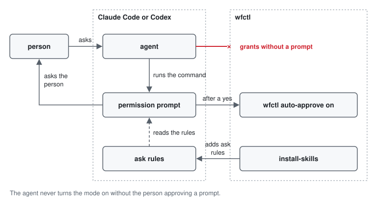

# Auto-approve turns on only with the person's approval

## Decision

When the agent runs `wfctl auto-approve on` in Claude Code, Claude Code asks
the person first. `install-skills --agent claude` adds four rules to the
`permissions.ask` list in `.claude/settings.json`:

```json
"permissions": { "ask": [
  "Bash(wfctl auto-approve on:*)",
  "Bash(uv run wfctl auto-approve on:*)",
  "Bash(uv run --project * wfctl auto-approve on*)",
  "Bash(uv run --project * wfctl auto-approve on)"
] }
```

The `--project` rules are there because wfctl's own remedy lines print `uv run
--project <dir> wfctl`, so an agent that copied one runs wfctl that way. The
first of them ends in `on*`, not `on:*`, because Claude Code reads any other
`*` in a rule literally when the rule ends in `:*`. Claude Code's docs don't
say whether a trailing `*` after a word also matches nothing, so the bare
command keeps its own rule. Claude Code then prompts the person every time the agent runs one of these commands,
even when a broader `allow` rule covers wfctl, since an `ask` rule overrides an
`allow` rule. The rules don't cover the creation hook, since the command typed
there is `workmux add`.

wfctl manages these rules the same way it manages its deny rule `Bash(cd:*)`.
`install-skills` adds them and records each one in the manifest with the kind
`ask`. `uninstall-skills` removes them. If a repo deletes a rule wfctl
installed, `doctor` reports it and `install-skills` refuses, as it does for the
deny rule today. A receipt with no kind is treated as `deny`, so manifests
written before this change still match. If wfctl stops shipping a rule it
added, the next `install-skills` asks before removing it
(`settings-edit-asks-first.md`), and `doctor` reports it until then.

In Codex, `install-skills --agent codex` copies one rules file to
`.codex/rules/wfctl.rules`. It holds a `prefix_rule` with the decision `prompt`
for each of the first two commands:

```
prefix_rule(pattern = ["wfctl", "auto-approve", "on"], decision = "prompt")
prefix_rule(pattern = ["uv", "run", "wfctl", "auto-approve", "on"], decision = "prompt")
```

Codex loads the project's `.codex/rules/` only after the person trusts the
project, and only when Codex starts, so `install-skills` tells them to trust the
project and restart Codex. It writes only `wfctl.rules`, so
any other rules file the project keeps there is left alone. The manifest
records it like any other installed file, and `doctor` reports it when it
drifts.

`wfctl start --auto-approve` is refused in every agent, and the refusal names
`wfctl auto-approve on`. The flag can sit anywhere in `start`'s arguments, such
as `start --force --auto-approve`, so no rule matching the command's leading
words could ask about it. Refusing it leaves `wfctl auto-approve on` as the
only way to turn the mode on (`approval-mode-is-stored-intent`).

Other agents, Bob Shell included, get nothing. They rely on their own
permission settings and on the `using-wfctl` instruction to run `on` only when
a person asked. Bob Shell has no way to ask, so its protection is a guard
refusal tracked as its own change.

This record adds a control beside `approval-mode-is-stored-intent` (accepted)
and doesn't replace it. That record's checks stay as they are. This one narrows
its accepted case 1, an agent granting itself the mode without being asked, for
agents running in Claude Code and Codex.

## Boundary



A solid arrow is a command the sender waits on, and the dotted arrow is a file
read later. The red edge is what the permission prompt refuses: the agent
running the command and the grant landing without the person's yes.

## Context

`approval-mode-is-stored-intent` lets the agent run `wfctl auto-approve on`
when a person asks for an unattended run. It accepts that the agent could also
run it unasked, since wfctl can't tell the two apart. It limits the damage with
a `mode` event naming the session, and with the review cap.

The plan walkthrough for #407 found that neither limit reaches a reviewer. The
event log sits in the local state dir. There, a grant the agent made unasked
shows "this session", the same as a grant the person asked for. As a result, an
unasked grant is neither stopped nor visible to anyone reviewing the PR.

The user asked whether the agent could be required to ask first. In Claude
Code, it can. Claude Code's permission layer already prompts the person for
any command matching an `ask` rule, and wfctl already writes managed rules into
`.claude/settings.json`.

## Threat model

### Defends against

The prompt stops an agent in Claude Code that runs `wfctl auto-approve on`
without being asked, whether by mistake, by habit, or because a document told
it to. The person sees the prompt and decides. In an unattended run nobody is
at the prompt, so the run waits until the person comes back.

Claude Code's docs say an ask rule prompts in every permission mode, including
`bypassPermissions` and auto mode, and that the auto mode classifier can't
approve a call an ask rule matches. Two settings deny the call instead of
asking: `dontAsk` mode, and a headless `claude -p` run with no permission host.
Either way the mode stays off. The plan's validation includes a manual run in
the default mode and in auto mode, since wfctl's tests can check only that the
rules are written.

wfctl's part is installing the four rules and keeping them in place. Claude Code
matches the command and shows the prompt, so the matching is transferred to
Claude Code. Its rules decide which forms the prompt catches.

Codex's prompt works the same way, with three limits:

1. Codex's docs say rules are experimental.
2. The docs don't say what a `prompt` rule does when approvals are off
   (`--ask-for-approval never`) or under
   `--dangerously-bypass-approvals-and-sandbox`.
3. A `prompt` rule sends the request to whichever reviewer Codex is set to use.
   If that's an automatic reviewer instead of the person, the reviewer decides
   and no person is asked. Codex rules have no decision that requires the
   person, since `codex execpolicy check` rejects `prompt-user`.

When Codex is installed, a test runs `codex execpolicy check` against the
shipped file. It checks that both forms prompt and that `off` doesn't.

The prompt doesn't stop an agent that hides the command on purpose, and it
doesn't apply to other agents.

### Must keep catching

1. The command as written: `wfctl auto-approve on`
2. Behind the runner this repo uses: `uv run wfctl auto-approve on`
3. After a variable assignment: `FOO=1 wfctl auto-approve on`
4. Inside a compound command: `cd x && wfctl auto-approve on`
5. A repo that deleted a rule wfctl installed, which `install-skills` refuses and `doctor` reports: `wfctl install-skills --agent claude`
6. Behind the runner wfctl's remedy lines print: `uv run --project /repo wfctl auto-approve on`

Forms 1 to 4 and 6 depend on Claude Code's matcher. Its docs say an ask rule
matches past a leading assignment and applies to each part of a compound
command. wfctl's tests check that the four rules are written to
`permissions.ask`, and form 5 has its own test, the same way the deny rule's
refusal does.

In Codex, forms 1 and 2 prompt, and a test checks both with `codex execpolicy
check`.

### Accepts

1. Behind a runner the rules don't name: `env wfctl auto-approve on`
2. Inside a shell the agent starts: `bash -c "wfctl auto-approve on"`
3. Through an absolute path: `/Users/me/.local/bin/wfctl auto-approve on`
4. An agent other than Claude Code or Codex, Bob Shell included, or Codex in a project the person hasn't trusted: `wfctl auto-approve on`
5. A hand-written mode file, which no prompt sees: `echo '{"auto_approve": true}' > mode.json`
6. An agent creating a worktree with the creation hook's variable set: `WFCTL_AUTO_APPROVE=1 workmux add 812-foo`
7. In Codex, after a variable assignment or inside a compound command: `FOO=1 wfctl auto-approve on`
8. A double dash before the argument: `wfctl auto-approve -- on`
9. In Codex, or in Claude Code with any other `uv run` option: `uv run --frozen wfctl auto-approve on`

Forms 1 to 3 require deliberately changing the plain command. Claude Code's
docs say its matcher doesn't strip `env`, doesn't look inside `bash -c`, and
matches the command as typed, so Claude Code catches none of the three. Form 4
falls back to that agent's permission settings and the `using-wfctl` instruction.
Form 5 is `approval-mode-is-stored-intent`'s accepted case 2. A later `wfctl
auto-approve on` writes the grant event, and the review cap counts from it.

Form 6 grants the mode only in the new worktree, and the grant carries the
agent's session, so the new worktree's session reads it as "another session".
We didn't add an ask rule for it, because Claude Code matches past the leading
assignment, so the rule would have to be `Bash(workmux add:*)` and would prompt
on every worktree an agent creates.

Form 7 is a gap in Codex's matcher. `codex execpolicy check` finds no rule for
`FOO=1 wfctl auto-approve on`, and Codex's docs don't say how it splits a
compound command, so this record doesn't claim either form prompts there.

Forms 8 and 9 are rewrites of the plain command, like forms 1 to 3. The CLI
still reads `on` after `--`, and `uv run` takes options before `wfctl`, but
neither host's rules can match every such form. Codex's rules have no wildcard,
so the `--project` form isn't covered there either.

For all nine, records still start as `proposed`, merging still needs a person,
and the review cap still turns the mode off.

### Must let through

1. Turning the mode off, with no prompt: `wfctl auto-approve off`
2. Reading the mode, with no prompt: `wfctl auto-approve`
3. The creation hook, when a person runs it: `WFCTL_AUTO_APPROVE=1 workmux add 812-foo`
4. The person typing the command themselves: `! wfctl auto-approve on`

## Direct baseline

Add no rule. The `using-wfctl` instruction tells the agent to run `on` only when
a person asked, and nothing else changes. That costs nothing, and it's what the
plan had before the walkthrough. It loses because the instruction is the only
thing between an agent and an unasked grant, and an agent that ignores it leaves
no trace a reviewer sees.

## Owns truth

The person decides whether the agent may turn auto-approve on right now.
Claude Code's or Codex's permission prompt asks them each time.

wfctl can't decide this, because whether a person asked is visible only in the
agent's conversation, and wfctl never sees that conversation. The agent
shouldn't decide it either, since it would be approving its own request for
less oversight.

wfctl checks whether the ask rules it installed are still in
`.claude/settings.json`, and `doctor` reports a `.codex/rules/wfctl.rules` that
has drifted. wfctl installed both, so it's the one side that can tell a rule it
put there from one the repo wrote.

## Considered

- **A worktree guard refusal of the agent's grant.**
  `approval-mode-is-stored-intent` already rejected this, because the user
  asked for an agent-driven grant. A refusal would require the person to type
  the command every time. The prompt keeps the agent-driven grant and adds the
  person's yes.
- **Showing the grant in the PR body.** The agent writes the PR body, so it
  could leave the grant out. We didn't choose this because it records the grant
  after the fact instead of asking first, and the user asked for the second.
- **One rule for any wfctl command, `Bash(wfctl:*)`.** We didn't choose this
  because it would prompt on every pipeline step, and people would allowlist
  wfctl to get rid of it, which removes the prompt for `on` too.
- **A guard refusal in Codex.** We didn't choose this because Codex can ask,
  and a refusal would make the person type the command every time, the same
  reason the first option above lost in Claude Code.

## Consequences

The managed permission table now has a list kind, so `_managed_permissions`,
the `_settings.py` helpers, and the manifest receipt carry `deny` or `ask` with
each rule. Every existing receipt is treated as `deny`.

Codex now has a layer of its own, `.codex/rules/`, where before it had none.

An unattended run in Claude Code or Codex can't turn the mode on
mid-run without the person. A run meant to start unattended uses the creation
hook, which isn't prompted.

## Log

- 2026-11-19  proposed    — the #407 plan walkthrough found an unasked grant is neither stopped nor visible to a reviewer
- 2026-11-20  proposed    — extended to Codex, with a rules file, and Bob Shell, with a guard refusal, at the user's request during the T034 check
- 2026-11-20  proposed    — security review: `wfctl start --auto-approve` is refused everywhere, the Bob Shell guard refuses only a command that runs wfctl, and Codex's unmatched forms move to Accepts
- 2026-11-20  proposed    — second security review: a third ask rule for `uv run --project`, the Bob Shell guard catches `-- on`, and the forms neither host matches move to Accepts
- 2026-11-20  accepted    — Agreed for #407 on 11/20/2026 · drawing drawings/auto-approve-grant-asks-first-data-flow.svg sha256:4eea401da81a
- 2026-11-20  amended     — Bob Shell's guard refusal moves to its own change, so this record covers Claude Code and Codex
- 2026-11-20  amended     — PR review: a fourth Claude Code rule for the bare `--project` form, `off` writes the mode before the event, and Codex's automatic reviewer is named as a limit
- 2026-11-20  amended     — the drawing names Codex beside Claude Code, and its rules box reads ask rules
- 2026-11-20  redrawn     — Agreed for #407 on 11/20/2026 · drawing drawings/auto-approve-grant-asks-first-data-flow.svg sha256:c4bcfb889a7a
- 2026-11-20  amended     — PR review: Codex reads the rules file only when it starts, so the install notice says to restart Codex
- 2026-11-22  amended     — #859: the first `--project` rule ends in `on*`, since Claude Code read its middle `*` literally, and `install-skills` asks before removing a rule wfctl no longer ships
