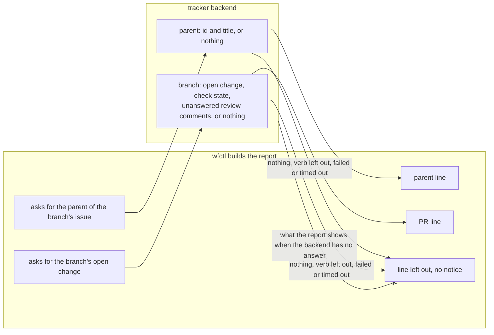

# The tracker backend finds parent issues and open PRs

## Context

In a worktree, the session-start report shows three things
(`session-report-built-in-code.md`):

1. The branch's issue.
2. The issue's parent epic.
3. The branch's open PR, with whether its checks pass and how many review
   comments are unanswered.

wfctl reads the issue today with `view`, but not the other two.

wfctl calls a PR, a merge request, or a patchset a change, since the tracker
config's `changes` section covers all three. No existing verb reads either
one:

- The issue verbs are `list`, `view`, `close`, `comment`, `create`, `label`,
  `labels`, `fields`, `state`, `start`, and `stop`. None of them returns a
  parent.
- The change verbs are `list`, `view`, and `fields`. Each one takes a change
  id, which a session on a branch with no recorded PR doesn't have.

Each tracker finds a parent and a PR its own way:

- GitHub: a sub-issues API returns an issue's parent, and a PR is found by
  its branch name.
- Jira: a story links to an epic through a field whose name differs between
  projects.
- Gerrit: a patchset belongs to a change, not to a branch.

Some trackers have no parent.

## Direct baseline

Add no verb. The report shows the issue and leaves out the parent and the PR.

This still cuts most of the 19.2k tokens of context that `/start-session` adds
today, as measured in #432, but it drops the
parent line and the PR line the issue asks for. A session picking up a branch
with an open PR wouldn't see failing checks or waiting review comments, and it
should usually deal with those first. That's why the decision adds two verbs.

## Decision

The tracker backend has two new read verbs, and a backend can leave out either
one:

1. `parent` takes an issue id. It prints the parent's id and title, or nothing
   when the issue has no parent.
2. `branch`, in the `changes` section, takes a branch name. It prints the
   branch's open change with its check state and its count of unanswered
   review comments, or nothing when the branch has no open change.

If a backend leaves a verb out, or the verb fails or times out, the report
leaves out that line. wfctl prints no notice, since #434 asks the report to
drop notices that repeat in every session.

## Owns truth

The backend finds an issue's parent and a branch's open change, in its
tracker's own terms.

wfctl can't compute either one. A parent is a sub-issue link on GitHub and a
project-specific field on Jira. A change is found by branch on GitHub and
by change id on Gerrit, so a Gerrit backend would most likely leave `branch`
out.

wfctl doesn't read any tracker's vocabulary. The `fields` verb returns
attributes under the backend's own key names, and wfctl never reads those
names, on purpose. wfctl draws the same line for whether an issue is open
(`backend-tracker-maps-issue-state.md`).

wfctl decides what the report shows when the backend has no answer. The backend
can't decide that, since it doesn't know whether the session-start report
called it or something else did.

## Boundary

The `--x` edge is the decision. The backend reports what its tracker holds, and
wfctl decides how the report reads.

## Considered

- **Add no verb (the direct baseline).** We didn't choose this because a
  session picking up a reviewed branch needs the PR line first.
- **Read the parent and the PR from `fields`.** We didn't choose this because
  `fields` returns the backend's own key names, and wfctl never reads those by
  name. If wfctl guessed at a key, it would treat every backend that names it
  differently as having no parent.
- **Have the skill run `gh` for these two reads.** We didn't choose this
  because it ties a skill every repository installs to one tracker. It also
  moves the rule about what to load back into the skill's instructions, which
  `session-report-built-in-code.md` moves into wfctl.
- **Print a notice when a backend has no `parent` verb.** We didn't choose this
  because it would print the same line in every session in that repository,
  which #434 asks the report to stop doing. `wfctl tracker-check` already
  lists which verbs a backend supports.

## Log

- 2026-11-01  proposed    — #432's worktree report needs the parent epic and the branch's PR
- 2026-11-02  accepted    — conversation 2026-11-01, #432
- 2026-11-02  superseded  — by tracker-reads-report-failure, which gives every tracker line a reason code instead of leaving it out
