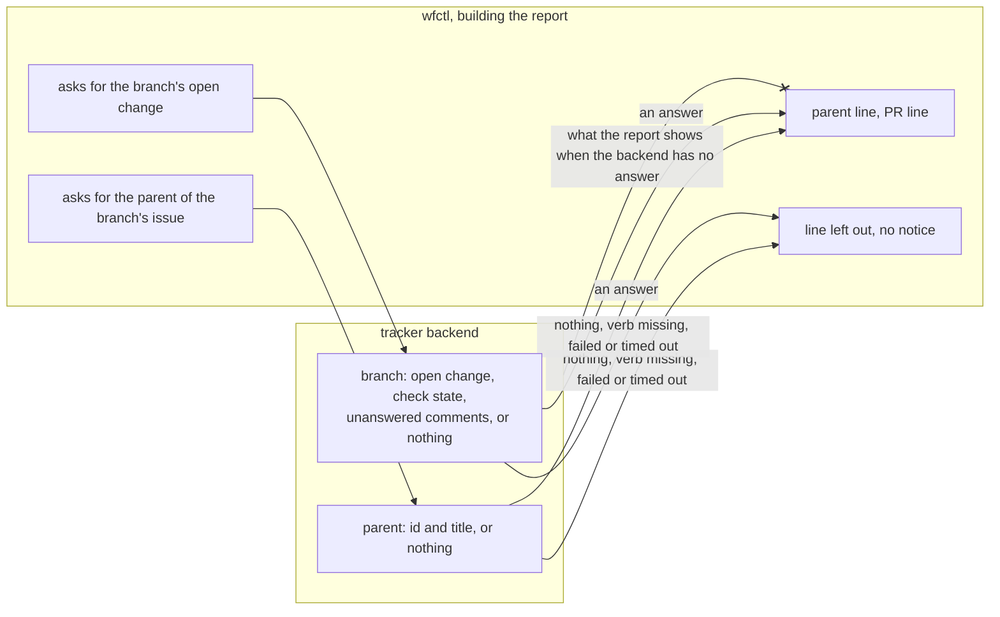

# The tracker backend finds parent issues and open PRs

## Context

In a worktree, the session-start report includes the branch's issue, the
issue's parent epic, and the branch's open PR, with whether its checks pass and
how many review comments are unanswered (`session-report-built-in-code`).
wfctl can read the issue today with `view`, but it has no way to read the
other two.

wfctl calls a PR, a merge request or a patchset a change, since the tracker
config's `changes` section covers all three. The issue verbs are `list`, `view`, `close`, `comment`, `create`, `label`,
`labels`, `fields`, `state`, `start` and `stop`, and none of them returns a
parent. The change verbs are `list`, `view` and `fields`. Each one takes a
change id, and a session on a branch with no recorded PR doesn't have one.

Trackers handle both differently. GitHub has a sub-issues API that returns an
issue's parent, and it finds a PR from its branch name. Jira links a story to
an epic through a field whose name differs between projects. A Gerrit patchset
belongs to a change, not to a branch. Some trackers have no parent at all.

## Direct baseline

Add no verb. The report shows the issue and leaves out the parent and the PR.

This still cuts most of the 19.2k tokens #432 measured, but it drops two lines the issue asks for. A
session picking up a branch with an open PR wouldn't see that the checks are
failing or that review comments are waiting, and it should usually deal with
those first.

## Decision

The tracker backend has two new read verbs, and a backend can leave out either
one. `parent` takes an issue id and prints the parent's id and title, or
nothing when the issue has no parent. `branch`, in the `changes` section,
takes the branch name and
prints the branch's open change with its check state and its count of
unanswered review comments, or nothing when the branch has no open change.

If a backend leaves a verb out, or the verb fails or times out, the report
leaves out that line. wfctl prints no notice, since #434 asks the report to stop
printing a notice that is the same in every session.

## Owns truth

The backend finds an issue's parent and a branch's open change, in its
tracker's own terms.

wfctl can't compute either one. A parent is a sub-issue link on GitHub and a
project-specific field on Jira. A change is found by branch on GitHub and by
change id on Gerrit. wfctl doesn't read any tracker's vocabulary, and the
`fields` contract keeps it that way on purpose. The same line applies to
whether an issue is open (`backend-tracker-maps-issue-state`).

wfctl decides what the report shows when the backend has no answer. The
backend can't decide that, since it doesn't know whether it was called for the
session-start report or for something else.

## Boundary

The `--x` edge is the decision. The backend reports what its tracker holds,
and wfctl decides how the report reads.

## Considered

- **Add no verb (the direct baseline).** We didn't choose this because a
  session picking up a reviewed branch needs the PR line first.
- **Read the parent and the PR out of `fields`.** We didn't choose this because
  `fields` returns the backend's own key names, and wfctl never reads those by
  name. A reader that guessed at a key would treat every backend that names it
  differently as having no parent.
- **Have the skill run `gh` for these two reads.** We didn't choose this
  because it ties a skill that every repository installs to one tracker, and it
  moves the rule about what to load back into the skill's instructions, which
  `session-report-built-in-code.md` moved into wfctl.
- **Print a notice when a backend has no `parent` verb.** We didn't choose this
  because it would print the same line in every session in that repository,
  which is the kind of repeated notice #434 asks the report to stop printing.
  `wfctl tracker-check` already lists which verbs a backend supports.

## Log

- 2026-11-01  proposed    — #432's worktree report needs the parent epic and the branch's PR
