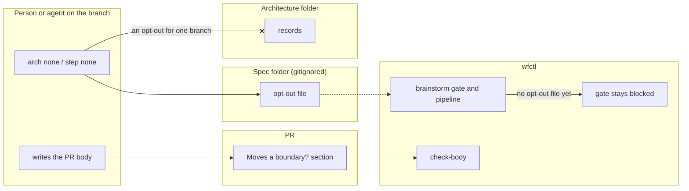

# The spec folder and PR body hold each branch's opt-outs

## Context

The architecture folder describes the system: the accepted records, the domain
model, and who owns what. Two commands also write opt-outs into it. An opt-out
is a branch's statement, with a reason, that a design step doesn't apply to it:

1. `wfctl arch none --reason "…"` writes `declarations/<branch>.md`, saying the
   branch drew no new boundary.
2. `wfctl step none <step>.<pass> --reason "…"` writes
   `step-claims/<branch>/<step>.<pass>.md`, saying a pass the repo declared
   doesn't apply to the branch.

On 2026-10-25 the folder held 15 declarations and 5 step claims, all from
branches that had already merged. Each one describes a single change, not the
system. As a result, the folder gains a file for every branch that opts out, and
a reader looking for the system's architecture has to skip past them.

Opt-outs went into the architecture folder so the reviewer would see them
(`an-absent-artifact-is-claimed-not-inferred.md`). The folder is committed, so a
file written there is part of the change under review. That record rejected the
spec folder for the same reason. The spec folder is gitignored, and in this repo
it sits outside the working tree, so nothing written there reaches a reviewer.

Two things have changed since then:

1. A repo can list headings every PR body has to answer under `change_sections`
   in `wfctl.json`. `wfctl check-body` fails a body that leaves one empty,
   writes N/A, or answers yes or no with no reason.
2. The fast path already answers "Needs a spec?" this way, with no file at all
   (`every-change-answers-spec-question.md`).

The brainstorm gate is the one reader that can't wait for a PR. It runs before
any PR exists, and it stays blocked until the boundary question is answered.

## Direct baseline

Keep opt-outs in the architecture folder. The gate and the pipeline read them
there, and the reviewer reads them in the diff.

This keeps every guarantee in place and adds no new structure. It also keeps
adding a file to the architecture folder for every branch that opts out.

## Decision

The spec folder holds each branch's opt-outs, for the boundary and for each
pass. The gate and the pipeline read them there.

The PR body carries the same opt-outs to the reviewer, under a "Moves a
boundary?" section. Every PR answers it yes or no with a reason, the same way it
answers "Needs a spec?", and lists any pass opt-outs under it. The repo makes
the section required by listing it under `change_sections`. wfctl doesn't name
the heading itself.

## Owns truth

The person on the branch still decides whether a boundary moved or a pass
applies, and writes the reason. This record changes only where the opt-out is
kept and where each reader finds it.

The pipeline reads its copy from the spec folder. It can't read the PR body,
because the gate runs before any PR exists. The spec folder already holds the
other files the pipeline reads about one branch, such as `design.md` and
`plan.md`, and it is stored on `specs-trunk` with them.

The reviewer reads their copy in the PR body. They can't read the spec folder,
because it is gitignored and, in this repo, outside the working tree. The PR body
also keeps the opt-out after the branch is deleted.

The architecture folder holds neither copy. An opt-out describes one branch, not
the system, and the folder should change only when the architecture does
(`knowledge-placement.md`).

## Boundary

A solid edge is a write or a result. A dotted edge is a file or a PR body read
later. The crossed edge is the write this record removes.

## Considered

- Keep opt-outs in the architecture folder. This is the direct baseline. We
  didn't choose it because it is the problem this record fixes.
- A `Boundary: none` trailer on a commit, which the gate reads from `git log`.
  This adds no file and keeps the opt-out in history. We didn't choose it
  because each opt-out would cost an empty commit, a rebase or squash can drop
  the trailer, and `628-early-answer-in-commit-trailer.md` already rejected a
  trailer for the early spec answer.
- A committed folder outside the architecture folder, such as `.wfctl/claims/`.
  This keeps the reviewer's copy in the diff. We didn't choose it because the
  repo still gains a file for every branch that opts out, just in a different
  folder, and a new file for every one-line fix was already ruled out for the
  spec answer.
- The gate stops requiring an opt-out and checks only that `design.md` exists.
  We didn't choose it because the pipeline would no longer make the agent
  answer the boundary question before specify.
- wfctl requires "Moves a boundary?" whenever a branch has an opt-out, whatever
  `change_sections` lists. We didn't choose it because it would be the first
  heading wfctl names itself, and a repo whose template lacks the heading would
  fail every PR until it added one (`wfctl/_sections.py` explains why wfctl
  holds no section name).

## Consequences

The reviewer is less certain to see an opt-out. Previously, the gate enforced
it, since an opt-out outside the change under review didn't count. Currently,
`check-body` enforces it, and only in a repo that lists "Moves a boundary?". The
opening-a-change skill runs `check-body`; CI and the worktree guard don't. A
repo that doesn't list the heading loses the reviewer's copy. That's acceptable
while wfctl has one user, and it should be revisited before it has a second.

The gate ignores `declarations/`. Otherwise a declaration written by an older
wfctl would count as a record and satisfy the gate. The architecture folder
would start filling up again, and nothing would flag it.

This change deletes the existing 15 declarations and 5 step claims. Git history
and each merged PR keep their reasons.

#382's short track reads the same opt-out file in the spec folder. That issue's
plan asks for a committed `arch none` file, so it needs the new location.

## Log

- 2026-10-25  proposed    — #635's level-2 pass; the architecture folder should
  change only when the architecture does
