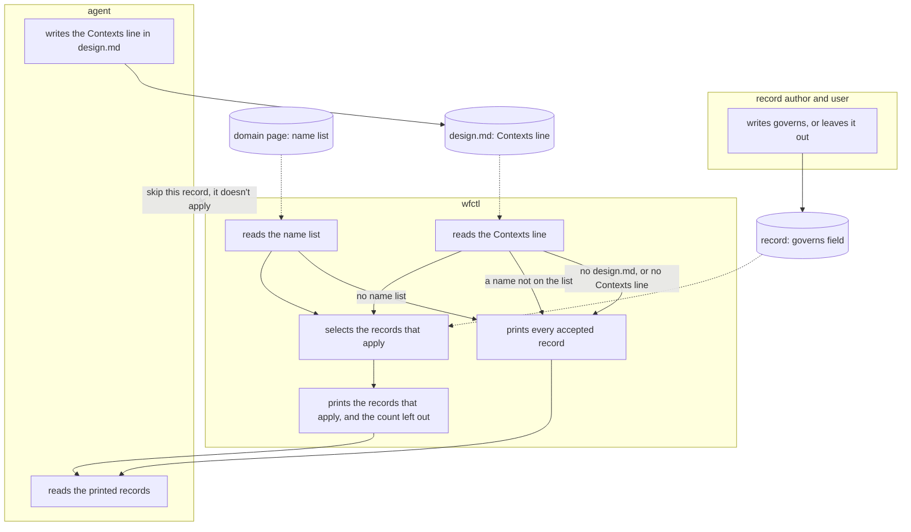

# Session start prints the records for the branch's contexts

## Context

Every session starts with `wfctl arch context`, which prints every accepted
architecture record. In the #432 worktree on 2026-11-03, that command printed
about 3,700 tokens, the largest single piece of a 9,400-token session start, and
it grows with every record accepted. Most of those records concern parts of
wfctl the branch never changes. For example, a branch that edits the review
panel doesn't need the records about install modes or spec storage.

The design checks already link records to contexts, as described in
`domain-page-names-contexts.md`. A branch lists the contexts it changes in the
`Contexts` line of `design.md`, and a record lists the contexts it applies to in
its `governs` field. Nothing uses that link to decide what a session loads.

An accepted record is never edited, so the 23 records accepted before the
`governs` field existed have none, and they can't gain one.

## Direct baseline

The simplest option is to keep printing every accepted record. It needs no code
changes, and it can never leave out a record that binds the branch. However, the
cost grows with every record accepted, and the agent reads records about parts
of wfctl it isn't changing.

## Decision

When the branch lists its contexts, `wfctl arch context` prints only the
accepted records that apply to them, and says how many it left out and that
`wfctl arch context --all` prints every one. A record applies to the branch in
three cases:

1. Its `governs` field names at least one context in the branch's `Contexts`
   line.
2. It has no `governs` field. A record that binds every change, such as
   `change-carries-release-note`, says so by leaving the field out.
3. Its `governs` field names something that isn't on the domain page. An
   accepted record isn't edited, so a typo there, or a context renamed since,
   would otherwise leave the record out of the branch that lists the context it
   meant. `wfctl doctor` reports the name, and the record prints until someone
   fixes it.

wfctl prints every accepted record whenever it can't tell which ones apply:

1. The repository's domain page has no name list.
2. The branch has no `design.md`, or its `design.md` has no `Contexts` line or
   an empty one. This covers the first session on a new branch and every branch
   that skips the spec pipeline.
3. The `Contexts` line names something that isn't on the domain page, since a
   misspelled context would leave out the records for the context it meant.

The session report's `Records` line gives the same count as `arch context`,
because both read it from one function.

## Owns truth

wfctl decides which accepted records apply to the branch. It compares two lists
it doesn't write: the contexts the agent named for the branch, and the contexts
each record's author named in `governs`, which the user then accepted with the
record. The agent shouldn't make this choice, because it would be deciding which
rules bind its own work. If the agent skips a record by mistake, nothing would
show it, since the record it skipped is the one it never read.

The record's author decides whether the record binds every change, by leaving
`governs` out. wfctl shouldn't decide this with a list of its own, because a
list in wfctl's code would ship the same answer to every repository, and each
repository's records are its own.

When wfctl can't tell whether a record applies, it prints it. Loading an extra
record costs some tokens, while leaving out a binding record lets the agent
break a rule it never saw.

## Boundary

A solid arrow is a direct action, and a dotted arrow is a file wfctl reads
later. The arrow ending in x is a claim wfctl doesn't accept from the agent.
Every path where wfctl can't tell which records apply ends at "prints every
accepted record".

## Considered

- Keep printing every record, as described in the direct baseline. We didn't
  choose this because the cost grows with every record, and every new record
  already carries the `governs` field that would let wfctl narrow the set.
- Print every record until the branch has commits, and narrow after that. We
  didn't choose this because commits don't say which contexts a branch changes.
  A branch with no commits has no `design.md` either, so it prints every record
  under the decision above. A branch with commits and no `Contexts` line has
  nothing to narrow by.
- Mark the records that bind every change with a reserved name, such as
  `governs: repository`. This approach is also valid, and it would tell a
  record nobody placed apart from one that binds every change. We didn't choose
  it because wfctl doesn't create context names of its own
  (`domain-page-names-contexts.md`). A repository that lists `repository` on
  its domain page would also need every branch to list it, or the records that
  bind every change would be left out. Leaving the field out prints the same
  records today with no new name.
- Find the branch's contexts from the files it changes. We didn't choose this
  because most modules haven't moved into their context's package yet (#671).
  Once they have, only the source of the branch's list changes.

## Consequences

- The 23 accepted records with no `governs` field print in every session, since
  they can't be edited. Today, only the 5 accepted records that carry the field
  can be left out. The record template asks every new record for the field, so
  the set a session loads stops growing with records about other contexts.
- Placing the older records needs a source outside them. The domain page's
  "Where the accepted records land" table places 13 of them, in prose. Turning
  that table into names wfctl can read is a change to the domain page, which the
  user accepts.
- A record that binds every change leaves `governs` out. The
  `architecture-decisions` skill says so where it describes the field.
- The `start-session` skill tells the agent that the printed records may be a
  subset, and that `wfctl arch context --all` prints the rest.

## Log

- 2026-11-03  proposed    — #700 level 2, from the handoff's three open questions
- 2026-11-04  accepted    — Andre accepted in the #700 session, 2026-11-03
