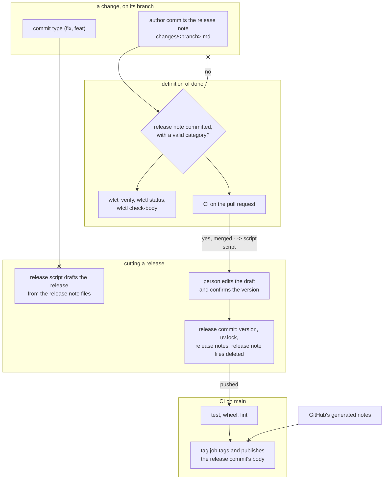

# Each change commits its own release note, and wfctl's definition of done requires it

**What does this record decide?**
Every change commits a small markdown file saying what changes for an existing
user. This repository's definition of done fails until that file exists, so
`wfctl verify`, the check before a pull request opens, and CI all refuse a
change without one. When a release is cut, a script collects the files into a
draft, and the person cutting the release edits the draft and picks the version.

## Context

A release note is a short file committed with a change, at
`changes/<branch>.md`, so each branch carries its own note. It says what an
existing user of wfctl will notice once the change ships, and it names one of
four categories: a behaviour change, an addition, a fix, or none. It can also
list the issues the change closes. The release notes are what a release
publishes, and they are built from those files. For example, the change that
recorded the speckit scripts one file per entry would have committed this as
`changes/293-mirror-below-recorded-dir.md`:

```markdown
---
category: behaviour change
issues: [293]
---
The next `install-skills --prune` deletes the speckit scripts unless the
project reinstalls once.
```

Today a person cuts every release by hand. They read every pull request merged
since the last tag, decide between a minor and a patch, bump the version, run
`uv lock`, and write a commit body that leads with the behaviour changes. They
then push straight to `main`, and CI tags the commit and publishes a release
whose notes GitHub generates from the merged pull request titles. Three things
go wrong with that:

1. Merged work waits until someone remembers to release it. Two weeks of it
   waited before 0.16.0.
2. The release notes are written twice. The commit body is written by hand,
   and the GitHub release carries a generated list instead of it.
3. Steps are dropped. 0.18.0, 0.20.0, and 0.21.0 each bumped the version and
   left `uv.lock` behind.

Release tools that read commit subjects would automate all of this, but they
cannot find the behaviour changes. In 0.23.0, all five behaviour changes were
committed as `fix`, and none was marked as breaking. One of them deletes files
from an installed project on its next routine command. Only one of the five
pull requests ticked the template's "Breaking change" box, which is optional
and which nothing reads. The evaluation that measured this is
`scans/571-evaluation.md`.

Established projects keep this judgment out of the commit type. pip, pytest,
and CPython each commit a release note file per change, Astro commits a
changeset file, and Kubernetes refuses to merge a pull request until its
description carries a note or says it has none. The projects that derive the
release from commit subjects document squash merging with an edited title as
the discipline that makes it work, and this repository uses merge commits.

wfctl already decides when a change is done from a file it can check rather
than from what an agent says. `wfctl verify` runs the commands a repository
lists under `verify` in `wfctl.json` and records whether they passed against the
current tree. `wfctl status` reports that record as the definition of done, and
`wfctl check-body` reports a missing or failed one before a pull request opens.

## Direct baseline

The release script is written and changes stay as they are. The script lists
every pull request merged since the last tag, proposes a version, bumps it,
runs `uv lock`, and drafts the commit body. The person cutting the release
writes the behaviour changes list by reading each merged pull request, as they
did for 0.22.0 and 0.23.0.

This baseline fixes the dropped steps and the duplicated release notes, and it
works. The 0.22.0 and 0.23.0 lists were accurate. Its cost is the reading. The
person reconstructs a judgment the author could have made when the change was
fresh, and reading 17 pull requests for 0.23.0 took a subagent. The cost grows
with the time between releases, which is the first problem above.

## Decision

A change isn't done until it commits its release note. This repository adds a
check script to the `verify` list in `wfctl.json`, and the script fails when
the branch does not add `changes/<branch>.md` under its own name, or when the
file names no valid category. Because the check is part of the definition of done, three
existing places refuse a change without a note:

1. `wfctl verify` records a failure, and `wfctl status` reports the definition
   of done as unmet.
2. `wfctl check-body` reports the failed verification before a pull request
   opens.
3. CI runs the same script on every pull request, so a change opened without
   running `wfctl verify` is still refused.

A change with nothing for a user to notice still commits the file, with the
category `none`. That keeps a skipped note distinguishable from a change that
had nothing to say.

When a release is cut, a script in this repository reads every file under
`changes/` and drafts the release from them. It proposes a minor when any note
is a behaviour change or an addition, and a patch otherwise. It puts the
behaviour changes first, bumps the version, runs `uv lock`, and deletes the
release note files in the same release commit, so `changes/` holds only what
is unreleased. The person cutting the release edits the draft, confirms the
version, and pushes.

The CI tag job keeps its gate. Nothing is tagged until test, wheel, and lint
pass on the release commit. When the job tags it, it publishes the release
commit's body as the GitHub release, in place of the list GitHub generates.

Release automation is this repository's process, not a feature wfctl ships.
The check is declared in this repository's `wfctl.json`, and both scripts live
under `.github/scripts/`. Nothing changes for a project that installs wfctl.

## Owns truth

The change's author owns "what changes for an existing user when this change
ships?".

The commit type can't answer it. A commit type describes the code change, and a
bug fix can still change behaviour a user relies on, as all five of 0.23.0's
behaviour changes did. A generator that reads commit types therefore misses
exactly the changes the release notes lead with.

The person cutting the release can answer it, but only by reconstructing it.
They read each pull request after the context is gone, and the effort grows with
every pull request that waits. An agent reading the history at release time is
the same reconstruction, done with less context than the author had. The author
knows the answer when the change is written, so asking them then costs one
file.

In this repository the author is almost always the agent that makes the change.
It writes the release note along with the code, so the note adds no work for a
person. What the agent does skip is an optional field, as the "Breaking change"
box showed, and that's why the note is part of the definition of done rather
than a request.

wfctl's verification owns "has this change committed its release note?".

The agent can't answer that for itself. A change that says it has a note is
the agent vouching for its own work, which wfctl's verification process
already refuses for tests and lint. The file is either committed on the branch
or it isn't, and a check script can see which.

The person cutting the release owns "which version is this, and what do the
release notes say?".

The script can't decide this alone. A release is a set of changes, and whether
the set is a minor or a patch, and which behaviour change leads, is a judgment
about the whole set. The script proposes both from the release note files, and
the person confirms them. That keeps the reason the tag job already gives for
a human version call, which is that the call needs context. What changes is
that the context arrives written down instead of reconstructed.

## Boundary



Solid arrows are steps in one run. The dotted arrow is read later: the release
script reads the merged release note files from `main` at release time. The
crossed-out arrows are the decision. A change without a release note is
refused, the script never reads the commit type to judge what a user will
notice, and the tag job never publishes GitHub's generated notes.

## Considered

- **A release note section in the pull request description, checked by CI.**
  This was the first version of this record, and it follows Kubernetes. It
  loses on fit. The description lives on GitHub rather than in the repository,
  so `wfctl verify` and `wfctl status` can't see it, and the check exists only
  once a pull request does. CI would also need a separate trigger to rerun when
  the description is edited, and the release script would have to call GitHub
  to read the notes back.
- **Derive the version and the release notes from commit subjects,** with
  release-please or python-semantic-release. Both automate everything this
  record leaves to a person. They lose because the commit type does not carry
  the behaviour changes here, and both tools document squash merging as the
  discipline they rely on. release-please also overwrites hand edits to its
  release pull request, and neither relocks `uv.lock` without extra
  configuration.
- **A release note trailer on each commit,** such as `Release-note: none`,
  checked by a local `commit-msg` hook and again in CI. Git already parses
  trailers, and GitLab uses the same shape. It loses on the unit. The pull
  requests in 0.23.0 carried 1 - 24 commits each, and the user-facing change is
  usually the sum of them, so most trailers would read `none` and be typed
  without thought. A trailer is also fixed once pushed, and correcting it means
  rewriting a branch the review has already read. A local hook is skipped by
  `--no-verify` and is missing from a fresh worktree.
- **An agent reads the history at release time and writes the list.** It needs
  nothing from the author, and an agent wrote the 0.23.0 list this way. It loses
  because it is the reconstruction this record exists to replace, done later
  with less context, and nothing checks it. The agent that made the change
  writes the release note for the cost of one file.
- **One shared release notes file that every change edits,** as a
  hand-maintained `CHANGELOG.md` works. It needs no script to collect the
  notes. It loses because every open pull request edits the same lines, so
  each merge conflicts with every other pull request still open. pip, pytest,
  and CPython moved to one file per change for this reason.
- **A label per pull request,** as uv and ruff do. A label is easy to add and
  to filter on. It carries the category but not the sentence, so the person
  cutting the release still writes every line. Ruff's own contributing guide
  says labels are often missing.

## Consequences

The release note check runs inside `wfctl verify`, so it reads the current
branch's name and compares the branch against `main`. On `main` itself there is
no branch to compare, so the check passes there. That is what lets the release
commit, which deletes the files, pass its own CI.

The note is named for the branch, not for an issue or a pull request, for three
reasons:

1. A pull request can close several issues, and one issue can take several pull
   requests. When two pull requests work on the same issue, each commits its
   own note, and the second never edits a note the first already merged.
2. Every branch has a name, including a branch that names no issue, such as a
   dependency update. The check has something to look for on every branch.
3. A pull request's number doesn't exist until it opens, so `wfctl verify`
   couldn't check a note named for it before then.

A branch name containing `/` becomes `-` in the file name, so every note sits
directly under `changes/`.

A stacked pull request carries its parent's release note in its diff against
`main`. The check therefore requires the file named for the branch itself, not
just any file under `changes/`.

The pull request template's "Type of Change" checkboxes ask the same question
less precisely than the release note's category, and two fields asking one
question will disagree. Whether the checkboxes go or stay is left to the
implementation, and it should decide before the first release that reads the
release note files.

Changes merged before the check exists have no release note. The first release
after it still needs those read by hand, and the release script should list
them as missing rather than treat them as `none`.

The comment above the tag job says the version is decided in the pull request
that makes the change. No release from 0.17.0 to 0.23.0 worked that way, and it
is rewritten to describe this record.

Nothing here reminds anyone that merged work is waiting. Since `changes/` holds
only unreleased notes, a count of its files is the reminder's natural input.
Whether something should prompt for a release is still an open question, and
nothing has been decided.

Whether a required release note gets written honestly or marked `none` by habit
is also open. No evidence was found either way. The review panel is the natural
place to compare a note's category against the diff.

## Log

- 2026-10-10  proposed    — #571. A release tool that reads commit subjects
  would miss every behaviour change in 0.23.0, so the judgment moves to the
  change that makes it.
- 2026-10-10  renamed     — from `pull-request-carries-release-note`. The note
  moved from the pull request description into a committed file.
- 2026-10-10  rewritten   — the release note is a file the definition of done
  requires, so wfctl checks it locally as well as in CI.
- 2026-10-12  revised     — the note is named for the branch rather than the
  issue, since a pull request can close several issues and one issue can take
  several pull requests.
