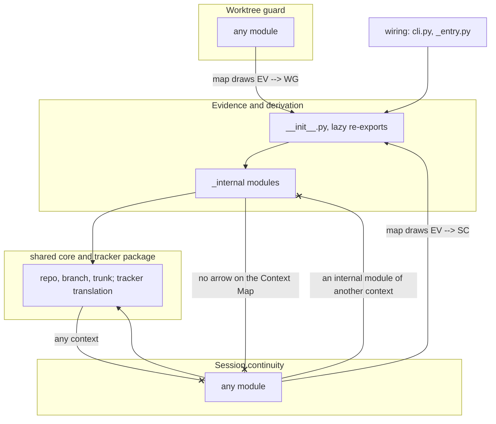

# Each bounded context is a package that re-exports its public names

## Context

The domain page (`domain/wfctl.md`) names seven bounded contexts and draws a
Context Map of which context depends on which. Nothing in the code follows
that map. wfctl is one flat package of 42 modules, and `cli.py` alone holds
8,983 of its 27,203 lines. Any module can import any other, so code can add a
dependency the map doesn't draw without anyone deciding to.

That has already happened. The status code in Evidence and derivation imports
`_session` to read the event log. That import makes Evidence depend on Session
continuity, the reverse of relationship R6 on the map. The user moved the event
log into Evidence on 2026-11-01 to keep R6 as drawn, but no check would have
found the reversal, and none would find the next one.

`a-rule-is-expressed-as-a-check.md` says a rule whose violation shows up in an
artifact the work already produces should ship as a check. A violation of the
Context Map is an import, and imports are in the source, so the map is that
kind of rule. Today it's prose only.

The proposed record `the-underscore-is-the-module-contract.md` overlaps with
this one. It decided that the underscore governs members, not modules,
and that `cli` importing `_pipeline` is not a crossing. That rule can't tell
two contexts apart, because it treats the package as one unit. This record
replaces its module half. Its member half, which governs a private name used
inside one context, is not decided here.

## Direct baseline

Keep the flat package and add only a check. The check reads a table that
assigns each module to a context, and fails on an import between two contexts
that the Context Map doesn't draw. The existing test in
`tests/test_architecture_view.py` already parses the view's drawing and builds
an import graph from the source, so the check is a few dozen lines on top of it.

This option requires no module to move, and it does find the next reversal of
R6. However, the context table is a second list of modules beside the code,
and a new module belongs to whichever context the table assigns it. A reader also can't tell from a file's path which
context it belongs to, or which of its modules another context may use. That's
why the decision below makes the context visible in the path.

## Decision

Each of the seven contexts is a Python package under `wfctl/`. The package's
`__init__.py` lists what it offers other contexts, and every module inside it
keeps a leading underscore. A module in one context may import from another
context only when the Context Map draws an arrow from that context to its own,
and only from the other context's package, never from a module inside it.

The rules the check enforces are:

1. Imports inside one context are not checked.
2. Context B may import context A when the Context Map draws `A --> B`. The arrow points the way data flows, from the upstream
   context to the downstream one that uses it, so the downstream context does
   the importing. For example, `EV -->|"status payload"| SC` lets Session
   continuity import Evidence and derivation, and not the reverse.
3. Across contexts, only the package may be imported, as in `from
   wfctl.evidence import derive`. Its `__init__.py` re-exports the public names
   from its underscore modules and lists them in `__all__`. An import of
   `wfctl.evidence._status` from another context fails, so Evidence can split
   or rename its own files without breaking a caller.
4. Any module may import two packages that are not contexts. The
   shared core holds the repo, branch, and trunk lookups that every context
   needs. The tracker package translates between wfctl and the trackers, an
   outside party several contexts use. Neither imports any context.
5. Wiring is the layer above the contexts. It routes a command to them and
   holds no logic of its own. Its two files may import every context, but only
   from their packages. `cli.py` is the full command line. `_entry.py` is the
   console script, and it starts the worktree guard and the restart hook
   without loading `cli.py`, so neither hook has to load the whole CLI. Each
   file starts code in more than one context, so it can't belong to any one of
   them without importing another. The check lists the wiring files, and a
   new one waits for a person's approval, the same as a new map arrow.

The check reads the Context Map from the mermaid block on the domain page, so
the page and the check can't disagree. It covers direct imports only. When
Session continuity reaches Architecture records through the `wfctl.evidence`
package, the map is composing as intended. Rule 3 already blocks another
context from importing Evidence's internal modules.

The existing imports that break these rules are listed in a baseline file. The
check fails on any import that breaks a rule and is not on the list, and on any
list entry that no longer matches an import, so the list can only shrink. The
check is one script, and `wfctl verify`, CI, and the test suite all run it.

The check also compares the branch with where it left `main`. Five kinds of
addition fail the check until a person approves them:

1. A baseline line.
2. A Context Map arrow.
3. A shared package.
4. A new package name for a context.
5. Any change to the check's own script, which holds the wiring list and the
   rules, or to the CI workflow that runs it.

The person approves by running the installed wfctl in their own terminal, with
a command the worktree guard refuses when an agent runs it. Otherwise an agent
that hits a failure could add a line or an arrow, or loosen the script or the
workflow in a separate PR, and turn the check green.

CI enforces this, since it runs `main`'s copy of both files. The local
refusals are weaker. The guard and the approval command are wfctl code an
agent can edit, so they stop an agent from taking a shortcut, but not one set
on getting around them, such as by calling the approval code from its own
Python. That's the same protection `wfctl review sign-off` gives.

A package's `__init__.py` loads its re-exports lazily, so importing one name
loads only the module that defines it. An eager re-export would load the whole
context on the first import, and the worktree guard runs before every shell
command, so its start-up time depends on loading as little as possible (#135).
The first move picks the mechanism. It uses Python 3.15's `lazy` imports if
mypy supports them by then, and a module-level `__getattr__` like Textual's if
not.

Every failure message names both contexts, says why the rule exists, and says
what to do instead. For a missing public name, it says: "If the package lacks
what you need, export it from its `__init__.py`."

## Owns truth

The user decides which contexts wfctl has and which may depend on which, and
records those choices in the Context Map on the domain page. The code can't make that
decision, because an import records only that one module needed another. It
doesn't record whether the dependency was meant, so a map read back from the
imports would agree with whatever the code already does.

Each context decides which of its names other contexts may use, by listing
them in its package's `__init__.py`. A caller shouldn't decide this, because it would be relying
on code the context never promised to keep stable. Then the context couldn't
rename its internals without breaking a caller it never agreed to have.

## Boundary

Solid arrows are imports the check allows, and each runs from the importing
module to the imported one. An `--x` edge is an import the check refuses, with
the reason on the edge. Three of the seven contexts are drawn, and the same
rules apply to the other four. The shared core and tracker box is not a context.

## Considered

- **Use import-linter.** import-linter 2.15 is mature, and its
  `ignore_imports` fails when an entry stops matching, so its baseline can
  shrink only, as ours does. We didn't choose it for two reasons. First, its
  contracts live in `pyproject.toml`, so the Context Map would exist twice and
  the two copies could drift apart. Our check reads the map from the domain
  page. Second, it checks whole modules, while the existing test also finds an
  import of a private name across modules, which we keep.
- **A ruff rule.** ruff runs on every change already. We didn't choose it
  because ruff has no support for custom rules.
- **One public module per package, with a plain name, and an empty
  `__init__.py`.** This record first chose it, to keep the guard's start-up
  cheap. We didn't keep it because no Python project or guide we found uses
  it, and lazy re-exports keep start-up just as cheap. SQLAlchemy, pydantic, and
  Textual all re-export from `__init__.py`, and Textual and pydantic do it
  lazily.
- **Any plain-named module is public, as PEP 8 and the typing spec describe.**
  We didn't choose it because a caller then imports a file by name, so a
  context can't split or rename that file without breaking the caller. Adding
  a plain-named file would also widen what other contexts may import without
  anyone deciding to.
- **Check indirect dependencies too.** A transitive check would also find
  Session continuity depending on Architecture records through Evidence. We
  didn't choose it because the map is meant to compose that way, and every
  such chain would need its own entry.
- **The direct baseline: a check over a context table, with no packages.**
  Described above. It loses on visibility rather than correctness, since the
  context table is a second module list and the path still says nothing.

## Consequences

This record ships with the check and its baseline, and no module moves on this
branch. Each context moves into its package in its own PR under #671. Those PRs
are ordered around open branches that change the same modules, such as #432. Each move
deletes the baseline entries it resolves.

`_paths.py` splits during the moves. Record lookups go to Architecture records,
feature and spec folder resolution to Evidence and derivation, and the state
dir to Session continuity. The repo, branch, and trunk lookups stay in the
shared core.

The `test_the_package_is_still_flat` test in `tests/test_architecture_view.py`
fails on the first move, as it was written to. The view in
`views/current-state.md` has to support subpackages in that same PR.

Item 7 on the domain page, filed as #688, would let a record name the check
that guards it. This check is the first one it would name.

## Log

- 2026-11-02  proposed    — #544: the Context Map becomes package boundaries, checked on every change
- 2026-11-02  accepted    — chat, 2026-11-02, #544
- 2026-11-02  amended     — #544 clarify: other contexts import the package, whose `__init__.py` re-exports lazily, instead of one plain-named public module; a baseline line or map arrow a branch adds waits on a person's approval
- 2026-11-02  amended     — #544 plan walkthrough: rule 5 defines wiring and names `_entry.py` beside `cli.py`; the branch that ships the check is the only exception to the approval rule, and the user approves its baseline by merging that branch's PR by hand
- 2026-11-02  amended     — #544 plan re-review: the title names re-exports, and the approval rule lists all five kinds of addition, including a change to the check's script or its CI workflow; the local refusals are a stated limit, and the bootstrap exception covers both files
