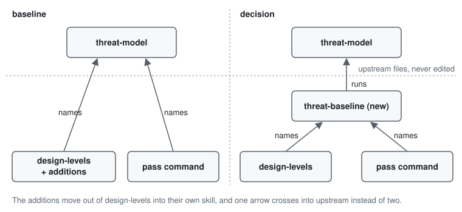

# A wfctl skill adds our parts to upstream's threat model

## Context

wfctl ships Anthropic's `threat-model` skill unedited. wfctl's changes to an
upstream-derived skill go in a layer above it, so the next upstream pull stays
a plain diff (`vendor-upstream-skills.md`). wfctl adds three parts the upstream
skill doesn't have:

1. If auto-approve is on, the agent still works through the four questions
   after the bootstrap. It answers them itself, prints each answer, and turns anything the
   code can't answer into an open question in the file.
2. The file has a new section listing fixes that were considered and rejected,
   with the trade-off for each. It goes after upstream's eight sections, since
   upstream tells consumers to find sections by heading and to tolerate extras
   at the end.
3. The file opens with one line saying it's a working map that gets revised,
   not a decision record. That way "risk accepted" in a threat row isn't read as
   an accepted architecture record.

The new `threat-baseline` pass (`security-record-needs-baseline.md`) names one
command for the agent to run. This record decides which file holds the three
additions, and which skill that command runs.

## Verified

- `wfctl/_pipeline.py:126` gives each brainstorm pass a command string, such as
  `SubStep("architecture", "/speckit.brainstorm", ...)`. The new pass names one
  command the same way.
- `speckit-brainstorm/SKILL.md` layers over `brainstorming` and `idea-refine`.
  It says so in its body: "`brainstorming` and `idea-refine` are
  upstream-derived and stay unedited ... **this skill is the layer above
  them**".
- `wfctl/cli.py:4436` mirrors a folder under `.agents/skills` into
  `.claude/skills` when its name is in `_MIRRORED_SKILLS`. Membership is by
  folder name, so a `_lib` folder can be listed the same way as a skill.
- Upstream's `threat-model/SKILL.md` calls
  `python3 .claude/skills/_lib/checkpoint.py` in its `allowed-tools`, and
  `bootstrap.md` calls the same path in every checkpoint step.
- The same `allowed-tools` list grants `Bash(git:*)` and `Bash(gh api:*)`.
  Claude Code approves these only for a skill it finds under `.claude/skills`.
  They cover `git push`, a branch delete, and any GitHub API write, such as
  closing an issue.
- `tests/test_skill_frontmatter.py:19` allows six frontmatter keys. Upstream's
  `argument-hint` isn't one of them, so shipping the file unedited fails that
  test until the test learns the key.
- `tests/test_skill_cross_references.py:94` finds a skill's own files by the
  wording "Read `X` in this skill directory". Upstream writes "Read
  `interview.md` in this directory", so the test misses all three mode files.

## Assumed

- Claude Code skips a folder under `.claude/skills` that has no `SKILL.md`.
  Upstream ships `_lib` that way. If Claude Code lists it as a broken skill, the
  helper moves and the mirror entry changes with it.
- Claude Code reads `allowed-tools` written as a YAML list, as upstream writes
  it. wfctl's own skills use a space-separated string. If the list form is
  ignored, the checkpoint calls prompt for permission instead of running.
- On an agent other than Claude, a design session on one control doesn't load
  `threat-model` once `design-levels` names `threat-baseline` as the
  whole-system skill. On Claude, the skill isn't discoverable, so the question
  doesn't arise there.

## Direct baseline

No new skill. The security part of `design-levels` lists the three additions
and tells the agent to run `/threat-model` with them. The pass names
`/threat-model` too.

This adds one paragraph and nothing else. The cost is that the additions exist
only in `design-levels`. An agent that reaches
`/threat-model` from the pass, or from `wfctl status`, runs upstream's version
without them. Both arrows in the baseline cross into upstream's files.

## Decision

A new wfctl skill, `threat-baseline`, holds the three additions. It tells the
agent to run upstream's `threat-model` against the repository root, and then
adds wfctl's parts. The pass names `/threat-baseline`, and `design-levels` names
the same skill. `threat-baseline` and `_lib` are mirrored into `.claude/skills`,
so the Skill tool finds `threat-baseline` by name and upstream's helper path
resolves.

`threat-model` isn't mirrored. `threat-baseline` tells the agent to read
upstream's `SKILL.md` from `.agents/skills/threat-model/` and follow it, and to
read upstream's other files from the same folder. Because Claude Code never
discovers the skill, its `Bash(git:*)` and `Bash(gh api:*)` grants never take
effect, and each `git` or `gh` command upstream runs goes through the usual
permission check. Upstream's files stay unedited.

As a result, Claude has no `/threat-model` command. Someone who wants upstream's
version without wfctl's additions can still read the same file.

## Diagram

The two graphs differ by one new skill and one fewer arrow crossing into
upstream's files. The decision is built for two kinds of change: a new
addition, or an upstream pull that changes how the modes run. In the baseline,
a new addition changes `design-levels` and has to be repeated wherever the pass
sends the agent. In the decision, it changes only `threat-baseline`.

## Considered

- The direct baseline, a note in `design-levels`. We didn't choose this because
  the pass would name a skill that doesn't know about the additions, so the most
  common way to reach the skill skips them.
- Edit upstream's `SKILL.md` and `schema.md`. We didn't choose this because the
  next upstream pull reverts the edit without a conflict, which is the failure
  `vendor-upstream-skills.md` exists to prevent.
- A command wrapper named `/threat-model` that adds the parts. We didn't choose
  this because wfctl suppresses a wrapper whose name matches a mirrored skill
  (`_mirror_supersedes_wrapper`), since Claude Code may pick either one. The
  wrapper would never install for Claude.
- Mirror `threat-model` too, so `threat-baseline` can invoke it by name. We
  didn't choose this because the skill's broad grants would let a push or a
  GitHub write run with no prompt, while the skill reads commit messages and
  advisories that anyone can write. `THREAT_MODEL.md` lists this as T10. The
  #818 security review found it.
- Add `permissions.ask` rules for the write forms, such as `Bash(git push:*)`.
  We didn't choose this because a prefix rule can't cover every write.
  `gh api` takes `-X POST` after the path, and `git -c alias.x='!sh …'` runs any
  command. Narrowing a vendored skill's grants per repository is #854.

## Consequences

wfctl now ships two skills for this job and one helper folder. A reader looking
for the threat model's behavior has to read both skills, and `threat-baseline`
says at the top that upstream's skill does the work.

Upstream's commands lose their grants on every agent. In default mode, a run
prompts for its history reads and advisory lookups. In auto mode, the
classifier lets those reads through and checks every write.

Because `threat-model` isn't discoverable on Claude, its description can't
trigger in a per-control session there.

Upstream writes its checkpoints to `.threat-model-state/` in the folder it
runs from, and wfctl doesn't install that folder. As a result, `install-skills`
adds `.threat-model-state/` to every project's `.gitignore`, including projects
that never run the skill. One ignored path is cheaper than a checkpoint folder
showing up in `git status` partway through a run.

## Verification

- A test fails if a path a shipped skill names under `.claude/skills/` doesn't
  resolve to a mirrored item, except `threat-model`, which `threat-baseline`
  reads from `.agents/skills/`.
- A test fails if a skill or command that reaches Claude grants a command that
  pushes, runs a git alias, or writes through `gh`.
- The own-files test recognizes upstream's "in this directory" wording and
  fails if `interview.md`, `bootstrap.md`, or `schema.md` is missing.
- After `uv run wfctl install-skills --agent claude`, the helper runs from the
  installed path: `python3 .claude/skills/_lib/checkpoint.py load
  ./.threat-model-state` prints `{"status": "absent"}`.
- A design-time prompt about one control, run against the installed tree, writes
  a `## Threat model` section and doesn't load `threat-model`.
- After `uv run wfctl install-skills --agent claude`, `.claude/skills/` has no
  `threat-model` folder.
- `/threat-baseline` builds wfctl's own `THREAT_MODEL.md` from the installed
  tree, with the rejected-fixes section and the opening line.

## Log

- 2026-11-21  proposed  — the threat-baseline pass needs one command, and our
  additions can't go in upstream's files (#818)
- 2026-11-22  revised  — `threat-model` is read by path rather than mirrored,
  since its grants approve a push or a GitHub write with no prompt (#818)
