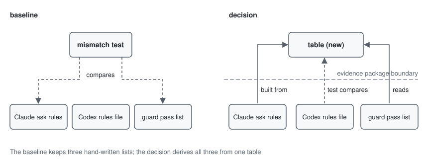

# One table lists the spellings the host prompts for

## Context

`prompt-approves-person-commands.md` lets the agent run `wfctl arch accept`,
`wfctl review sign-off`, and `wfctl arch approve-imports` once the user
approves them at the host's permission prompt. That only holds if three lists
agree on which spellings of those commands make the host ask:

1. The Claude Code `ask` rules that `wfctl install-skills` writes into
   `.claude/settings.json`.
2. The Codex `prefix_rule` entries in `.codex/rules/wfctl.rules`.
3. The spellings the worktree guard lets through.

If the guard lets through a spelling the host's rules don't match, the command
runs with no prompt. If the rules match a spelling the guard refuses, the user
never sees the prompt and the agent is blocked for nothing. The first mistake
loosens a security control, and nothing in the suite would catch it unless the
three lists are compared.

The guard's text check lives in `_review_gate.py`, which belongs to evidence
and derivation. The rules are written by `cli.py`, which is wiring and can
import any context. The Context Map draws an arrow from evidence and
derivation to the worktree guard, and none from install and drift to it, so
the guard can't import a list that lives in the installer
(`contexts-are-packages.md`).

## Verified

- `.github/scripts/check_imports.baseline` places `_review_gate.py` and
  `_review_notes.py` in `evidence`.
- `docs/architecture/domain/wfctl.md` draws `EV -->|"the checks a PR must pass"| WG`
  and no arrow from `IN` to `WG`.
- On the #407 branch, `wfctl/cli.py:3933` defines `ASK_RULES` as four Claude
  Code rule strings for `wfctl auto-approve on`, and
  `wfctl/agents/codex/rules/wfctl.rules` repeats the same spellings by hand as
  two `prefix_rule` entries.
- `wfctl/_review_gate.py:47` - `55` hold the three refusal messages, and
  `read()` refuses sign-off and approve-imports with two loose regexes,
  `_SIGN_OFF` and `_APPROVE_IMPORTS`.
- `wfctl/cli.py:3718` maps the Claude Code hook to the `Bash` tool and the Bob
  Shell hook to `execute_command` or `run_shell_command`.

## Assumed

- Bob Shell's hook payload carries the tool's name in `tool_name`, as Claude
  Code's does. If it doesn't, the guard can't tell which host ran it from the
  payload, and the installer passes the host to the hook command instead.
- Claude Code matches an `ask` rule ending in `:*` against the start of the
  command, so `Bash(wfctl arch accept:*)` matches `wfctl arch accept s` and
  `wfctl arch accept --dry-run -- s` alike. A walk with the installed rules
  confirms it.

## Direct baseline

Each list is written by hand where it is used. `cli.py` gains rule strings
for the three commands beside `ASK_RULES`. The Codex rules file gains a
`prefix_rule` for each spelling. `_review_gate.py` gains a regex for each
spelling it lets through. A test runs each guard pass-list entry against the
Claude Code rule strings to catch a mismatch.

## Decision

One table in evidence and derivation lists every prompted spelling, as the
words the command starts with:

```python
PROMPTED = (
    Prompted("arch accept", ("wfctl", "arch", "accept")),
    Prompted("review sign-off", ("wfctl", "review", "sign-off")),
    Prompted("arch approve-imports", ("wfctl", "arch", "approve-imports")),
)
```

None of the three has a `uv run` spelling. The user approves a command by
its text, and `uv run wfctl` runs the branch's own copy, which the agent may
have edited.

The `evidence` package exports it, so both readers can reach it:

1. `cli.py` builds the Claude Code `ask` rules from it, and `install-skills`
   writes them. `doctor` reports a missing one, as #407's `_ManagedRule`
   already does.
2. The worktree guard lets a command through only when its raw text starts
   with one entry's words joined by single spaces, compared literally and
   case-sensitively, and the text holds no shell character that could change
   what runs: no separator, substitution, redirect, quote-stripping
   backslash, or unquoted comment. The comparison is on the raw text rather
   than on words split the way the shell splits them, because splitting
   removes quotes and backslashes, so `wfctl "arch" accept s` would split to
   the same words as the plain form. Claude Code's rule doesn't match that
   quoted form, so it would run with no prompt.

The Codex rules file stays package data, since Codex reads it as written. A
test builds the expected `prefix_rule` entries from the table and compares
them against the file, the same way `required-sections-are-wfctls.md`
compares its constants against the templates.

## Diagram



The change this is built to absorb is a new spelling, or a fourth command
moving to the prompt. In the
baseline, that touches three lists and the test that compares two of them. In
the decision, it touches the table, and the Codex file test fails until the
file matches. The decision adds one element, the table, and no new boundary.
The guard's import of evidence and derivation is the arrow already drawn on
the Context Map.

## Considered

- The guard reads `.claude/settings.json` and lets through whatever the `ask`
  rules match. We didn't choose this as the source of spellings because the
  settings file is the user's too, and an `ask` rule the user adds for some
  other command would widen what the guard lets through. The guard still
  reads the file, but only to check that the rule for the table's entry is
  there, per item 17 of the record's "Must keep catching" list.
- The installer passes the host to the hook as a flag, such as `wfctl hook
  worktree-guard --host bob`. This works too. We didn't choose it because the
  payload already names the tool, and a flag means every existing install
  needs its hook entry rewritten. It's the fallback if the Bob assumption
  above is wrong.
- Generate the Codex rules file from the table at install time. We didn't
  choose this because the file is the one place a Codex user reads what wfctl
  asks for, and a generated file adds an install step for two rules that
  rarely change. The test keeps it in step.
- Keep the table in `install`, beside the rule writer. We didn't choose this
  because the guard can't import install and drift, and adding that arrow
  would wait on `wfctl arch approve-imports` for a list that is mainly the
  guard's.

## Consequences

- A spelling is added in one place, and the guard and the Claude Code rules
  follow it.
- `_SIGN_OFF` and `_APPROVE_IMPORTS` stop being the whole check for those two
  commands. The guard reads them the way it reads the accept today, so a
  plain spelling passes and every wrapped form stays refused.
- The guard reads `.claude/settings.json` on a command that matches the table,
  which costs one small file read on those commands and nothing on any other.
- The dry run matches the accept's entry too, so it prompts. Moving it to a
  spelling outside the table is the plan's call.

## Verification

1. A test reads every entry in the table, builds its Claude Code rule, and
   checks that `install-skills` writes it.
2. A test runs each entry's plain spelling through the guard with the rule
   present and checks that it passes, then with the rule missing and checks
   that it's refused.
3. A test compares the Codex rules file against the table.
4. The threat model's "Must keep catching" and "Must let through" lists in
   `prompt-approves-person-commands.md` each get a test that runs every entry
   through the guard.

## Log

- 2026-11-20  proposed  — #833 level 3. The host's rules and the guard's pass list have to agree, or a command runs with no prompt.
- 2026-11-20  amended   — plan review PR-014: the guard compares raw text, since split words let a quoted form through.
- 2026-11-21  amended   — the table drops both `uv run` spellings, so all three commands run the installed wfctl.
