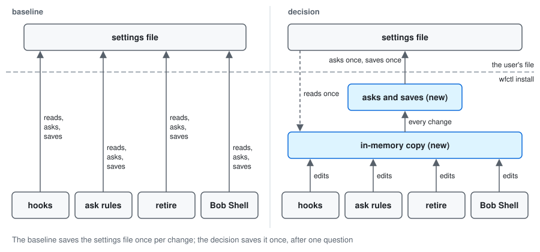

# Install asks once per settings file

## Context

`settings-edit-asks-first.md` has `install-skills` ask before it changes an
existing settings file. Today install changes that file in four separate
passes, and each pass reads the file, edits it, and saves it on its own:

1. The hooks pass adds or updates each hook wfctl ships.
2. The ask rules pass adds each permission rule wfctl ships.
3. The retire pass removes the rules an earlier install added that wfctl no
   longer ships.
4. The Bob Shell pass removes the tool approvals an older wfctl added to
   `.bob/settings.json`.

The hooks and ask rules passes save once per entry, not once per pass. Claude
Code's settings file gets three hooks and eight rules, so one install can save
the same file up to eleven times before the retire pass runs.

That didn't matter while install changed the file without asking. Now each of
those saves needs the user's yes first. If each pass asked on its own, one
install could ask about the same file several times, and the skip logic for no
terminal would be written four times.

## Verified

- `wfctl/cli.py:4724` `_merge_hooks` calls `_read_settings` and, when
  `merge_hook` reports a change, `_write_settings`, once for each entry in
  `MANAGED_HOOKS`.
- `wfctl/cli.py:4033` `MANAGED_HOOKS` holds three hooks, and
  `_managed_permissions` at `wfctl/cli.py:4826` returns one deny rule, the four
  `ASK_RULES`, and one rule per entry in `PROMPTED`, which holds three.
- `wfctl/cli.py:4938` `_merge_permissions` reads and writes the file once for
  each rule it adds, then calls `_retire_permissions`, which reads and writes it
  once for each rule it removes.
- `wfctl/cli.py:5131` `_unmerge_bob_tool_allows` reads and writes
  `.bob/settings.json` once for each tool approval it removes.
- `wfctl/cli.py:6034` - `6053` in `install_skills_cmd` call the three entry
  points in that order: hooks, then permissions with the retire pass inside it,
  then the Bob Shell pass.
- `wfctl/cli.py:5408` `_interactive` returns `sys.stdin.isatty()`, and is the
  seam tests use to run both paths.
- Each pass already keeps the prior manifest receipts for a file it can't read
  or write, with `records.extend([keep] if keep else [])`, so the next install
  tries again.
- `_ManagedRule.cost` and `_HOOK_GONE` already give every shipped rule and hook
  a line saying what losing it costs, and an `assert` after `_HOOK_GONE` fails
  when a hook has none.

## Assumed

- A settings file is small enough that holding it in memory for the length of
  one install costs nothing worth measuring. A settings file of several
  megabytes would falsify this, and none has been seen.
- No other process writes the settings file during the few seconds install
  holds its copy. If Claude Code rewrote the file in that window, the single
  save would discard its change, as each of today's saves already would.

## Direct baseline

Each pass keeps its own read and save, and asks before each save. A pass checks
`_interactive()` first and skips the save when nobody is at a terminal. A user
at a terminal answers up to eleven questions about one file on a fresh upgrade,
and the four passes each carry the same skip and the same receipt handling.

## Decision

Every pass edits one in-memory copy of each settings file. Install reads each
file once, hands the copy to the hooks, ask rules, retire, and Bob Shell passes
in today's order, and keeps a list of what each pass changed. Install then
compares the copy with the file:

1. If the copy is unchanged, install doesn't ask and doesn't save.
2. If the file doesn't exist yet, install saves the copy without asking, as
   `settings-edit-asks-first.md` accepts.
3. If a terminal is attached, install lists every change and asks once. A yes
   saves the copy in one write.
4. If the user says no, or no terminal is attached, install leaves the file
   alone. It names how many changes it skipped and the command to run in the
   user's own terminal.

The question looks like this, with each line under a change taken from the
entry's existing `cost` line or `_HOOK_GONE` entry:

```
.claude/settings.json needs these changes:
  + hook      PreToolUse  wfctl hook worktree-guard
              without it, nothing stops a Bash call reaching into a sibling worktree
  + ask rule  Bash(wfctl arch approve-imports:*)
              without it, the guard refuses wfctl arch approve-imports from the agent
  + ask rule  Bash(uv run --project * wfctl auto-approve on*)
              without it, Claude Code doesn't ask before the agent turns auto-approve on
  - ask rule  Bash(uv run --project * wfctl auto-approve on:*)
              wfctl no longer ships this rule
Apply them? [y/N]
```

If the change isn't saved, install writes the prior manifest receipts for that
file back, the same way each pass does today for a file it can't write. The
manifest then still matches the file, and `wfctl doctor` reports the pending
changes from it. If the file can't be parsed, install reports it once and every
pass skips it.

## Diagram



The change this is built to absorb is a fifth kind of settings change, such as
a new kind of entry wfctl manages. In the baseline, the new pass adds its own
read, save, question, and skip, which is two more arrows to the settings file
and a fifth copy of the skip logic. In the decision, the new pass edits the
copy, and the question and the save already cover it. The decision adds two
elements, the copy and the ask-and-save step, and no new boundary. The divider
between the user's settings file and wfctl's install is the one
`install-modes.md` already draws.

## Considered

- Ask inside each pass, as the direct baseline does. We didn't choose this
  because one install could ask about the same file up to eleven times, and
  the skip and receipt handling would be written four times.
- Keep each pass's own read and save, and have each pass return its pending
  edits for install to apply after one question. This works too. We didn't
  choose it because each pass would describe its edits as data instead of
  making them, so the merge logic in `install.merge_hook` and
  `install.remove_permission` would need a second form that describes rather
  than applies.
- Add a separate description field to each hook and rule for the question. We
  didn't choose this because each entry's `cost` line already says what it
  protects, and `doctor` prints it to the same user. A second string per entry
  would drift from the first.

## Consequences

- An install that changes a settings file asks at most once per file, and saves
  each file at most once.
- A new hook or rule shows up in the question with no extra code, since it
  already needs a `cost` line.
- The four passes stop reading and saving the file themselves, so each one's
  receipt handling for an unwritable file moves to the one save step.
- A failure while saving now loses every change for that file, not only the
  ones after it. That's the outcome the user expects from a single yes.

## Verification

1. A test runs an install that changes hooks and rules in one file with a
   terminal attached, and checks that install asks once and saves once.
2. A test runs the same install with no terminal and with a no, and checks that
   the file is byte-identical afterwards and the manifest keeps the prior
   receipts.
3. Each item in the "Must keep catching" and "Must let through" lists of
   `settings-edit-asks-first.md` gets its own test.
4. A test checks that every change in the question carries a description line.

## Log

- 2026-11-23  proposed  — #859 level 3. Asking before every save would ask up
  to eleven times per file, so the passes now share one copy and one question.
