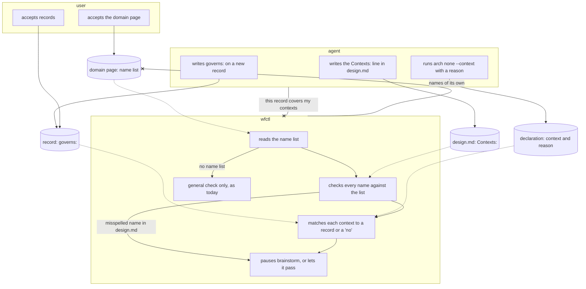

# Design checks read context names from the domain page

## Context

A bounded context is a distinct part of wfctl with its own terms, ideas, and
rules. For example, "install and drift" covers how wfctl installs its skills
into a project and reports when they fall out of date, while "session
continuity" carries work from one agent session to the next. The domain page
under `domain/` lists these contexts. On 2026-10-25, the user accepted
that list as the set of names records and branches can use.

Currently, the brainstorm step runs a general architecture check. This check
only verifies that the branch has changed any record under the arch root or
has declared that none is needed (using `wfctl arch none`). It does not check
whether the record matches the context the branch changed. As a result, a
branch can pass the check even if its record covers a different area than
what changed. This gap is described in #649.

#648 adds a similar check for level-3 software design records, and it has the
same limitation. This change ties both checks to contexts at the same time. If
only one of them were tied to contexts, the two checks would give different
answers about the same branch. As a result, this work starts once #648 merges.

## Direct baseline

The simplest option is to leave the general check as it is. With this approach,
the architecture check passes if the branch changes any record or includes a
`wfctl arch none` declaration, even if the record does not match the changed
context. The agent might try to match records to contexts, but nothing
requires it to.

This option requires no code changes. However, it does not fix the problem
where a record is about the wrong context, as described in #649. That's why
the decision below ties both checks to contexts.

## Decision

The design checks link records to the contexts changed by a branch. They get
the context names from the domain page.

1. The domain page begins with a fixed list of short names, one for each
   context and one for each outside party, like `install-and-drift` and
   `workmux`. wfctl reads this list every time it checks. It does not create
   its own names.
2. A branch lists the contexts it changes in one `Contexts:` line in
   `design.md`.
3. A record lists the contexts it governs in a `governs:` field.
4. If a context does not need a record, the branch marks "no" for each context
   separately, using `wfctl arch none --context <name> --reason "…"`. At level
   3, `wfctl step none` uses the same flag.
5. wfctl checks each name against the list. It pauses brainstorm until every
   context in the branch's `Contexts:` line has a record that governs it or a
   "no".

A repo without a name list works the same as it does now. The general check
remains. It finds branches with no answer, and the new check finds records
about the wrong context.

## Owns truth

The user chooses which contexts the repository has and what they are called.
Each repository's contexts come from its domain model, and the user accepts
them on the domain page. wfctl should not decide this, since it is used in
repositories with contexts it has never seen. The agent should not decide it
either, because it would be making up the names its own work is checked
against.

wfctl checks whether every context a branch changes has a record or a "no".
The agent should not answer this, since that would mean grading its own work.
An agent that wrote a record might think it covers the right context when it
does not. That's why wfctl runs the check.

The agent still decides which contexts a branch changes, which contexts a new
record governs, and the reason for each "no". wfctl cannot figure out the
first one yet. Today's modules overlap contexts, so wfctl cannot tell which
context a changed file belongs to. #544 would restructure the code into one
package per context. After that, wfctl can tell a branch's contexts from the
files it changes, and only the source of the branch's list will change.

## Boundary

A solid arrow is a direct action, and a dotted arrow is a file that wfctl
reads later. An arrow ending in x is a claim the other side does not accept.
With no name list on the domain page, wfctl runs only the general check.

## Considered

- Keep the general check, as described in the direct baseline. We did not
  choose this because a record about the wrong context can pass it, which is
  the gap #649 describes.
- Keep the name list in `wfctl.json`, next to `steps` and `review`. This
  approach is also valid, and `wfctl check config` would validate it
  automatically. We did not choose this because the names are found and
  accepted on the domain page, and `model-the-domain` writes that page.
  Someone would have to keep a second copy in `wfctl.json` in sync by hand. A
  rename on the domain page would then silently leave the check on the old
  name.
- Get a branch's contexts from the files it changes, starting now. We did not
  choose this because today's modules overlap contexts, so mapping paths to
  contexts would be another module list. #544 would make this possible by
  giving each context its own package. When #544 is done, only the source of
  the branch's list will change.

## Consequences

- The "no" answer applies to each context, not the whole branch. After #544,
  when wfctl finds a branch's contexts from its files, the list might include
  a context the agent did not consider. A branch-wide "no" would cover that
  context without anyone deciding it.
- If a name is misspelled in `design.md`, it appears as the reason brainstorm
  is paused, not when it is typed. If a record's `governs:` field has a name
  that is not on the list, `wfctl doctor` reports it because record validation
  happens there.
- `model-the-domain` creates the name list as part of its output, so a
  repository that has run the skill gets the per-context checks
  automatically.
- The PR template's "Moves a boundary?" section now has a `Contexts:` line.
  `opening-a-change` copies the list from `design.md` into this section, since
  a reviewer reading the PR does not see `design.md`.
- Level 3 decides the exact format of the name list, how wfctl reads it when
  there is more than one page under `domain/`, and where the parser and
  matcher are located.

## Log

- 2026-10-26  proposed    — #649 level 2, after the user approved the five
  level-1 states and this ownership split
- 2026-10-26  accepted    — Andre in the #649 brainstorm session, 2026-10-26: "Yes" to accepting the record after the writing-style rewrite
