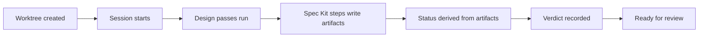
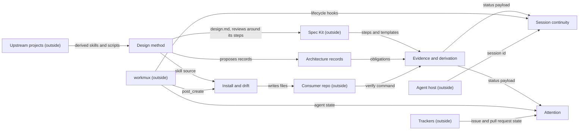

# wfctl domain model

State: accepted
Person who knows the domain: Andre Marin
Accepted: 2026-10-25, for #649. The user accepted the six bounded contexts and the parties outside wfctl as the names that records and branches can use. The items under "Recommendation" are not accepted, and each one becomes its own follow-up work.
Last checked against the code: 2026-09-29, 63345fe
Records this model draws on: `a-rule-is-expressed-as-a-check`, `install-modes`, `knowledge-placement`, `layer-model`, `level-4-owns-pattern-selection`, `no-hardcoded-agent`, `pipeline-state-is-one-payload`, `required-sections-are-wfctls`, `session-identity-from-named-agent`, `session-state-is-re-derived`, `supervisory-screen-owns-grouping`, `vendor-upstream-skills`, `wfctl-runs-the-verification`

## Domain vision statement

The vision statement and each capability's classification are in
[vision.md](vision.md), so this page doesn't repeat them. This page lists the
bounded contexts those capabilities belong to, which gives each architecture
record a stable name for what it governs.

## Decision frame

Business outcome: when an agent starts work on wfctl, it sees the architecture
records that apply to its change, and each record names what it governs.

Decision this round supports: which bounded contexts wfctl has, and how a record
names the context or boundary it governs.

In scope: wfctl's own contexts, the parties outside wfctl, a context map, and
where each of the 13 accepted records belongs.

Out of scope: the 41 proposed records, which are left as proposed on purpose,
the 31 level-3 records under `design/`, the record format, the `arch context`
command, and the `software-design-decisions` skill. Each of these changes in
follow-up work once this model is reviewed.

Constraints: contexts are drawn around language, rules, ownership, and rate of
change, not around modules. Andre rejected a module list as the scope because
it skips the modeling work instead of doing it.

## Evidence

| Row | Claim | Label | Source | Contradicts |
| --- | --- | --- | --- | --- |
| E1 | A feature is a piece of work or functionality, usually tied to an issue. An issue can be split into sub-issues, so features and issues aren't one-to-one. | stated | Andre, 2026-09-29 | |
| E2 | `wfctl doctor` reports that two spec directories claim issue 11. It also reports that issues 17 and 24 are each claimed by one directory and by a row in another feature's Issue Grouping Map. | observed | `wfctl doctor`, 2026-09-29 | |
| E3 | When the restart hook clears the pane, "the session" means the agent conversation. | stated | Andre, 2026-09-29 | |
| E4 | Work is done when it meets the agreed completion criteria, its tests are written and passing, and it's ready for review. A workflow step being done is a separate meaning. An issue is closed when its PR merges or it's superseded, and that isn't called done. | stated | Andre, 2026-09-29 | |
| E5 | Printing all 13 accepted records at the start of a session is noise. The user wants the records for the boundaries the branch changes, and a branch can change several. | stated | Andre, 2026-09-29 | |
| E6 | The design method skills wrap Spec Kit. The brainstorm runs before Spec Kit's steps, and a review runs before the spec is finalized, so the spec that reaches implementation is more detailed. Spec Kit is mostly unchanged, while the skills around it keep changing. | stated | Andre, 2026-09-29 | |
| E7 | Session continuity depends on workmux lifecycle hooks, both for creating a branch and for removing worktrees and stale specs. | stated | Andre, 2026-09-29 | |
| E8 | workmux may add a sidebar that could replace wfctl's dashboard. No design for it exists yet. | stated | Andre, 2026-09-29 | |
| E9 | The workmux `post_create` hook runs `wfctl install-skills` in a new worktree. | observed | `.workmux.yaml`, `post_create` | |
| E10 | Of the 13 accepted records, 8 govern a boundary between wfctl and an outside party, 2 govern a boundary between two of wfctl's own contexts, 1 governs a single context, and 2 apply to the whole repository. | inferred | the placement table on this page | |
| E11 | Pattern selection is meant to be language agnostic. It recognizes common problems that software development already has a documented pattern for. The Python catalog is one reference for it, not the goal. | stated | Andre, 2026-09-29 | `level-4-owns-pattern-selection` and the `python-pattern-selection` skill both name Python, and #416 tracks that every other language gets no catalog |
| E12 | The C++ design book is Iglberger's *C++ Software Design*. The level-3 record template cites it, and the level-4 skill doesn't. The level-4 skill cites Ayeva and Kasampalis, *Mastering Python Design Patterns*. | observed | `software-design-decisions/design-record-template.md`, `python-pattern-selection/SKILL.md` | |
| E13 | The large modules carry long comments that explain what the code does, which is a code smell. Today, only an agent can maintain the code. It should be restructured so it's readable without those comments and its interacting pieces are modular. | stated | Andre, 2026-09-29 | |
| E14 | `cli.py` has 7,420 of wfctl's 17,804 lines. The next largest are `_evidence.py` at 1,514, `_pipeline.py` at 1,120, and `_arch.py` at 983. | observed | `wc -l wfctl/*.py` at 63345fe | |
| E15 | The user asked whether the six contexts miss automated architecture checks, such as fitness functions that find violations or drift. | stated | Andre, 2026-09-29 | |
| E16 | The references already cite fitness functions from *Building Evolutionary Architectures*, and name `a-rule-is-expressed-as-a-check` as wfctl's version of that claim. No record in wfctl declares a fitness function that checks it. | observed | `docs/references/README.md`, "Keeping an architecture true while it changes" | |
| E17 | The six bounded contexts hold, and the user can't name a missing one. | stated | Andre, 2026-09-29 | |

## Scenarios

| Row | Actor intent | Command | Rules | Outcome and events | Alternatives and failures | Evidence rows |
| --- | --- | --- | --- | --- | --- | --- |
| S1 | An agent starts work on the restart hook and needs the decisions that apply to it. | start a session | The branch names an issue. The session shows the records for the boundaries the branch changes. | The session starts and shows the records that apply. | Today, all 13 records print whatever the branch changes, so the agent has to judge which ones are relevant. | E5 |
| S2 | A developer wants a new branch that's ready to work in. | create a worktree, then start a session | workmux creates the worktree, and its `post_create` hook installs the skills. The branch name includes the issue. | The worktree exists with the skills installed, and the session starts. | If the environment names no agent, the worktree gets `.agents/` and no `.claude/`, and the hook still exits 0. | E7, E9 |
| S3 | An agent finishes a spec and wants the step to count as done. | write the artifact, then verify | A step is done when its artifact is on disk in the expected shape. The agent never certifies its own completion. | The step reads done, and wfctl records a verification verdict against the tree it ran on. | A truncated write leaves a file that exists but lacks the content of a spec. | E4 |

### Behavior

Question answered: where does a piece of work get its meaning as it moves from a branch to a verdict?

What it shows: three outside parties act along one line; workmux at the start, Spec Kit in the middle, and the consumer repo at the verdict. wfctl derives the status in between.

## Ubiquitous Language

| Term | Context | Meaning | Example | Synonyms and forbidden meanings | Evidence |
| --- | --- | --- | --- | --- | --- |
| Feature | Evidence and derivation | A unit of work. The issue, the branch, and the spec directory are three ways to refer to it. | 541 is an issue, `541-bounded-contexts` is its branch, and its spec directory has the same name. | Not the issue alone, since one feature can group several issues. | E1, E2 |
| Session | Session continuity | An agent conversation. wfctl records the ID its caller supplies. | The restart hook clears the pane, and a new session continues from the handoff. | Not the tmux pane, and not the workmux worktree. | E3 |
| Done (work) | Evidence and derivation | The agreed criteria are met, the tests pass, and the work is ready for review. | A branch with its checks passing and a PR open. | Not closed. | E4 |
| Done (step) | Evidence and derivation | A workflow step has its evidence on disk in the expected shape. | `specify` reads done once `spec.md` has its required sections. | Not verified. | E4 |
| Closed | outside wfctl, at the tracker | The PR merged, or the issue was superseded. Only a person decides it. | Issue 541 closes when its PR merges. | Not done. | E4 |
| Verdict | Evidence and derivation | The recorded result of running the repo's verification command, along with the tree it ran against. | A passing run against a named commit. | Not an agent's statement that it finished. | `wfctl-runs-the-verification` |
| Step | Evidence and derivation | One stage of the pipeline, in one of four states: done, in progress, pending, or skipped. | `plan` is in progress. | Not a glyph, since the renderer chooses the glyph. | `pipeline-state-is-one-payload` |
| Handoff | Session continuity | The prose a session leaves for the next one. It's the one thing wfctl can't derive. | The Next Session TODO in the session summary. | Not session state that wfctl can recompute. | `session-state-is-re-derived` |
| Record | Architecture records | One durable architecture decision, with a status of proposed, accepted, superseded, rejected, or retired. | `install-modes`. | Not a design write-up, which belongs to one feature. | `knowledge-placement` |
| Pattern | Design method | A documented solution to a common problem, recognized at level 4 once the boundary above it is settled. It's language agnostic, and a catalog for one language is one reference for it. | Using a callable instead of writing a Strategy hierarchy. | Not "Python pattern", since the Python catalog is one reference. | E11, E12 |
| Fitness function | Architecture records | A check that objectively tests whether the code still follows one record. It relates to a record the way a unit test relates to a function (Ford, Parsons, Kua, and Sadalage, *Building Evolutionary Architectures*, ch. 2). | An import contract that fails when session code imports an evidence module's internals. | Not the verify command, which checks the change rather than a record. | `a-rule-is-expressed-as-a-check`, `docs/references/README.md` |
| Drift | Install and drift | The installed skills differ from the bundle the running wfctl ships. | `doctor` reporting that a skill is behind. | Not architectural drift, where the code moves away from a record. That's a failing fitness function, so the one word has two meanings. | `doctor`, E15 |
| Attention | Attention | A worktree needs a person, and the reason why. | A pipeline blocked on a manual step. | Not activity, since a busy agent isn't asking for anything. | `supervisory-screen-owns-grouping` |

## Subdomains

none — the classification is the table in [vision.md](vision.md), with one row per capability, and this page doesn't repeat it.

## Bounded Contexts

| Context | Purpose | Owned language and facts | Includes | Excludes | Owner |
| --- | --- | --- | --- | --- | --- |
| Evidence and derivation | Determine what the durable artifacts prove has happened. | Feature, step, done, verdict, the status payload | Status and gate derivation, and `verify` with its verdict | Running the steps, and deciding that a change is finished | wfctl |
| Architecture records | Keep decisions as obligations that later work is checked against. | Record, status, what a record governs | The records, `arch context`, `arch none`, and where each record belongs | Deciding whether a record is accepted, which a person decides | wfctl |
| Design method | Make the spec that reaches implementation more detailed and better thought through. | Design level, domain model, refactor pass | The skills for brainstorm, the four design levels, domain modeling, decompose, and the refactor pass | The Spec Kit steps, which it wraps without forking | wfctl |
| Install and drift | Put wfctl's skills and config into a project and report when they drift. | Layer, mirror, seed, manifest, drift | `install-skills`, `doctor`, the manifest | What the skills say, which belongs to the design method | wfctl |
| Session continuity | Carry work from one agent session to the next, which is the one part wfctl can't derive. | Session, handoff, restart | `/start-session`, `/end-session`, the restart hook | Where the pipeline stands, which it reads from evidence and derivation | wfctl |
| Attention | Show which worktree needs a person, and why. | Attention group, silent agent | The supervisory grouping and the dashboard that shows it | Deciding anything, since it only shows what the other contexts derive | wfctl |

Six parties outside wfctl each have their own language:

1. workmux, which manages the worktree lifecycle
2. the trackers (GitHub, Jira, Gerrit)
3. Spec Kit
4. the agent host
5. the consumer repository
6. the upstream projects that skills are derived from

### Context Map

Question answered: where do meaning, authority and translation change?

| Relationship | Upstream | Downstream | Team relationship | Translation owner | Mechanism | Consistency and failure |
| --- | --- | --- | --- | --- | --- | --- |
| R1 | Spec Kit | Evidence and derivation | Conformist, since Spec Kit is another project and wfctl has no say in its steps | wfctl, which pins section names and checks them against the template it ships (`required-sections-are-wfctls`) | files in the spec directory | If upstream renames a heading, a test in wfctl's own suite fails. |
| R2 | Design method | Spec Kit | wfctl adds a layer on top and doesn't fork (`vendor-upstream-skills`) | wfctl | `design.md` goes in before the steps, and reviews run around them | The next upstream pull reverts any edit inside a derived skill. |
| R3 | Design method | Architecture records | Same owner. Skills propose records, and a person accepts them. | wfctl | a proposed record written to the arch root | The branch that wrote a proposed record pauses until a person decides on it. |
| R4 | Architecture records | Evidence and derivation | Same owner | wfctl | `arch context` shows the accepted records in every session, and the "architecture accepted" fact reads the records this branch changed | Only the branch's own records can pause it, and a record counts as decided once it's accepted, superseded, rejected, or retired. |
| R5 | Design method | Install and drift | Same owner | wfctl | skill source under `wfctl/agents/`, shipped as package data | A skill fixed in source reaches a repo only when `install-skills` runs there. |
| R6 | Evidence and derivation | Session continuity | Same owner, and the payload is the published language | wfctl | one status payload (`pipeline-state-is-one-payload`) | wfctl re-derives session state on every read (`session-state-is-re-derived`). |
| R7 | Evidence and derivation | Attention | Same owner | wfctl | the same status payload | The screen shows what wfctl derives and decides nothing. |
| R8 | workmux | Session continuity | Conformist | wfctl | lifecycle hooks for creating branches and removing worktrees | A worktree made with bare `git worktree add` skips the hooks and registers no tmux session, and nothing reports it. |
| R9 | workmux | Install and drift | Conformist | wfctl | the `post_create` hook running `install-skills` | The hook exits 0 even when it installs less than intended. |
| R10 | workmux | Attention | Conformist | wfctl | agent state reported through hooks | An interrupted agent fires no hook, so it can show as working for days. |
| R11 | Agent host | Session continuity | Conformist | wfctl, which maps the agent named in `WFCTL_AGENT` to the variable its host exports and records the ID as given | an opaque session ID (`session-identity-from-named-agent`) | wfctl refuses a conversation that presents a different ID. If `WFCTL_SESSION_ID` is unset and wfctl has no variable for the agent, the holder reads `unknown`, and the gates behave as they did before session IDs existed. |
| R12 | Consumer repo | Evidence and derivation | Customer-supplier. The repo supplies the command, and wfctl records the verdict. | wfctl | a declared verification command | If no command is declared, wfctl reports the change as unverified. |
| R13 | Install and drift | Consumer repo | wfctl owns either a whole file or one entry in a file the repo owns (`install-modes`) | wfctl | the manifest and three install modes | Overwriting a repo's own file loses its work, so wfctl backs up what it overwrites. |
| R14 | Trackers | Attention | Conformist | wfctl | the tracker verbs | The screen has no facts about a PR until the tracker responds. |
| R15 | Upstream projects | Design method | Conformist. wfctl layers its changes over what it takes and doesn't fork (`vendor-upstream-skills`). | wfctl | derived skills, plus the shell scripts and templates the Spec Kit runtime is built from, each with attribution | The next upstream pull reverts an edit made inside a derived file, and no conflict shows up. |

## Invariants and Aggregates

none — this round ran at strategic depth, so tactical design wasn't run.

## Where the accepted records land

Andre reviewed the six contexts on 2026-09-29 and confirmed they hold. Each placement below is how this model reads the record, and no record was changed to fit it.

| Record | Governs | Why |
| --- | --- | --- |
| `pipeline-state-is-one-payload` | Evidence and derivation, toward Session continuity and Attention | Every view reads the same payload. |
| `session-state-is-re-derived` | Session continuity and Evidence and derivation | Session continuity reads its state from evidence and derivation, and keeps only the handoff. |
| `level-4-owns-pattern-selection` | inside Design method, between level 3 and level 4 | It decides which stage of the method handles pattern selection, and three skills have to follow it. `architecture-design` excludes "local pattern selection" by name, `software-design-decisions` leaves out a choice with no credible alternative, and `python-pattern-selection` is the skill it created. Several parts of one context share this rule, so it needs a record even though it crosses no context boundary. |
| `install-modes` | Install and drift and the consumer repo | Whether wfctl or the repo owns a file. |
| `layer-model` | Install and drift and the consumer repo | Source versus generated output. |
| `no-hardcoded-agent` | Install and drift and workmux | Committed hook config is shared across developers. |
| `required-sections-are-wfctls` | Evidence and derivation and Spec Kit | wfctl pins section names that upstream could rename. |
| `wfctl-runs-the-verification` | Evidence and derivation and the consumer repo | The repo declares the command, and wfctl records the verdict. |
| `session-identity-from-named-agent` | Session continuity and the agent host | The host supplies the ID, and wfctl knows which variable carries it. |
| `supervisory-screen-owns-grouping` | Attention, workmux, and the trackers | wfctl groups the worktrees, and the others supply facts. |
| `vendor-upstream-skills` | Design method and the upstream projects | Attribution and layering, not forking. |
| `a-rule-is-expressed-as-a-check` | the whole repository | It applies to every rule wfctl ships, whatever context the rule belongs to, and it's written as a repo-wide claim. |
| `knowledge-placement` | the whole repository | It covers where anyone writing in this repository puts a fact, and no context in wfctl reads or enforces it. The code cites it only to explain where a comment goes. |

Proposed records are left as proposed on purpose, so they aren't placed here.

## Implementation feedback

| Scenario or invariant | Code, test or spike | What it means for the model | Status |
| --- | --- | --- | --- |
| S2 | `.workmux.yaml` runs `install-skills` from `post_create`, and passes `--agent` only when `WFCTL_AGENT` is set. | R9 holds, and the case where no agent is set fails silently on that edge. | consistent |
| E1 | `wfctl doctor` reports features that claim the same issue. | The code has already met the case where one feature has several issues, and works around it with a grouping map. The language says a feature is a unit of work, and the issue is only one way to refer to it. | open |
| E10 | The placement table above. | Most records govern a boundary with an outside party. If records could name only wfctl's own contexts, 8 of the 13 would have nothing to name. | open |

## Recommendation: how a record declares what it governs

This is a recommendation, not a change. Each item becomes its own follow-up work
once the user has reviewed the contexts.

1. A record gets a `governs` field that lists every context or outside party it applies to. One name means the record is inside one context, two or more mean it governs a boundary, and `repository` means the whole repository. A record can name an outside party, since 8 of the 13 accepted records need one, and it can apply to more than two parties, as `supervisory-screen-owns-grouping` and `pipeline-state-is-one-payload` do. The names come from the Bounded Contexts table and the list of parties outside wfctl on this page. A name on neither list is a finding from `wfctl check`, in line with `a-rule-is-expressed-as-a-check`.
2. A branch lists the contexts it changes, in the same place it already says whether a boundary moves. `arch context` prints the records whose `governs` names one of those contexts first, and shows the rest as a count. With no list, it prints everything, as it does today. We considered mapping changed paths to contexts and didn't recommend it while the modules overlap contexts, because it's a module list under another name. Once item 6 gives each context its own package, the package a change modifies identifies its context, and wfctl can derive the list instead of the branch writing it.
3. The level-3 bar changes from "credible alternatives were weighed" to "a second module has to follow the choice". When only one module needs to know about a choice, its reasoning goes in that module's docstring, and it doesn't get a record. A level-3 record names the context it's in.
4. A level-2 record governs a boundary, or one context when several parts inside it have to follow the rule. `level-4-owns-pattern-selection` is the example among the 13. It governs the design method alone, and the three skills named in its placement follow it. A record that can name neither is reported as a finding, not quietly given a different scope.
5. A record can also govern the whole repository, when it applies to anyone writing in it rather than to one context. `knowledge-placement` and `a-rule-is-expressed-as-a-check` are the two examples. `arch context` prints a repository-wide record in every session.
6. Each context gets its own package in the code, and a check enforces the Context Map's relationships as import contracts. Today, `arch context` prints a record, and the brainstorm gate requires a decision on the boundary, but nothing checks afterward that the code keeps to it. With one package per context, a module in one context that imports another context's internals is visible in the code, so by `a-rule-is-expressed-as-a-check` it becomes a check. That restructure also addresses E13 and E14. Much of what the long comments explain is how the pieces depend on each other, and a package boundary makes that explicit.
7. A record can name the fitness function that checks it. wfctl runs that function the way it runs the verification command, and reads its verdict as evidence. This adds no context. The record declares the check, which belongs to Architecture records, and running it and recording the verdict belongs to Evidence and derivation. So it's a new mechanism on R4. The import contracts in item 6 are the first fitness functions wfctl's own code would have.

The follow-up issues for the record format, `arch context`, and the
`software-design-decisions` skill aren't filed yet. Whether the pipeline should
require a context map is tracked in #543, and the restructure in item 6 is
tracked in #544.

## Decisions

none — this round accepted no record. The 13 accepted records are placed above and aren't repeated here.

## Open questions

| Row | Question or conflict | Why it matters | Who can answer | Next evidence |
| --- | --- | --- | --- | --- |
| O1 | Does a workmux sidebar replace the dashboard, and if so, does Attention shrink or go away? | It changes what wfctl owns in the Attention context. | Andre | A design of the sidebar, or a trial of it. |
| O2 | Where does a branch list the contexts it changes? | `arch context` can't use `governs` without that list. | Andre | Answered by `domain-page-names-contexts`. A branch lists them in one `Contexts` line in `design.md`. |
| O3 | Which of a feature's issues claims the spec directory when the feature groups several issues? | The doctor notices in E2 show that the code and the language disagree. | Andre | Settle the language, then add a check. |
| O4 | The record and the skill say "Python pattern selection", while the goal is language agnostic. | The term has two meanings, and an agent working in another language gets no pattern guidance. | Andre | #416, which already tracks the gap. |
| O5 | Should one of the two meanings of "drift" get a new name? | Once fitness functions report architectural drift, `doctor`'s drift and a failing fitness function would share a word with different meanings. | Andre | A fitness function shipped under item 7. |

## What reopens this model

- workmux ships a sidebar that replaces wfctl's dashboard.
- Spec Kit changes its steps or template headings, which would make R1's upstream unstable.
- A branch changes a capability that has no context on this page.
- A record doesn't fit any boundary on the map.
- `resume`, or another command, keeps a position it didn't derive, which would move it out of the evidence and derivation context.
