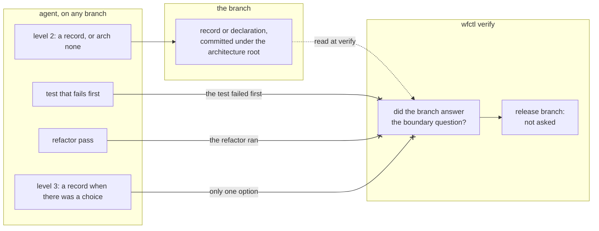

# Every change answers the boundary question, and wfctl checks that it did

## Context

wfctl asks whether a change draws or moves a boundary at one point only, which
is the design step of the Spec Kit pipeline. A change that skips the pipeline is
never asked. The project instructions allow that skip for bug fixes, copy edits,
and other small changes, and the agent decides which changes qualify. Over 90
days, more than half of this repository's roughly 530 commits were `fix:`,
`docs:`, or `chore:` changes, so most changes were never asked the question.

Being small doesn't mean a change moves no boundary. A bug fix in the worktree
guard changes what an agent may write in the `main` checkout. When nobody asks
the boundary question, the change still draws its boundary, but without a record,
and nobody reviews that decision.

Andre asked for four passes on every change, in this order:

1. Level 2 asks whether the change draws a boundary. It writes a record when the
   change does, and runs `wfctl arch none` when it doesn't.
2. Level 3 writes a design record for any structural choice that had more than
   one credible option.
3. The change is implemented with a test that fails before it.
4. A behavior-preserving refactor runs `clean-code`.

This record decides which of the four wfctl checks, and which stay instructions
to the agent.

## Direct baseline

Change the instructions and check nothing. The skills that tell a small change
to skip design would instead tell it to run the four passes. The design step
would go on asking the boundary question inside the pipeline, and nothing would
ask it anywhere else.

This is how the release note worked before wfctl checked it, and it is how the
"not for trivial changes" exclusion has worked in four skills since #161. An
instruction that nothing checks is followed when the agent remembers it.

## Decision

Every branch answers the boundary question, and `wfctl verify` fails a branch
that doesn't. A branch answers it the same way the design step already accepts:
it adds or edits a record under the architecture root, or it commits the
declaration `wfctl arch none` writes. The design step's own check is unchanged.

The other three passes stay instructions in the skill that runs them. wfctl
doesn't check whether level 3 found only one credible option, whether the test
failed first, or whether the refactor ran.

## Owns truth

A wfctl run over the branch owns whether the change answered the boundary
question. The agent shouldn't answer this, since it would be grading its own
work. The answer is a committed file, and wfctl can see whether the branch adds
one without trusting anything the agent says.

Nothing owns whether the other three passes ran. Each one would only leave the
agent's own statement that it ran. A file saying "level 3 had one option" or
"the refactor ran" is written by the same agent whose work it describes, so its
presence proves only that a file was written. The review panel isn't checked for
the same reason. These three stay instructions delivered when they apply, which
is what the rule for checks says to do with a rule nothing can observe.

The `arch none` declaration is also written by the agent, but it is different in
one way. It carries a reason, and a reviewer can read that reason and disagree
with it. The check proves the question was answered. The reviewer judges whether
the answer is right.

## Boundary

The dotted edge is a file wfctl reads later. Each crossed edge is a claim wfctl
doesn't accept, because only the agent could vouch for it. A level-3 record, when
one is written, is a review document and not evidence for this check.

## Considered

- **The direct baseline above.** It is free, and it is the arrangement that left
  most of this repository's changes unasked. We didn't choose it because the
  boundary answer is a committed file, and the rule for checks says a rule
  whose violation is visible in a file the work already produces is checked.
- **A step in `opening-a-change`, before the review panel.** Every change passes
  through it, which is why the panel moved there. We didn't choose it because it
  runs after the code exists. The value of the design passes is that they run
  before any code, so a step at that point can only check the answer and can't
  shape the design.
- **A refusal on `gh pr create` in the worktree guard.** #622 proposes this for
  unreviewed commits. We didn't choose it because it covers only an agent's
  command line, not CI or a person opening a pull request in the browser, and
  the definition of done already runs `wfctl verify` on every change.
- **A file for every pass, claimed with `wfctl step none`.** The handoff
  suggested this shape. `step none` records that a pipeline step doesn't apply,
  and only accepts a step that is declared. The three unchecked passes are how
  the work is done, not steps of their own, so declaring them would add pipeline
  rows for methods. It would also produce files only the agent vouches for.
- **Exempt documentation-only changes.** A copy edit has nothing to design. We
  didn't choose it because in this repository the skills are Markdown, and they
  decide what an agent may do. An exemption by file type would exempt the
  changes most likely to move a boundary. Answering with `arch none` costs one
  command.

## Consequences

The design step and `wfctl verify` read the same files, and they should share
one reader. If they don't, the list of folders that don't count as an answer
can grow in one and not the other.

Release branches are exempt, under the condition this repository already uses
for release notes: the branch name matches its version. The exemption is this
repository's to state, since wfctl doesn't know how a project names its
release branches.

Branches open when this ships fail `wfctl verify` until they commit an answer.

When the short pipeline in #382 lands, it requires a committed `arch none` to
take the short track. That is the same file this check reads, so the two don't
need separate readers.

## Log

- 2026-10-22  proposed    — #628: the boundary question is asked only inside
  the Spec Kit pipeline, and most changes skip the pipeline
