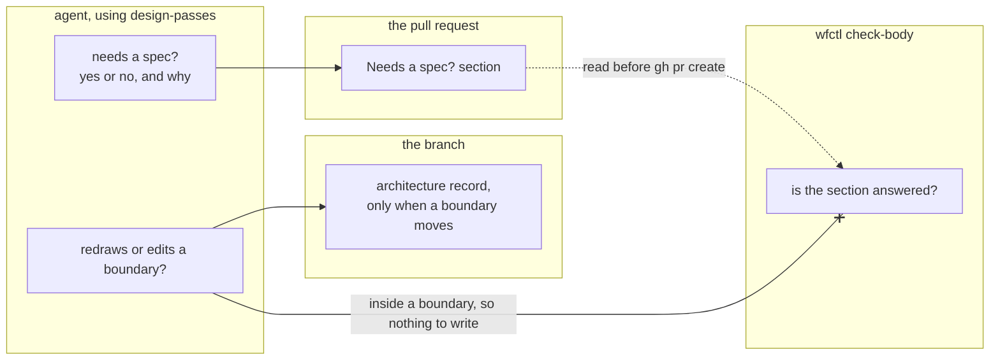

# Every change records in its PR whether it needs a spec

## Context

Right now, the agent decides on its own whether a change needs a full spec, and
nothing records that decision. The project instructions let bug fixes, copy
edits, and other small changes bypass the Spec Kit pipeline. Over the last 90
days, more than half of this repo's roughly 530 commits were `fix:`, `docs:`, or
`chore:` changes, so for most changes the reviewer never saw this decision.

Andre asked for four passes on every change that bypasses Spec Kit: the boundary
question at level 2, a design record at level 3 when a structural choice had
more than one credible option, a test that fails before the change, and a
behavior-preserving refactor. The `design-passes` skill runs them, and
`628-design-passes-own-skill` covers where the skill lives.

It's easy to treat these as one question, so this record keeps them apart:

1. Does the change redraw or edit a boundary? Working inside an existing
   boundary needs nothing written. Redrawing or editing one may need an
   architecture record.
2. Does the change need a full spec? Touching a boundary doesn't answer this.
   Andre decides where the line is, and he hasn't decided yet.

## Direct baseline

Ask both questions in the `design-passes` skill and record nothing. The agent
answers in its head, and the reviewer sees only the code.

This is how the "not for trivial changes" exclusion has worked in four skills
since #161. Since the decision isn't written down, a reviewer can't check or
challenge it.

## Decision

Every change answers whether it needs a spec, as a yes or no and a one-sentence
reason. The `design-passes` skill asks the question first, before any code, so
the answer shapes the work instead of describing it afterwards.

The answer is written down in one place, the PR. The PR template has a "Needs a
spec?" section, and `wfctl check-body` fails a PR body that leaves it empty,
writes N/A, or gives a yes or no with no reason. `628-spec-answer-in-pr-body`
covers how the check works.

The answer describes one change, not the system, so it lives with the change.
The architecture folder only gains a record when the architecture changes.

The boundary question gets its own answer. A change inside an existing boundary
writes nothing for it. A change that redraws or edits a boundary may add an
architecture record. `wfctl verify` doesn't require an `arch none` declaration
on every branch, since that would add a file to every one-line fix. The Spec Kit
design step still requires a record or a declaration, same as today.

## Owns truth

The PR owns the answer a reviewer reads, and `wfctl check-body` checks that the
answer is there. We shouldn't take the agent's word that it answered, since it
would be grading its own work. The section is visible in the PR body, so wfctl
can check it without relying on anything the agent says.

The check confirms that the section has an answer and a reason, not that the
reason is right. A bare yes or no fails, because it leaves no record of why the
decision was made, and the reason is what lets a reviewer catch an answer that
contradicts the diff. A reviewer who reads "no, the fix changes one check inside
the worktree guard" can compare that with the diff and disagree with it. The
review panel's disposition table is different. It was removed from `check-body`
because it only claimed that a panel ran, and wfctl can't verify that from text.

## Boundary

The dotted edge is a file wfctl reads before the PR is opened. The crossed edge
is something `check-body` doesn't read: the boundary answer, because working
inside a boundary leaves nothing to check.

## Considered

- **The direct baseline above.** It's free, but the reviewer never sees the
  decision. We didn't choose it because the answer fits in one sentence, and a
  PR section makes it reviewable at almost no cost.
- **`wfctl verify` requiring a committed `arch none` or record on every branch.**
  The first draft of this record proposed this. We didn't choose it because it
  adds a file to every one-line fix. It also asks the wrong question, since a
  change inside an existing boundary has nothing to declare.
- **One question: touching a boundary means needing a spec.** It's simpler,
  with one answer instead of two. We didn't choose it because a change that
  touches a boundary may need an architecture record but not a full spec.
  Andre hasn't decided where the spec line falls, and merging the questions
  would decide it for him.
- **A second copy before any code, as a `Needs-spec:` trailer on the branch's
  first commit.** The previous draft of this record did this
  (`628-early-answer-in-commit-trailer`). We didn't choose it because nothing
  reads the trailer, and git silently ignores one that isn't in the commit
  message's last paragraph. What shapes the decision is the skill asking the
  question before any code, and that happens whether or not the answer is
  stored.
- **A file in the feature's spec folder, written by a wfctl command.** wfctl
  could check it, and the spec store keeps it after the worktree is removed. We
  didn't choose it because the answer describes one change, and the PR already
  keeps it where the reviewer reads it.
- **A step in the `opening-a-change` skill.** Andre decided against it because
  it runs after the code is written.

## Consequences

The PR template gets a section, and every PR in this repo fills it in.
Release PRs come from the release script and never run through `check-body`, so
they don't need an exemption.

Andre hasn't decided where the spec line falls yet. Until he does, each answer
gives its own reason, and the reviewer judges it.

Nothing checks that the question was asked before any code. An agent that
skipped it can still answer "No" when the PR opens, and `check-body` passes it.
The risk is a small fix that makes a design decision nobody looked at, such as
having the worktree guard read a new config file. If a reviewer catches it, the
code may have to change, not only the paperwork.

The review panel reduces that risk, but doesn't close it. The panel runs before
the PR description is written, so no reviewer sees the answer. Instead, each
reviewer reads only the diff and reports any new stored state, setting the code
reads, command, or boundary that no record or spec on the change covers. The
author writes the answer after reading those findings, and still decides what
to do with each one. In an attended run, the person sees the findings in the
panel's table before the PR opens. In an unattended run nobody reads the table,
so a finding the author dismisses stays in the reviewer's report and goes no
further. The panel also can't show that the question came first.

Right now, the short pipeline in #382 requires a committed `arch none` to choose
the short track. This record drops that file from every fix, so #382's
requirement needs a second look. #635 covers where per-branch answers such as
`arch none` belong, and #382 depends on its answer.

## Log

- 2026-10-22  proposed    — #628: whether a change needs a spec is decided by
  the agent alone and recorded nowhere
- 2026-10-22  proposed    — revised before review: Andre asked for the answer to
  be recorded twice, early and in the pull request, instead of an `arch none`
  file on every branch, and for the boundary and spec questions to stay apart
- 2026-10-23  proposed    — revised after plan review: the answer is recorded
  only in the PR. The early trailer was dropped because nothing read it and git
  ignores a misplaced one without warning
- 2026-10-23  proposed    — revised in the plan walkthrough: a bare yes or no
  fails the check, and the review panel reports a design decision the diff
  makes that nothing on the change covers
