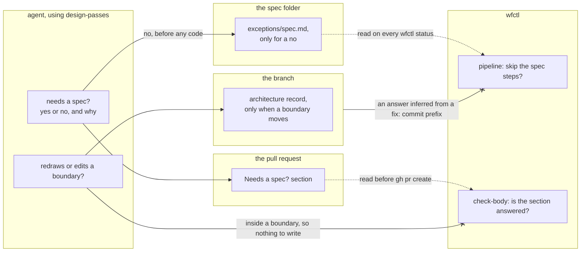

# Every change records whether it needs a spec

## Context

Right now, the agent decides on its own whether a change needs a full spec, and
nothing records that decision. The project instructions let bug fixes, copy
edits, and other small changes bypass the Spec Kit pipeline. Over the last 90
days, more than half of this repo's roughly 530 commits were `fix:`, `docs:`, or
`chore:` changes, so for most changes the reviewer never saw this decision.

Andre asked for four passes on every change that bypasses Spec Kit: the boundary
question at level 2, a design record at level 3 when a structural choice had
more than one credible option, a test that fails before the change, and a
behavior-preserving refactor. The `design-passes` skill runs them, and
`628-design-passes-own-skill` covers where the skill lives.

It's easy to treat these as one question, so this record keeps them apart:

1. Does the change redraw or edit a boundary? Working inside an existing
   boundary needs nothing written. Redrawing or editing one may need an
   architecture record.
2. Does the change need a full spec? Three spec questions decide it, and step 1 of the
   `design-passes` skill lays each one out with its source. The change needs a
   spec when it alters behavior or adds persistent state, makes an
   architecturally significant decision that is expensive to reverse, or moves
   ownership.

The second question's tests include moving a boundary, so a yes to the first is
also a yes to the second. They stay two questions because the PR answers each
under its own heading, and a change that needs a spec can still move no
boundary.

## Direct baseline

Ask both questions in the `design-passes` skill and record nothing. The agent
answers in its head, and the reviewer sees only the code.

This is how the "not for trivial changes" exclusion has worked in four skills
since #161. Since the decision isn't written down, a reviewer can't check or
challenge it.

## Decision

Every change answers whether it needs a spec, as a yes or no with a reason that
answers each of three spec questions by name. The `design-passes` skill asks the question first,
before any code, so the answer shapes the work instead of describing it
afterwards.

A "no" is written down twice. First, before any code, the agent records the
"no" and its reason using `wfctl spec none --reason "…"`. This writes
`exceptions/spec.md` in the branch's spec folder. The pipeline reads that file
and routes the branch straight to `implement`, then `review`, skipping the spec
steps. A "yes" writes no file, since the spec steps the branch then runs are
its evidence.

Second, the PR records the answer, whether yes or no. The PR template has a
"Needs a spec?" section, and `wfctl check-body` fails a PR body that leaves it
empty, writes N/A, or gives a yes or no with no reason.
`628-spec-answer-in-pr-body` covers how the check works.

The answer describes one change, not the system, so it lives with the change.
The architecture folder only gains a record when the architecture changes.

The boundary question gets its own answer. A change inside an existing boundary
writes nothing for it. A change that redraws or edits a boundary may add an
architecture record. `wfctl verify` doesn't require an `arch none` declaration
on every branch, since that would add a file to every one-line fix. The Spec Kit
design step still requires a record or a declaration, same as today.

## Owns truth

The PR owns the answer a reviewer reads, and `wfctl check-body` checks that the
answer is there. We shouldn't take the agent's word that it answered, since it
would be grading its own work. The section is visible in the PR body, so wfctl
can check it without relying on anything the agent says.

The pipeline reads the "no" from the spec folder because it has to route the
branch before any code exists, when there's no PR body yet. wfctl doesn't infer
the answer from the branch name or a `fix:` commit prefix. A branch with no
recorded answer runs the full pipeline, since wfctl can't tell whether a missing
answer means the change needs no spec or nobody asked
(`an-absent-artifact-is-claimed-not-inferred.md`).

The check confirms that the section has an answer and a reason, not that the
reason is right. A bare yes or no fails, because it leaves no record of why the
decision was made, and the reason is what lets a reviewer catch an answer that
contradicts the diff. A reviewer who reads "no, the fix changes one check inside
the worktree guard" can compare that with the diff and disagree with it. The
review panel's disposition table is different. It was removed from `check-body`
because it only claimed that a panel ran, and wfctl can't verify that from text.

## Boundary

Dotted edges are files wfctl reads later. Crossed edges are what wfctl doesn't
read. Working inside a boundary leaves nothing to check, so wfctl skips the
boundary answer. It also doesn't infer the spec answer from the branch.

## Considered

- **The direct baseline above.** It's free, but the reviewer never sees the
  decision. We didn't choose it because the answer fits in one sentence, and a
  PR section makes it reviewable at almost no cost.
- **`wfctl verify` requiring a committed `arch none` or record on every branch.**
  The first draft of this record proposed this. We didn't choose it because it
  adds a file to every one-line fix. It also asks the wrong question, since a
  change inside an existing boundary has nothing to declare.
- **One question: touching a boundary means needing a spec.** It's simpler,
  with one answer instead of two. An earlier draft didn't choose it because a
  change that touched a boundary might need an architecture record but not a
  full spec, and Andre hadn't decided where the spec line falls. #679 decided
  the line with three spec questions, and moving a boundary is a yes to one of them, so this
  record now holds that a boundary move needs a spec. We still didn't merge the
  questions, because a spec can be needed for a change that moves no boundary.
- **Leave the line to each answer's own reason.** The earlier draft did this,
  and the reviewer judged every reason on its own terms. We didn't keep it
  because the agent had no test to apply. `design-levels` already named the
  line in one sentence, and `design-passes` said wfctl doesn't set it, so the
  two skills disagreed.
- **A second copy before any code, as a `Needs-spec:` trailer on the branch's
  first commit.** The previous draft of this record did this
  (`628-early-answer-in-commit-trailer`). We didn't choose it because nothing
  reads the trailer, and git silently ignores one that isn't in the commit
  message's last paragraph. What shapes the decision is the skill asking the
  question before any code, and that happens whether or not the answer is
  stored.
- **The PR as the only place the answer is written.** An earlier draft of this
  record chose this. It turned down a file in the spec folder because the PR
  already keeps the answer where the reviewer reads it. That changed with #679,
  since the pipeline now has a review step after `implement`. A branch that
  needs no spec has to reach that step without running brainstorm first. The PR
  body doesn't exist until the end, so the pipeline needs the answer somewhere
  it can read before any code.
- **Infer the answer from the branch name or its commit prefixes, such as `fix:`
  or `docs:`.** This
  writes no file. We didn't choose it because a prefix describes the commit,
  not whether the commit makes a design decision. The agent also picks the
  prefix.
- **A step in the `opening-a-change` skill.** Andre decided against it because
  it runs after the code is written.

## Consequences

The PR template gets a section, and every PR in this repo fills it in.
Release PRs come from the release script and never run through `check-body`, so
they don't need an exemption.

Each answer answers the three spec questions by name, so a reviewer checks the reason against the
diff one question at a time. A no-spec change that moves a boundary is now a
contradiction the reviewer reports, where it used to be an architecture record
written without a spec.

Nothing checks that the question was asked before any code. An agent that
skipped it can write `exceptions/spec.md` after the code, or answer "No" only
when the PR opens, and `check-body` passes it. However, the file makes a
skipped question visible earlier. Until the file exists, `wfctl status` points
the branch at brainstorm. The risk is a small fix that makes a design decision
nobody looked at, such as having the worktree guard read a new config file. If
a reviewer finds it, the code may have to change, not only the paperwork.

The review panel reduces that risk, but doesn't close it. The panel runs before
the PR description is written, so no reviewer sees the answer. Instead, each
reviewer reads only the diff and reports any new stored state, setting the code
reads, command, or boundary that no record or spec on the change covers. The
author writes the answer after reading those findings, and still decides what
to do with each one. In an attended run, the person sees the findings in the
panel's table before the PR opens. In an unattended run nobody reads the table,
so a finding the author dismisses stays in the reviewer's report and goes no
further. The panel also can't show that the question came first.

Right now, the short pipeline in #382 requires a committed `arch none` to choose
the short track. This record drops that file from every fix, so #382's
requirement needs a second look. #635 covers where per-branch answers such as
`arch none` belong, and #382 depends on its answer.

## Log

- 2026-10-22  proposed    — #628: whether a change needs a spec is decided by
  the agent alone and recorded nowhere
- 2026-10-22  proposed    — revised before review: Andre asked for the answer to
  be recorded twice, early and in the pull request, instead of an `arch none`
  file on every branch, and for the boundary and spec questions to stay apart
- 2026-10-23  proposed    — revised after plan review: the answer is recorded
  only in the PR. The early trailer was dropped because nothing read it and git
  ignores a misplaced one without warning
- 2026-10-23  proposed    — revised in the plan walkthrough: a bare yes or no
  fails the check, and the review panel reports a design decision the diff
  makes that nothing on the change covers
- 2026-10-31  proposed    — revised for #679: a "no" is also written to the
  spec folder before any code, so the pipeline can route the branch to
  implement and review without the PR body
- 2026-10-31  proposed    — revised for #679: three tests decide whether a
  change needs a spec, and a change that moves a boundary needs one
- 2026-10-31  accepted    — Andre in the #679 session, 2026-10-31: chose the recorded no-spec file ('go with your recommendation, keep it in this branch'), then accepted it after the plan review fixes
