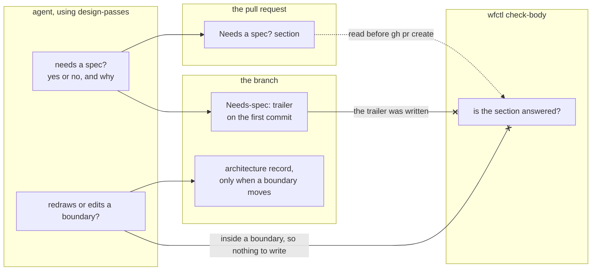

# Every change records whether it needs a spec, once before coding and once in the PR

## Context

Right now, the agent decides on its own whether a change needs a full spec, and
nothing records that decision. The project instructions let bug fixes, copy
edits, and other small changes bypass the Spec Kit pipeline. Over the last 90
days, more than half of this repo's roughly 530 commits were `fix:`, `docs:`, or
`chore:` changes, so for most changes the reviewer never saw this decision.

Andre asked for four passes on every change that bypasses Spec Kit: the boundary
question at level 2, a design record at level 3 when a structural choice had
more than one credible option, a test that fails before the change, and a
behavior-preserving refactor. The `design-passes` skill runs them, and
`628-design-passes-own-skill` covers where the skill lives.

It's easy to treat these as one question, so this record keeps them apart:

1. Does the change redraw or edit a boundary? Working inside an existing
   boundary needs nothing written. Redrawing or editing one may need an
   architecture record.
2. Does the change need a full spec? Touching a boundary doesn't answer this.
   Andre decides where the line is, and he hasn't decided yet.

## Direct baseline

Ask both questions in the `design-passes` skill and record nothing. The agent
answers in its head, and the reviewer sees only the code.

This is how the "not for trivial changes" exclusion has worked in four skills
since #161. Since the decision isn't written down, a reviewer can't check or
challenge it.

## Decision

Every change records whether it needs a spec, as a yes or no and a one-sentence
reason, in two places:

1. **Early, before any code.** The `design-passes` skill asks the question first,
   and the answer goes in a `Needs-spec:` trailer on the branch's first commit.
   `628-early-answer-in-commit-trailer` covers that choice.
2. **Late, in the PR.** The PR template has a "Needs a spec?" section, and
   `wfctl check-body` fails a PR body that leaves it empty or N/A.
   `628-spec-answer-in-pr-body` covers how the check works.

The early answer is where the decision gets made. The late answer catches a
change that skipped the early step, so it's the one wfctl checks.

The boundary question gets its own answer. A change inside an existing boundary
writes nothing for it. A change that redraws or edits a boundary may add an
architecture record. `wfctl verify` doesn't require an `arch none` declaration
on every branch, since that would add a file to every one-line fix. The Spec Kit
design step still requires a record or a declaration, same as today.

## Owns truth

The PR owns the answer a reviewer reads, and `wfctl check-body` checks that the
answer is there. We shouldn't take the agent's word that it answered, since it
would be grading its own work. The section is visible in the PR body, so wfctl
can check it without relying on anything the agent says.

The check only confirms the section has an answer, not that the answer is
right. That's enough here, since the reviewer judges the answer itself. A
reviewer who reads "no, the fix changes one check inside the worktree guard" can
disagree with it. The review panel's disposition table is different. It was
removed from `check-body` because it only claimed that a panel ran, and wfctl
can't verify that from text.

wfctl doesn't check the early trailer. Adding a missing trailer means rewriting
branch history, and the PR section already guarantees an answer before the PR
is opened.

## Boundary

The dotted edge is a file wfctl reads before the PR is opened. Each crossed edge
is something `check-body` doesn't read: the trailer, because the PR section is
its backstop, and the boundary answer, because working inside a boundary leaves
nothing to check.

## Considered

- **The direct baseline above.** It's free, but the reviewer never sees the
  decision. We didn't choose it because the answer fits in one sentence, and a
  PR section makes it reviewable at almost no cost.
- **`wfctl verify` requiring a committed `arch none` or record on every branch.**
  The first draft of this record proposed this. We didn't choose it because it
  adds a file to every one-line fix. It also asks the wrong question, since a
  change inside an existing boundary has nothing to declare.
- **One question: touching a boundary means needing a spec.** It's simpler,
  with one answer instead of two. We didn't choose it because a change that
  touches a boundary may need an architecture record but not a full spec.
  Andre hasn't decided where the spec line falls, and merging the questions
  would decide it for him.
- **Only the early answer.** It records the decision where it's made. We didn't
  choose it alone because skipping the early step leaves no answer, and
  nothing catches that before the PR is opened.
- **Only the late answer.** The check works the same way. We didn't choose it
  alone because it's written after the code, so it records the decision instead
  of shaping it.
- **A step in the `opening-a-change` skill.** Andre decided against it because
  it runs after the code is written.

## Consequences

The PR template gets a section, and every PR in this repo fills it in.
Release PRs come from the release script and never run through `check-body`, so
they don't need an exemption.

Andre hasn't decided where the spec line falls yet. Until he does, each answer
gives its own reason, and the reviewer judges it.

Right now, the short pipeline in #382 requires a committed `arch none` to choose
the short track. This record drops that file from every fix, so #382's
requirement needs a second look. One option is to let the `Needs-spec:` trailer
pick the track.

## Log

- 2026-10-22  proposed    — #628: whether a change needs a spec is decided by
  the agent alone and recorded nowhere
- 2026-10-22  proposed    — revised before review: Andre asked for the answer to
  be recorded twice, early and in the pull request, instead of an `arch none`
  file on every branch, and for the boundary and spec questions to stay apart
