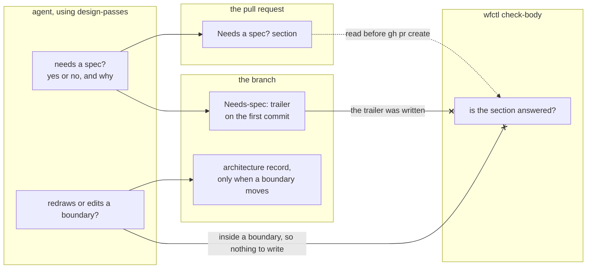

# Every change records whether it needs a spec, once before the code and once in the pull request

## Context

Currently, the agent decides alone whether a change needs a formal spec, and
nothing records the decision. The project instructions let bug fixes, copy
edits, and other small changes skip the Spec Kit pipeline. Over 90 days, more
than half of this repository's roughly 530 commits were `fix:`, `docs:`, or
`chore:` changes, so most changes made this decision without a trace a reviewer
could read.

Andre asked for four passes on every change that skips Spec Kit: the boundary
question at level 2, a design record at level 3 when a structural choice had
more than one credible option, a test that fails before the change, and a
behavior-preserving refactor. The `design-passes` skill runs them, and
`628-design-passes-own-skill` decides where it lives.

Two questions are easy to merge into one, and this record keeps them apart:

1. Does the change redraw or edit a boundary? Working inside an existing
   boundary needs nothing written. Redrawing or editing one may need an
   architecture record.
2. Does the change need a full spec? Touching a boundary doesn't settle this.
   Where the line falls is Andre's decision and is still open.

## Direct baseline

Ask both questions in the `design-passes` skill and record nothing. The agent
answers in its own head, and the reviewer sees only the code.

This is how the "not for trivial changes" exclusion has worked in four skills
since #161. A reviewer can't disagree with a decision nobody wrote down.

## Decision

Every change records whether it needs a spec, with yes or no and one sentence of
reasoning, in two places:

1. **Early, before any code.** The `design-passes` skill asks the question first,
   and the answer goes in a `Needs-spec:` trailer on the branch's first commit.
   `628-early-answer-in-commit-trailer` decides that location.
2. **Late, in the pull request.** The template carries a "Needs a spec?" section,
   and `wfctl check-body` fails a body whose section is empty or N/A.
   `628-spec-answer-in-pr-body` decides how the check works.

The early answer is where the decision is made. The late answer is the backstop
for a change whose early step was skipped, so it is the one wfctl checks.

The boundary question keeps its own answer. A change inside an existing boundary
writes nothing for it. A change that redraws or edits a boundary may write an
architecture record. `wfctl verify` doesn't require an `arch none` declaration on
every branch, since that would add a file to every one-line fix. The Spec Kit
design step still requires a record or a declaration, as it does today.

## Owns truth

The pull request owns the answer a reviewer reads, and `wfctl check-body` checks
that the answer is there. The agent shouldn't be trusted to have answered, since
that would mean grading its own work. The section is visible in the body, so
wfctl can check it without trusting anything the agent says.

The check sees only that the section holds an answer, not that the answer is
right. That is enough here, because the answer is the thing under review. A
reviewer reads "no, the fix changes one check inside the worktree guard" and can
disagree with it. The review panel's disposition table is different. It was
removed from `check-body` because the table only said that a panel ran, and
prose can't prove that.

The early trailer isn't checked. A missing trailer can be added only by
rewriting the branch's history, and the late section already guarantees an
answer before the pull request opens.

## Boundary

The dotted edge is a file wfctl reads before the pull request opens. Each crossed
edge is something `check-body` doesn't read: the trailer, because the section is
the backstop for it, and the boundary answer, because working inside a boundary
leaves nothing to check.

## Considered

- **The direct baseline above.** It is free, and it leaves the decision
  invisible to the reviewer. We didn't choose it because the answer fits in one
  sentence, and a pull request section makes it reviewable at almost no cost.
- **`wfctl verify` requiring a committed `arch none` or record on every branch.**
  This was the first draft of this record. We didn't choose it because it adds a
  file to every one-line fix. It also asks the wrong question, since a change
  inside an existing boundary has nothing to declare.
- **One question: a boundary touched means a spec is needed.** It is simpler,
  with one answer instead of two. We didn't choose it because touching a
  boundary may need an architecture record without needing a full spec. Andre
  hasn't decided where the spec line falls, and merging the questions would
  decide it for him.
- **Only the early answer.** It records the decision where it is made. We didn't
  choose it alone because a skipped early step then leaves no answer, and nothing
  would notice before the pull request opens.
- **Only the late answer.** The check works the same way. We didn't choose it
  alone because it is written after the code exists, so it records the decision
  rather than shaping it.
- **A step in `opening-a-change`.** Andre decided against it, because it runs
  after the code exists.

## Consequences

The pull request template gains a section, and every pull request in this
repository answers it. A release pull request is written by the release script
and never runs through `check-body`, so it needs no exemption.

Where the spec line falls is still open. Until Andre decides, each answer gives
its own reason, and the reviewer judges it.

The short pipeline in #382 currently requires a committed `arch none` to choose
the short track. That is the file this record stops requiring on every fix, so
#382's requirement needs revisiting. The `Needs-spec:` trailer is one candidate
for what chooses the track.

## Log

- 2026-10-22  proposed    — #628: whether a change needs a spec is decided by
  the agent alone and recorded nowhere
- 2026-10-22  proposed    — revised before review: Andre asked for the answer to
  be recorded twice, early and in the pull request, instead of an `arch none`
  file on every branch, and for the boundary and spec questions to stay apart
