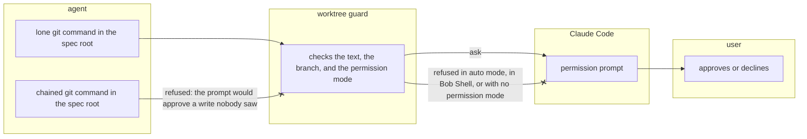

# The worktree guard asks before git commands in the spec root

## Decision

When the spec root is a worktree of its own, such as a `specs-trunk` checkout
beside the project, the worktree guard asks the user before a git command that
syncs the store's branch with `origin`, instead of refusing it. Claude Code
shows the command and runs it only after the user approves. `git add` and `git
commit` keep running with no prompt, as they do today.

The guard asks only when all four of these hold:

1. The command is one plain `git -C <spec-root> <verb> …`, with nothing chained
   to it, no redirect, and nothing the shell rewrites, such as `$` or a glob.
2. The verb and every word after it are on this list:
   1. `push`, with `origin`, and a force push only as `--force-with-lease
      --force-if-includes` together.
   2. `pull`, with `origin`, `--rebase`, or `--ff-only`.
   3. `fetch`, with `origin` or `--prune`.
   4. `rebase`, with the spec root's own branch on `origin` as the upstream,
      such as `origin/specs-trunk`, or `--continue`, `--abort`, or `--skip`.
3. git commits in that folder on a branch of the store's own, the same test the
   guard already applies before it allows a commit there.
4. Claude Code runs the command, in default, accept-edits, or plan mode.

In every other case, the guard refuses the command as it does today.

The list is short because every feature shares the store's one branch. Only
the `main` checkout should act on other features' work, and a feature session
shouldn't. Any verb or argument the list leaves out could act on another
worktree or another branch, or run a command of its own, and the prompt
wouldn't show that. For example, `git -C <spec-root> worktree remove --force
peer` deletes another feature's worktree, and `rebase -x '<command>'` runs a
shell command between commits.

## Boundary

The crossed edges are the forms the guard refuses. A chained command never
reaches the prompt, since part of it could write into another worktree. A host
that won't ask gets the refusal instead of the prompt.

## Context

Previously, the guard allowed only `git add` and `git commit` in a spec root
that is a worktree of its own, and refused every other git verb there, such as
a push or a rebase. pfms keeps its specs in `/workspaces/pfms-specs`, a
worktree of the pfms repository on `specs-trunk`, so every push of its specs
was refused.

pfms worked around this with a wrapper script, `worktree-guard-ask.sh`,
registered in place of `wfctl hook worktree-guard`. The wrapper runs the guard
and turns a refusal of a lone `git -C /workspaces/pfms-specs …` command into an
`ask`. Any other refusal passes through.

Currently, `install-skills` and `doctor` find the guard by its command. They
don't find `wfctl hook worktree-guard` in pfms's settings file, so both report
the guard as missing, and every `wm add` in pfms asks the user to add it again.
Saying yes runs the guard twice on every Bash call, and the plain copy refuses
the commands the wrapper exists to turn into a prompt. This is #882.

## Threat model

### Defends against

An agent that runs a git command in the spec root that changes the store's
history or its remote, such as a push, a rebase, or a reset, without the user
agreeing to that run. The agent may chain the command to another one, wrap it,
or spell it so the guard reads one folder and git works in another. It isn't
trying to hide what it runs.

The prompt is the check for this agent. The guard's job is to make sure a
command reaches the prompt only when the text the user approves is the whole
of what runs. That's why a chained command, a redirect, a `$`, or a second git
option before the verb gets the refusal instead. It's also why only the four
verbs in the Decision ask. A verb such as `worktree` or `update-ref` acts on
another worktree or branch under a command that names only the spec root. An
option such as `rebase -x` or `fetch --upload-pack` runs a command the guard
can't read. And a git alias runs whatever the shared config says, which the
agent can set from its own worktree with no prompt.

The guard doesn't defend against a git hook in the store, since the command's
text can't show what it runs. "Accepts" covers that.

The prompting modes follow `prompt-approves-person-commands.md`. In auto mode,
Claude Code ran a command matching an `ask` rule with no prompt, so the guard
asks only in `default`, `acceptEdits`, or `plan` mode. In any other mode, in
Bob Shell, or when the payload names no mode, the guard refuses, and the
refusal says which mode would ask. pfms's wrapper asked in every mode, so this
is stricter than what pfms runs today.

### Must keep catching

The guard refuses each of these. `/repo-specs` is a spec root on `specs-trunk`,
and `/repo/wt/peer` is another feature's worktree.

1. Chained after the git command: `git -C /repo-specs push && true`
2. Chained before a write into a peer: `git -C /repo-specs push; rm -rf /repo/wt/peer/src`
3. Piped into another command: `git -C /repo-specs push | cat`
4. With a redirect into a peer: `git -C /repo-specs push > /repo/wt/peer/out`
5. A variable for the verb: `git -C /repo-specs $VERB`
6. A command substitution in an argument: `git -C /repo-specs push $(echo origin)`
7. Another git option before the verb: `git -C /repo-specs -c core.hooksPath=/tmp/h push`
8. A second `-C` that moves git into a peer: `git -C /repo-specs -C /repo/wt/peer reset --hard`
9. A path into a peer worktree: `git -C /repo-specs mv a /repo/wt/peer/b`
10. A relative path that climbs out of the store: `git -C /repo-specs mv a ../repo/wt/peer/b`
11. A path naming `.git`: `git -C /repo-specs rm -r .git`
12. A spec folder inside the main checkout, where git works on the main checkout's branch: `git -C /repo/specs reset --hard`
13. A git command in a peer worktree rather than the spec root: `git -C /repo/wt/peer push`
14. The lone command in auto mode: `git -C /repo-specs push`
15. The lone command in Bob Shell, which can't ask: `git -C /repo-specs push`
16. The lone command from a payload that names no permission mode: `git -C /repo-specs push`
17. A git notes write in the store, which the review check refuses first: `git -C /repo-specs notes add -m x`
18. A push of a notes ref from the store: `git -C /repo-specs push origin refs/notes/wfctl-review`
19. A verb that removes another feature's worktree: `git -C /repo-specs worktree remove --force peer`
20. A verb that moves another feature's branch: `git -C /repo-specs update-ref refs/heads/peer HEAD`
21. A push of another feature's branch: `git -C /repo-specs push origin peer`
22. A force push with no lease: `git -C /repo-specs push --force`
23. A lease without the check that the remote's commits are already here: `git -C /repo-specs push --force-with-lease`
24. A reset that discards other features' uncommitted spec files: `git -C /repo-specs reset --hard`
25. A stash that sets aside other features' uncommitted spec files: `git -C /repo-specs stash`
26. A rebase that runs a command into a peer by a relative path: `git -C /repo-specs rebase -x 'touch ../repo/wt/peer/b' origin/specs-trunk`
27. A fetch that runs a command of its own: `git -C /repo-specs fetch --upload-pack=/tmp/h origin`
28. A config change that sets what later git commands run: `git -C /repo-specs config core.hooksPath /tmp/h`
29. A git alias, which runs whatever the shared config says: `git -C /repo-specs sync`
30. A rebase onto another branch of `origin`, which a force push would then publish onto the store's branch: `git -C /repo-specs rebase origin/main`
31. A redirect the shell parses away, such as a descriptor duplication: `git -C /repo-specs push 2>&1`
32. A command sent to the background, which a trailing `&` leaves looking like one plain command: `git -C /repo-specs push &`

Items 17 and 18 stay refused because the review check runs before the
worktree check and refuses any notes write, as
`review-record-in-git-notes.md` requires. Items 19 - 30 stay refused because
their verb or one of their arguments isn't on the Decision's list. Items 31
and 32 stay refused because the line holds a shell operator, which no word on
the list contains.

The guard also refuses a git command in a spec root that isn't the top of its
own checkout, such as one set to `/repo/wt/peer/specs`. git finds the peer's
checkout there, so a push or a commit would land on that feature's branch. The
same git test as a commit refuses it, since the peer's own checkout already
has that branch.

The guard also refuses `git -C /repo-specs rebase origin/specs-trunk` when git
reads `origin/specs-trunk` as anything but the remote-tracking branch. git
looks up a short name as a tag and as a local branch first, so a tag of that
name pointing at `main`, made by mistake, would make the routine rebase do
what item 30 refuses. The refusal says how git read the name, and to fetch
first if the spec root has never fetched. This check doesn't stop an agent
that moves the remote-tracking branch itself, which "Accepts" item 3 covers.

### Accepts

These reach the prompt, and the user's yes runs them:

1. A force push that overwrites only commits this store already has, such as
   after a squash: `git -C /repo-specs push --force-with-lease --force-if-includes`
2. A git hook in the store that runs on a rebase or a push: `git -C /repo-specs rebase origin/specs-trunk`
3. A setting or a ref in the shared repository that changes what an allowed command does, such as `rebase.autoStash`, `push.default`, the upstream a bare `pull` or `rebase` uses, or `refs/remotes/origin/specs-trunk` moved to point at `main`: `git -C /repo-specs pull --rebase`

We accept item 1 because the prompt shows the command, and
`--force-if-includes` refuses the push when the remote has commits nobody here
has pulled. We accept items 2 and 3 because the command's text can't show what
a hook, a setting, or a ref points at. When the spec root is a worktree of the
project, every worktree shares its config and its refs, so the agent can
change any of them from its own worktree with `git config` or `git
update-ref`, with no prompt. Refusing those in every worktree would refuse
ordinary git work, and the guard's job is the command it reads. A hook the
agent sets that way already runs with no prompt on every `git commit` in the
store.

### Must let through

The first four ask, so Claude Code runs each one once the user approves. The
last three run with no prompt, as they do today.

1. A push from the spec root: `git -C /repo-specs push`
2. A rebase onto the remote branch: `git -C /repo-specs rebase origin/specs-trunk`
3. A pull: `git -C /repo-specs pull --rebase`
4. A push from a feature folder in the store: `git -C /repo-specs/882 push`
5. Staging a feature folder: `git -C /repo-specs add 882`
6. A commit: `git -C /repo-specs commit -m x`
7. A read: `git -C /repo-specs log --oneline`

## Direct baseline

Keep the guard as it is, and have `install-skills`, `doctor`, and the
protection check accept a wrapper a project declares as running the guard
(option 2 in #882).

We didn't choose this because wfctl can't tell from the settings file whether a
declared wrapper calls the guard at all. A wrapper that skips it would read as
installed, and `doctor` would stop reporting the missing guard. Proving the
wrapper calls the guard is its own problem, which #313 describes.

## Owns truth

The user decides whether one git command runs in the spec root, by approving it
at the prompt. The guard shouldn't decide that alone, because a push or a reset
there changes history that every feature's specs share.

The guard decides whether a command reaches the prompt. It checks that the
command is one plain git command on the Decision's list, that git commits in
that folder on the store's own branch, and that the host will ask. Claude Code can't check any of
that, since it sees only the text and has no idea where the spec root is.

## Considered

- Ask for every git verb in the spec root, `add` and `commit` included. We
  didn't choose this because spec commits are routine, and a prompt on each one
  is the friction the commit exemption removed.
- Ask in every permission mode, as pfms's wrapper does. We didn't choose this
  because Claude Code ran an `ask` with no prompt in auto mode, so there the
  `ask` would allow the command with nobody looking.
- Ask for every git verb but `add` and `commit`, and refuse only the forms
  found to reach another worktree, such as `worktree remove` and `rebase -x`.
  We didn't choose this because git has more verbs and options that act on
  other worktrees or run commands than a list of refusals can name, so each one
  it missed would ask under a prompt that says it runs in the spec root. The
  first security review found three such forms.
- Allow push, pull, and fetch with no prompt, and ask only for the rest. We
  didn't choose this because a push publishes the store's history, and a force
  push rewrites it. Both are actions the user should see first.

## Consequences

- pfms can delete `worktree-guard-ask.sh` and register the plain `wfctl hook
  worktree-guard` again, after which `doctor` and `wm add` stop asking to add
  the guard. That follow-up lives in pfms.
- In auto mode, pfms's specs pushes are refused, where the wrapper asked. The
  refusal says to switch to the default mode or run the push in a terminal.
- `install-skills`, `doctor`, and the protection check don't change. They keep
  finding the guard by its command.

## Log

- 2026-11-28  proposed    — #882 level 2. The guard asks before a lone git
  command in a spec root on its own branch, in place of the wrapper pfms runs.
- 2026-11-28  proposed    — #882 security review. The guard asks only for the
  push, pull, fetch, and rebase forms that sync the store with `origin`, since
  any other verb could act on another feature's worktree or branch.
- 2026-11-28  proposed    — #882 code review. A rebase asks only onto the
  spec root's own branch on `origin`, since a rebase onto another branch and
  the allowed force push would publish that branch's history onto the store.
- 2026-11-28  proposed    — #882 security review round 3. The rebase upstream
  has to resolve to the remote-tracking branch, since a tag or local branch of
  the same name is read first.
- 2026-11-28  proposed    — #882 code review round 2. The ref check catches a
  name clash, not a moved remote-tracking branch, which "Accepts" item 3 now
  names beside the shared config.
- 2026-11-28  accepted    — approved at the permission prompt
- 2026-11-28  amended     — #888 review. Items 31 and 32 refuse a redirect or
  a trailing `&` the parser drops, which narrows what reaches the prompt.
