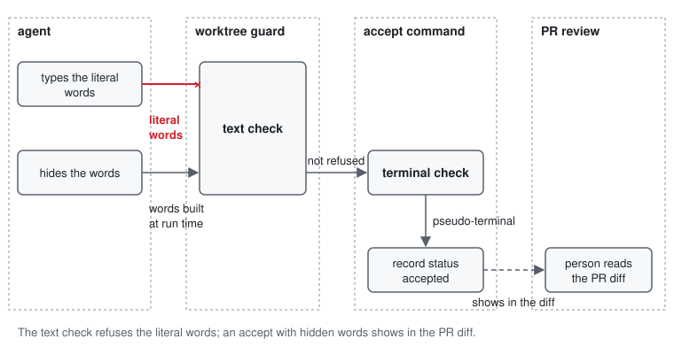

# The guard refuses the literal accept words, not hidden ones

## Decision

The worktree guard's text check defends against an agent that types the literal words of the accept command, not one that hides them. It keeps refusing every command where `wfctl`, `arch`, and `accept` appear as literal words, after quotes and backslashes are removed, in a place the shell runs them:

1. Directly, through a runner such as `env`, `uv run`, or `sudo`, or through a path to wfctl.
2. Inside a script the command runs, such as `bash -c`, `ssh`, `eval`, `env -S`, `tmux`, `parallel`, or text piped into a shell.
3. Inside a `$(…)` or backtick substitution, including one inside a quoted message.
4. Under a pseudo-terminal, such as `script -q /dev/null wfctl arch accept …`.

A command with words built at run time is outside what the text check promises. That includes a variable, a glob, a brace, an escape, an interpreter that builds the argument list, and a script written to a file first. The text check may still refuse such a command. If a change stops refusing one to clear a false refusal, that isn't a regression. For those commands, the terminal check and the person reading the PR diff are the controls.

## Boundary

The red edge is the form the worktree guard refuses. The solid arrows are a command running, and the dotted arrow is the record status change, which the person reads later in the PR diff.

## Context

Accepting an architecture record is the user's decision, so wfctl uses two checks to keep agents from running the accept command. The worktree guard's text check reads each command before it runs and refuses one that runs the accept command. The accept command's terminal check refuses to write when stdin or stdout isn't a terminal.

Three kinds of agent reach those checks, and each check stops a different one:

1. An agent that types the literal words, as a skill line or an issue might tell it to. The agent's shell has no terminal, so the terminal check refuses it. The text check refuses it earlier, before anything runs, with a message saying the command is for a person.
2. An agent that types the literal words under a pseudo-terminal, such as `script`, so the command passes the terminal check. Only the text check stops it.
3. An agent that hides the words and runs under a pseudo-terminal. Neither check stops it. The record status changes to accepted in a commit, and that change shows in the diff of the PR, where the person reads it.

R-013, in the #740 research notes, already accepted the third case. It lists hidden forms that "no text rule can close", including `python -c "subprocess.run([...])"`, and accepts the gap on the same tamper-evident ceiling as the drawing fingerprint. It never said which forms the text check must keep catching, though. And since it's a research note in one feature's spec folder, `wfctl arch context` never printed it.

That gap showed on #792. The fix narrowed the text check so it stopped refusing commit messages and file copies that only mention wfctl. The review brief said the guard must not let any real accept through, so reviewers treated every narrowing as a regression. Three security rounds each found a new hidden form, all of the third kind, and each fix led to the next finding. Nobody could tell a real regression from a form R-013 had already accepted.

## Direct baseline

Leave R-013 as a research note, and let each review brief set the bar for the guard.

We didn't choose this because it's the arrangement that produced the #792 loop. The bar moves with whoever writes the brief. A brief stricter than R-013 turns every accepted gap into a blocking finding.

## Owns truth

The worktree guard checks whether the accept command's words appear as typed where the shell would run them. The terminal check can't determine that, since a pseudo-terminal from `script` passes it whatever the command says.

The terminal check determines whether a terminal is attached to the run. The text check can't, since command text doesn't show where it runs.

Only the person can confirm that a person accepted this record. The person reads the PR diff and sees the record status change there. Neither check can confirm it. An agent running as the user can write the command into a file and run that file, and nothing in the command text or the terminal tells that run apart from the user's.

This record sets which forms the text check must refuse, and a review judges findings against it. A review brief shouldn't set that bar for each run, since the coordinator who writes the brief also wrote the change under review.

## Considered

- The text check refuses every form that can run the accept command, which is the bar the #792 review brief used. We didn't choose this because no text rule can meet it, as R-013 found, and trying to meet it swaps false refusals for new hidden forms, one round at a time.
- Drop the text check and rely on the terminal check. We didn't choose this because an agent that types the literal words under `script` would get through, and the text check is the only control for that agent.
- A sign-off an agent can't produce, such as a hardware key or an operating-system prompt. R-013 names this as the real fix, and it's equally sound. It's a larger change than this record, and a record adopting it would replace this one.

## Consequences

- The text check keeps its rules for expansions, such as wfctl's name followed by a `$`, a backtick, a brace, or a glob. These rules are best effort. A change can narrow one to clear a false refusal, as long as every literal form above stays refused.
- A security review of the guard reads this record and judges each finding against the four literal forms. A hidden form getting through is worth noting, but it isn't a regression.
- Under this record, every bypass the #792 panels found uses words built at run time: `"$(command -v wfctl 2>/dev/null)" $C`, an escaped backtick inside a substitution, a zsh glob qualifier, and `python -c`. Each also needs a pseudo-terminal so it passes the terminal check. So none of them blocks #792, as long as its tests show every literal form still refused.
- #799 adds a threat-model step before code for any change to a security control, so the next change to the guard starts from this record rather than meeting it at review.

## Log

- 2026-11-18  proposed    — three #792 security rounds found hidden forms past the guard with no written bar to judge them against; R-013 accepted the gap but never said which forms the text check must keep catching
- 2026-11-18  accepted    — #792 agreed by Andre · drawing drawings/guard-catches-literal-accept-data-flow.svg sha256:cf38aec4c256
