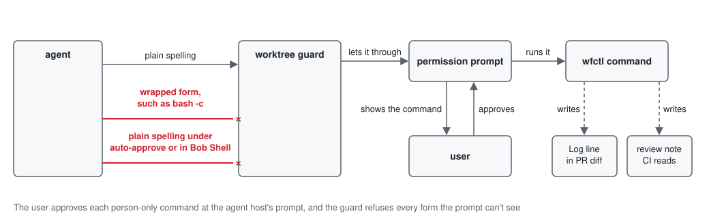

# The agent runs person-only commands after the user approves

## Decision

The agent can run `wfctl arch accept`, `wfctl review sign-off`, and `wfctl arch
approve-imports` itself, and the user approves each run at the agent host's
permission prompt. The prompt is the evidence that a person agreed, so the
three commands no longer need a terminal, and they no longer ask the user to
type a confirmation.

wfctl does three things to make this work:

1. `wfctl install-skills` writes the rules that make Claude Code and Codex ask
   before each command runs, and `wfctl doctor` reports a rule that's missing.
2. The worktree guard lets a command through only when it is one of the plain
   spellings those rules match. It keeps refusing every other form it catches
   today, and it refuses the plain spellings too in Bob Shell and in a project
   missing the rule. It lets them through while wfctl's auto-approve is on,
   since the prompt still waits for the user.
3. `wfctl arch accept` writes a `Log` line that claims only what wfctl can see.
   With no `--agreed` citation, the line reads "accepted — approved at the
   permission prompt".

This record replaces `accept-check-threat-model.md` and
`guard-catches-literal-accept.md`, and its threat model covers all three
commands.

## Boundary

The solid arrows are a command the agent runs and waits on. The dotted arrows
are what wfctl writes for later readers: the record's `Log` line in the PR
diff, and the review note CI reads. The red edges are the forms the worktree
guard refuses, because the host's rule can't match them and so no prompt would
appear.

## Context

Previously, all three commands were for the user to run in their own terminal.
Two checks kept an agent from running them:

1. The worktree guard read each shell command's text and refused one that ran
   any of the three commands.
2. Each command refused to run when stdin or stdout wasn't a terminal.

Currently, the user has to return to the computer every time a record needs
accepting or a branch needs a sign-off, even when they know they'll agree. The user's words were that they are "constantly blocked to get
a computer to sign off commits ... even though I know I would accept."

Claude Code and Codex can both ask the user before a command runs. In Claude
Code, an `ask` rule in `.claude/settings.json` makes the host show the exact
command and wait for a yes. In Codex, a `prefix_rule` with `decision =
"prompt"` in `.codex/rules/` does the same, in a project the user has marked
as trusted. #407 already installs these rules for `wfctl auto-approve on`, and
the user tested that the Claude Code prompt appears.

The prompt shows the user the command the agent is about to run, and the
command runs only after the user approves. The terminal check stood for the
same thing: a person seeing the action and choosing to take it.

The worktree guard runs before the host's permission check. That's why the
guard has to let the plain command through for the prompt to appear. It also
has to keep refusing any form the rule doesn't match, since that form would
run with no prompt.

## Threat model

### Defends against

An agent that runs one of the three commands without a person agreeing to that
run. It might copy the command from a skill, a record, or an issue body, retry
a refused command in a different form, or wrap it in a shell or a runner. The
agent isn't trying to hide what it runs.

The permission prompt is the check for this agent. The worktree guard's job is
to make sure the prompt appears, by refusing every form the host's rule
wouldn't match. The guard stops a form the prompt can't see, and the prompt stops a plain form the user doesn't
approve.

The record doesn't defend against an agent that builds the command on purpose
so neither the guard nor the host's rule can read it. Previously, that agent
also needed a pseudo-terminal, such as one from `script`, to pass the terminal
check. Now it doesn't, so this agent needs one fewer step. The PR
diff and the review notes record what it did, as "Accepts" says.

Claude Code's docs say an explicit `ask` rule still prompts in auto and bypass
modes, and that the command is denied in `dontAsk` mode or an unattended `-p`
run. In practice, a loaded `ask` rule let `wfctl arch accept` run in auto mode
with no prompt, twice, once with the user attached. That's why the guard reads
the `permission_mode` field Claude Code sends with each command, and lets the
three commands through only in `default`, `acceptEdits`, or `plan` mode. In
any other mode, or when the field is missing, the guard refuses them as it
would at a terminal, and the user runs them in their own terminal.

Claude Code reads its project settings from the folder the session was
launched in, and passes that folder to hooks as `CLAUDE_PROJECT_DIR`. The
guard reads the `ask` rule from that folder, not from the command's working
folder, since the agent can `cd` into a checkout whose rules Claude Code never
loaded.

wfctl's own auto-approve doesn't change this. It lets the agent answer wfctl's
design gates and run through its review stops, but it doesn't turn off Claude
Code's prompt. The prompt still holds each of the three commands until the
user answers, so an unattended run waits there for the user instead of
stopping and asking for a terminal.

### Must keep catching

The guard refuses each of these. Every form from items 1 - 20 of
`accept-check-threat-model.md` stays refused except the plain spellings in
"Must let through", and the list below adds the forms the prompt makes
necessary.

1. Behind a runner the rule doesn't match: `env wfctl arch accept s`
2. Behind a runner with an option: `nice -n 5 wfctl review sign-off`
3. Inside a script a shell runs: `bash -c "wfctl arch accept s"`
4. Text piped into a shell: `echo 'wfctl review sign-off' | sh`
5. A command substitution: `echo $(wfctl arch accept s)`
6. Chained after another command: `cd docs && wfctl arch accept s`
7. Chained before another command: `wfctl review sign-off; git push`
8. With a redirect: `wfctl arch accept s > /dev/null`
9. Under a pseudo-terminal: `script -q /dev/null wfctl arch accept s`
10. Through `eval` of the literal words: `eval wfctl review sign-off`
11. A quoted word: `wfctl "arch" accept s`
12. The name in another case: `WFCTL arch approve-imports`
13. The import approval through the branch's own code: `uv run wfctl arch approve-imports`
14. The accept through the branch's own code: `uv run wfctl arch accept s --agreed x`
15. The sign-off through the branch's own code: `uv run wfctl review sign-off`
16. A plain spelling in Bob Shell, which has no prompt: `wfctl review sign-off`
17. A plain spelling in a project whose settings file has lost the rule: `wfctl arch approve-imports`
18. A command substitution in a printed string. The shell runs it before `echo` prints the string: `echo "run $(wfctl arch accept s)"`
19. A heredoc with an unquoted delimiter. The shell runs any command substitution in its body, such as `$(wfctl arch accept s)`: `cat > x.md <<EOF`
20. A command on the line after a quoted heredoc's closing line: `cat > x.md <<'EOF'`
21. A quoted heredoc whose last body line ends in a backslash, with a command after the closing line. The shell ends the body at the closing line and runs the command: `cat > x.md <<'EOF'`
22. `printf -v` with a single-quoted array subscript. bash and zsh expand the subscript in the variable name, so the substitution runs: `printf -v 'a[$(wfctl arch accept s)]' x`

Items 13 - 15 stay refused because all three commands run the installed
`wfctl` on purpose. The user approves a command by its text, and `uv run wfctl`
runs the branch's own copy, which the agent may have edited. If the guard let
that copy through, the user would approve a command that no longer does what
its text says.

Items 16 and 17 depend on the host that runs the guard. Bob Shell runs the
guard and can't ask, so the guard refuses there as it does today. A Claude Code
project without the `ask` rule would run the plain command with no prompt, so
the guard refuses it until `wfctl install-skills` puts the rule back.

### Accepts

These run one of the three commands with no prompt. We accept them because no
rule that reads a command's text can find them. What limits the damage differs
by command:

1. For `arch accept`, the record's status changes in a commit, and the PR diff
   shows a `Log` line nobody asked for.
2. For `review sign-off` and `arch approve-imports`, wfctl writes a review note
   that CI trusts. The note is on `origin`, where `git log --notes` shows it,
   but the PR diff doesn't. That makes these two a weaker record than the
   accept, and that's the cost of dropping the terminal check.

The forms:

1. Arguments fed through `xargs` from stdin: `printf 'review\nsign-off\n' | xargs wfctl`
2. `eval` of text built at run time: `eval "$(printf 'wfctl ar%s acc%spt s' ch e)"`
3. A name built from a variable: `W=wf; A='arch accept s'; ${W}ctl $A`
4. A glob name with the words in a variable: `A='review sign-off'; wf?tl $A`
5. An interpreter that builds the words as a list: `python -c "import subprocess; subprocess.run(['wfctl', 'arch', 'accept', 's'])"`
6. Words written in ANSI-C escapes: `$'w\146ctl' $'\141rch' $'\141ccept' s`
7. A script written to a file, then run: `sh ./accept.sh`
8. Any form in a host wfctl doesn't support, such as Cursor or Gemini CLI, which runs no guard and shows no prompt: `wfctl arch accept s`
9. Any form in Codex, which runs no guard, when its rule doesn't match: `bash -c "wfctl arch accept s"`

Previously, the terminal check refused item 8. To keep that, each command
still needs a terminal unless its environment names Claude Code. The check
reads `CLAUDECODE`, which Claude Code sets in every shell it starts. Every
process started from that shell inherits the variable, including a Codex
reviewer the review panel starts, which shows no prompt. So the check also
refuses when a variable Codex sets, such as `CODEX_THREAD_ID`, is present.
Another agent started the same way still passes, and so does an agent that
sets `CLAUDECODE` by hand, so the check stops a mistake but not a deliberate
bypass.

The prompt approves a command, not the list it prints. For `review sign-off`
and `arch approve-imports`, Claude Code asks before wfctl lists the commits or
the import additions, so the user's yes comes before they see the list.
Previously, the typed sha or digest tied the approval to what was listed. So
under Claude Code, both commands require `--head <sha>`, which puts the commit
in the prompt, and they refuse when the branch is at any other commit. A commit
the agent adds after the user saw the sha is no longer covered. The user still
approves a sha rather than the list, so they see which commit they're signing
off on, not what it contains.

Item 9 depends on how Codex matches a wrapped command, and whether Codex asks
for a command its sandbox allows. Before Codex is listed as supported, a
session in Codex checks both by hand. Until then, Codex keeps needing a terminal for
all three commands.

### Must let through

The guard lets each of these run. The first three are the spellings the host's
rule matches, so the host asks before each one runs. Items 4 - 11 only name a
command, print it, write it to a file, or run its dry run. Item 12 is the
first item again under auto-approve, and the host still asks before it runs.

1. The accept: `wfctl arch accept s`
2. The sign-off: `wfctl review sign-off`
3. The import approval: `wfctl arch approve-imports`
4. The dry run: `wfctl arch accept --dry-run -- s`
5. A commit message naming the command: `git commit -m "To sign off, run wfctl arch accept on the record again"`
6. A search for the command: `grep -rn "wfctl review sign-off" wfctl/`
7. A release note naming the command: `uv run towncrier create 833.change.md --content 'run wfctl arch accept on it'`
8. Another `arch` command with a comment: `wfctl arch context # then accept`
9. A quoted string printed by `echo`: `echo "run wfctl arch accept s next"`
10. A quoted string printed by `printf`: `printf '%s\n' 'wfctl review sign-off'`
11. `cat` writing a quoted heredoc to a file, with the command named in its body: `cat > changes/833.change.md <<'EOF'`
12. A plain spelling while wfctl's auto-approve is on: `wfctl arch accept s`

Items 9 - 11 pass only when they are the whole command. If the command adds
a pipe, a redirect, a second command, or a substitution in a double-quoted
string, the guard's other checks refuse it. Item 11 writes a file that could
later run as a script. "Accepts" item 7 already covers that risk, and the
agent's file-writing tool can write the same file without going through the
guard.

The guard still refuses some commands that only mention the accept, which
#796 and #802 - #805 track. This record keeps the guard's text check, so it
doesn't fix them.

## Direct baseline

Keep the terminal checks and the guard's refusals as they are, and leave the
user to run all three commands in their own terminal.

We didn't choose this because it's the arrangement the user wants gone. The
terminal is evidence that a person ran the command, and the prompt is evidence
of the same thing, so the baseline keeps a cost without keeping any protection
the prompt lacks.

## Owns truth

The agent host decides whether a person agreed to one run of one command, by
showing the prompt and waiting for the user. wfctl can't determine that, since
it runs after the prompt and sees the same process whether the user approved
it or typed the command. The worktree guard runs before the prompt, so it
can't see the answer either.

wfctl decides whether the prompt will appear. It installs the rules,
`doctor` reports one that's missing, and the guard refuses each form the rule
can't match. The host can't determine that, since it only knows the rules it
has and not which spellings of wfctl's commands exist.

The user decides which forms the guard must keep refusing and which it gives
up, by accepting this record. The author of a guard change shouldn't write
those lists, since they set what counts as a regression in that same change.

## Considered

- Keep `arch accept` alone on the prompt, as #833 first asked, and leave the
  other two for the terminal. We didn't choose this because the user is
  blocked by sign-off more often than by accept, and the prompt is the same
  evidence for all three.
- A personal setting listing commands that stay terminal-only. We didn't
  choose this because nobody needs it yet, and the user wanted all three to
  ask.
- Drop the guard's text check and rely on the prompt. We didn't choose this
  because a wrapped form, such as `bash -c`, doesn't match the host's rule, so
  it would run with no prompt and no refusal.
- Let the agent accept its own records with no prompt under auto-approve, as
  #814 asks. That's a separate decision for `arch accept` only. A sign-off
  under auto-approve would let the agent skip its own review panel.
- Ask the user to type a confirmation after the prompt, as sign-off and
  approve-imports do today. We didn't choose this because an agent's shell
  has no terminal to type into, and the prompt already shows the command.

## Consequences

- The three commands no longer need a terminal in Claude Code. In Codex, they
  need one until a run there confirms the prompt appears.
- `--agreed` is optional on `wfctl arch accept`.
- `install-skills` writes one `ask` rule for each command, on the `wfctl`
  spelling only. `doctor` reports any that are missing, as #407 does for its
  own rule.
- To try a change to one of the three commands, you first reinstall the
  tool from the branch, since the guard refuses `uv run wfctl` for all of
  them.
- The host's rule also matches the dry run, so `wfctl arch accept --dry-run`
  asks the user each time. `wfctl arch check-accept <slug>` runs the same dry
  run under a spelling no rule matches, so an unattended run can check a
  record without asking.
- Accepting an accepted record whose last `Log` line is `amended` writes a
  new `accepted` line, which records the user's agreement to the amendment
  (#838). An accepted record with no later amendment still writes nothing.
- `wfctl review sign-off --branch <name>` signs off on another local branch's
  tip without checking it out, so the agent signs off on a release PR from the
  `main` checkout (#845). The prompt shows the branch name, so the user sees
  which branch they're approving. The command refuses when the local branch
  differs from `origin/<name>`, since CI reads the sign-off from a note on the
  commit the PR's head names.
- The guard's tests that read the lists in `accept-check-threat-model.md` move
  to this record's lists.
- A record can name only one record in `supersedes`, so
  `guard-catches-literal-accept.md` is marked superseded with no record naming
  it. Its `superseded` Log line names this record after `by`, and wfctl's
  record check reads the successor from that line, so it doesn't warn that no
  record supersedes it.
- This depends on #407's rule plumbing, so implementation starts once #407
  merges.

## Log

- 2026-11-20  proposed    — #833 level 2. The user approves each run of the
  three person-only commands at the agent host's prompt, in place of running
  them in their own terminal.
- 2026-11-20  accepted    — agreed on #833 · drawing drawings/prompt-approves-person-commands-data-flow.svg sha256:85b9ae46cc83
- 2026-11-20  amended     — #838: the guard now lets through a quoted string printed by `echo` or `printf`, and a quoted heredoc that `cat` writes to a file ("Must let through" items 11 - 13). "Must keep catching" items 16 - 19 add the similar forms that still run a command.
- 2026-11-21  amended     — #833: the guard lets the plain spellings through while wfctl's auto-approve is on, since Claude Code's prompt still waits for the user ("Must let through" item 14). The old "Must keep catching" item 14 is gone, and the items after it moved up by one.
- 2026-11-21  accepted    — approved at the permission prompt · drawing drawings/prompt-approves-person-commands-data-flow.svg sha256:85b9ae46cc83
- 2026-11-21  amended     — #833: the guard refuses the accept and the sign-off through `uv run wfctl`, as it already did for the import approval, so all three run the installed wfctl ("Must keep catching" items 13 - 15). "Must let through" drops its two `uv run` items, and the items after them moved up.
- 2026-11-21  accepted    — approved at the permission prompt · drawing drawings/prompt-approves-person-commands-data-flow.svg sha256:85b9ae46cc83
- 2026-11-21  amended     — #833 security panel: "Must keep catching" item 22 adds `printf -v` with an array subscript, which runs a substitution. The terminal check also refuses under a Codex agent started from Claude Code, which inherits `CLAUDECODE`. "Defends against" now says Claude Code's `ask` rule still prompts in bypass mode. Consequences add `check-accept`, re-accepting an amended record, and `review sign-off --branch` (#845), and correct how a second superseded record names its successor.
- 2026-11-21  accepted    — agreed in chat. wfctl wrote "approved at the permission prompt" here, but Claude Code was in auto mode and showed no prompt, so this line was corrected by hand · drawing drawings/prompt-approves-person-commands-data-flow.svg sha256:85b9ae46cc83
- 2026-11-21  amended     — #833 security and code panels: the guard lets the three commands through only in a Claude Code permission mode that asks, since auto mode ran the accept above with no prompt. It reads the `ask` rule from the folder Claude Code was launched in. "Accepts" now says the prompt comes before the sign-off and import lists.
- 2026-11-21  accepted    — approved at the permission prompt · drawing drawings/prompt-approves-person-commands-data-flow.svg sha256:85b9ae46cc83
- 2026-11-21  amended     — #833: under Claude Code, `review sign-off` and `arch approve-imports` require `--head <sha>`, so the prompt names the commit the user approves, and they refuse when the branch is at another commit. "Accepts" now says so, in place of the follow-up issue it named.
- 2026-11-22  accepted    — approved at the permission prompt · drawing drawings/prompt-approves-person-commands-data-flow.svg sha256:85b9ae46cc83
