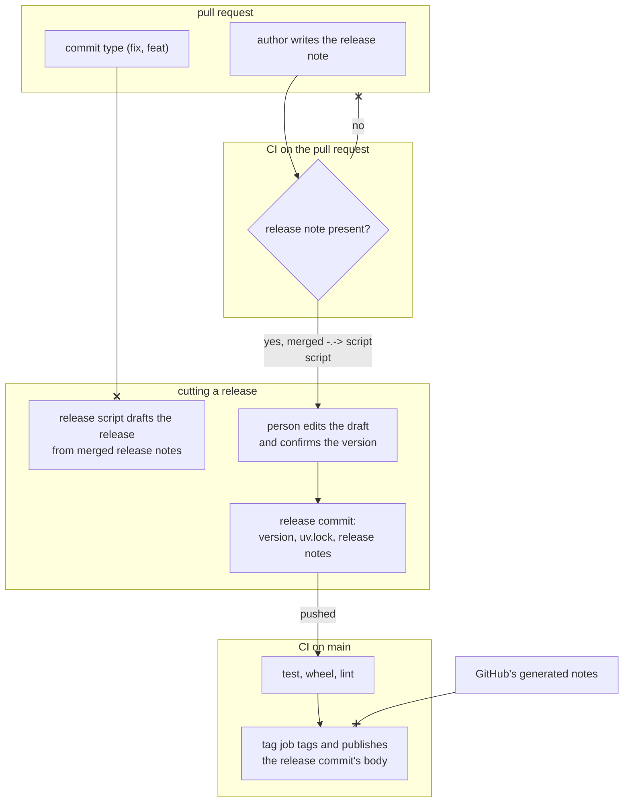

# Each pull request carries its own release note, and a person assembles the release from them

**What does this record decide?**
Every pull request states what changes for an existing user, in a release note
that CI requires before the pull request can pass. When a release is cut, a
script in this repository collects those notes into a draft, and the person
cutting the release edits the draft and picks the version.

## Context

A release note is one line in a pull request's description. It says what an
existing user of wfctl will notice once the change ships, and it falls into one
of four categories: a behaviour change, an addition, a fix, or none. The
release notes are what a release publishes, and they are built from those
lines. For example, the pull request that recorded the speckit scripts one file
per entry would carry "Behaviour change: the next `install-skills --prune`
deletes the speckit scripts unless the project reinstalls once."

Today a person cuts every release by hand. They read every pull request merged
since the last tag, decide between a minor and a patch, bump the version, run
`uv lock`, and write a commit body that leads with the behaviour changes. They
then push straight to `main`, and CI tags the commit and publishes a release
whose notes GitHub generates from the merged pull request titles. Three things
go wrong with that:

1. Merged work waits until someone remembers to release it. Two weeks of it
   waited before 0.16.0.
2. The release notes are written twice. The commit body is written by hand,
   and the GitHub release carries a generated list instead of it.
3. Steps are dropped. 0.18.0, 0.20.0, and 0.21.0 each bumped the version and
   left `uv.lock` behind.

Release tools that read commit subjects would automate all of this, but they
cannot find the behaviour changes. In 0.23.0, all five behaviour changes were
committed as `fix`, and none was marked as breaking. One of them deletes files
from an installed project on its next routine command. Only one of the five
pull requests ticked the template's "Breaking change" box, which is optional
and which nothing reads. The evaluation that measured this is
`scans/571-evaluation.md`.

Established projects keep this judgment out of the commit type. Kubernetes,
pip, pytest, CPython, Django, and Astro all capture a user-facing note per pull
request, and Kubernetes refuses to merge a pull request until its note is filled
in or says it has none. uv, ruff, and Rust capture a label per pull request and
write the note at release time. The projects that derive the release from
commit subjects document squash merging with an edited title as the discipline
that makes it work, and this repository uses merge commits.

## Direct baseline

The release script is written and the pull requests stay as they are. The
script lists every pull request merged since the last tag, proposes a version,
bumps it, runs `uv lock`, and drafts the commit body. The person cutting the
release writes the behaviour changes list by reading each merged pull request,
as they did for 0.22.0 and 0.23.0.

This baseline fixes the dropped steps and the duplicated release notes, and it
works. The 0.22.0 and 0.23.0 lists were accurate. Its cost is the reading. The
person reconstructs a judgment the author could have made when the change was
fresh, and reading 17 pull requests for 0.23.0 took a subagent. The cost grows
with the time between releases, which is the first problem above.

## Decision

The release note is written in the pull request that makes the change, and a
pull request without one fails CI. The release script reads the notes of every
pull request merged since the last tag and drafts the release from them. It
proposes a minor when any note is a behaviour change or an addition, and a
patch otherwise. It puts the behaviour changes first, bumps the version, runs
`uv lock`, and prepares the release commit. The person cutting the release
edits the draft, confirms the version, and pushes.

The CI tag job keeps its gate. Nothing is tagged until test, wheel, and lint
pass on the release commit. When the job tags it, it publishes the release
commit's body as the GitHub release, in place of the list GitHub generates.

Release automation is this repository's process, not a feature wfctl ships. The
script lives under `.github/scripts/`, and the release note check is a job in
this repository's CI. Nothing changes for a project that installs wfctl.

## Owns truth

The pull request author owns "what changes for an existing user when this
change ships?".

The commit type can't answer it. A commit type describes the code change, and a
bug fix can still change behaviour a user relies on, as all five of 0.23.0's
behaviour changes did. A generator that reads commit types therefore misses
exactly the changes the release notes lead with.

The person cutting the release can answer it, but only by reconstructing it.
They read each pull request after the context is gone, and the effort grows with
every pull request that waits. An agent reading the history at release time is
the same reconstruction, done with less context than the author had. The author
knows the answer when the change is written, so asking them then costs one line.

In this repository the author is almost always the agent that opens the pull
request. It writes the release note along with the rest of the description, so
the note adds no work for a person. What the agent does skip is an optional
field, as the "Breaking change" box showed, and that's why CI requires the note
rather than asking for it.

The person cutting the release owns "which version is this, and what do the
release notes say?".

The script can't decide this alone. A release is a set of changes, and whether
the set is a minor or a patch, and which behaviour change leads, is a judgment
about the whole set. The script proposes both from the notes, and the person
confirms them. That keeps the reason the tag job already gives for a human
version call, which is that the call needs context. What changes is that the
context arrives written down instead of reconstructed.

## Boundary

Solid arrows are steps in one run. The dotted arrow is read later: the script
reads merged release notes at release time, through `gh`. The crossed-out
arrows are the decision. The script never reads the commit type to judge what a
user will notice, and the tag job never publishes GitHub's generated notes.

## Considered

- **Derive the version and the release notes from commit subjects,** with
  release-please or python-semantic-release. Both automate everything this
  record leaves to a person. They lose because the commit type does not carry
  the behaviour changes here, and both tools document squash merging as the
  discipline they rely on. release-please also overwrites hand edits to its
  release pull request, and neither relocks `uv.lock` without extra
  configuration.
- **A release note trailer on each commit,** such as `Release-note: none`,
  checked by a local `commit-msg` hook and again in CI. Git already parses
  trailers, and GitLab uses the same shape. It loses on the unit. The pull
  requests in 0.23.0 carried 1 - 24 commits each, and the user-facing change is
  usually the sum of them, so most trailers would read `none` and be typed
  without thought. A trailer is also fixed once pushed, and correcting it means
  rewriting a branch the review has already read. A local hook is skipped by
  `--no-verify` and is missing from a fresh worktree.
- **A release note file per pull request,** as pip and pytest do with
  towncrier. It is equally sound and has one advantage, since a file is
  reviewed in the diff like code. It loses on fit. This repository already
  writes a change's impact in the pull request description, and the release
  note belongs beside it rather than in a second place the author has to
  remember.
- **A label per pull request,** as uv and ruff do. A label is easy to add and
  to filter on. It carries the category but not the sentence, so the person
  cutting the release still writes every line. Ruff's own contributing guide
  says labels are often missing.

## Consequences

The pull request template gains a "Release note" section, holding a category
and one line written for an existing user. The template's "Type of Change"
checkboxes ask the same question less precisely, and two fields asking one
question will disagree. Whether they go or stay is left to the implementation,
and it should decide before the first release that reads the notes.

The release note check runs on the pull request's description, so it has to run
again when the description is edited. GitHub's default `pull_request` trigger
does not include edits. The check therefore needs its own workflow that listens
for `edited`, which also keeps a description edit from rerunning the test suite.

`wfctl check-body` checks a description before a pull request opens, and it
ships to every project. It shouldn't require a release note everywhere. It can
check for one only when the repository's own template has the section, which
gives the author the finding before CI does. That is a follow-up, not part of
this decision.

Pull requests merged before the check exists have no release note. The first
release after it still needs those read by hand, and the script should list
them as missing rather than treat them as none.

The comment above the tag job says the version is decided in the pull request
that makes the change. No release from 0.17.0 to 0.23.0 worked that way, and it
is rewritten to describe this record.

Nothing here reminds anyone that merged work is waiting. The script can report
how many release notes are unreleased when it runs. Whether something should
prompt for a release is still an open question, and nothing has been decided.

Whether a required release note gets written honestly or answered with "none"
by habit is also open. No evidence was found either way. The review panel is
the natural place to compare a note's category against the diff.

## Log

- 2026-10-10  proposed    — #571. A release tool that reads commit subjects
  would miss every behaviour change in 0.23.0, so the judgment moves to the
  pull request that makes the change.
