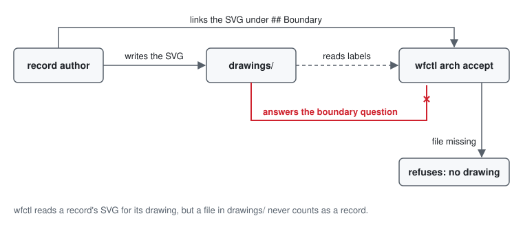

# A record's drawing can be an SVG file that wfctl reads

## Decision

A record's drawing can be an SVG file, stored in the `drawings/` folder under the
arch root as `<slug>-<kind>.svg`. The record links it with a markdown image
under `## Boundary`, or under `### <kind>` when it declares several kinds.
wfctl counts that link as the drawing, the same way it counts a fenced block.

wfctl reads two things from the SVG:

1. The labels, from its `<text>` elements. The label check compares them
   against the record's prose, as it does for mermaid.
2. The failing step of a sequence, from an element with the class
   `failing-step`. A `sequence` record needs at least one.

The edge an owning side refuses carries the class `refused-edge`, and the SVG's
style colors it red. No check reads that class. The SVG picks its colors with a
`prefers-color-scheme` media query, so it stays readable when the device is in
dark mode. It also fills its own background with GitHub's page color for that
mode, so it blends into the page when the themes match.

Mermaid fences still pass every check.

## Boundary

The dotted edge is a file wfctl reads later. The red edge is the claim wfctl
refuses.

## Context

Every record's drawing is a mermaid fence today, and wfctl's acceptance checks
read only fences. On GitHub, mermaid's layout engine places the nodes itself.
Labels overlap, and the refused edge or the failing step is hard to find. The
hand-drawn SVGs from the #739 brainstorm and the #598 review use boxes on a
grid, a label on every arrow, and the refused edge in red, and they read at a
glance. The user decided on 2026-11-11 that skills teach SVG as the default
and that every boundary drawing is an SVG.

Currently, a record with only an SVG fails `wfctl arch accept` with "no
drawing", since the check looks for a fence. The label check and the sequence
check read mermaid syntax, so they find nothing in an image link.

## Direct baseline

Keep the checks as they are. Skills teach SVG, and a record carries its SVG
next to a mermaid fence of the same drawing, so `wfctl arch accept` keeps
passing.

We didn't choose this because the two copies drift. The checks read the
mermaid copy and the reader sees the SVG, so a label changed in one is never
compared against the other. This means the check passes a drawing nobody looks
at.

## Owns truth

wfctl checks whether a record has a drawing, whether the SVG's labels appear
in the record's prose, and whether a sequence shows its failing step. These
checks read only the file and the record, so wfctl can run them at acceptance
without asking anyone.

The author marks the failing step with the `failing-step` class. wfctl
shouldn't infer it from the picture, since it would have to guess from a
stroke color or the shape of a path. If that guess is wrong on one drawing,
the author gets a refusal they can't dispute. The same reasoning made the
author declare the diagram kind (`the-author-declares-the-diagram-kind.md`).

The user decides whether a drawing reads well, and accepting the record is how
they sign off on it. An agent shouldn't decide this, since it can't see a
visual problem and could claim it had looked. That's why the worktree guard
refuses `wfctl arch accept` from an agent unless the command carries
`--dry-run`. The command also refuses to write without a terminal. These are
the same two checks `wfctl review sign-off` has.

wfctl decides where the SVG is stored. The design gate and the branch's record
listing ask git whether anything under the arch root changed, excluding a list
of folders that hold no records. If an SVG could sit beside its record, those
readers would count it as a record changed on the branch. As a result, a branch
could answer the boundary question with only a picture. A fixed `drawings/` folder
goes on that list, the same as `views/` and `scans/`.

## Considered

- **The SVG sits beside its record.** A rename or a delete then changes one
  place, and nobody has to look for the drawing. We didn't choose it because
  every reader of the arch root would have to exclude SVGs by file extension,
  where today it excludes folders. A new reader that missed the extension
  would count a drawing as a record.
- **The SVG is written inline in the record's markdown.** Each record stays
  one file, with no link to break. We didn't choose it because GitHub removes an
  inline `<svg>` element from markdown, so the record would show nothing.
- **The failing step is marked by its color.** It needs no class, since a
  red stroke already marks the step. We didn't choose it because the check would
  compare color values, and two shades of red, or a dark-mode color, would
  read as no failing step.
- **The SVG carries a fixed white background.** It reads the same in every
  theme with no media query. It's equally sound, but it shows as a bright
  card on a dark page. The user compared both on
  github.com and preferred the version that switches colors.

## Consequences

`drawings/` joins the folders that hold no records, so the design gate, the
record listing, and `wfctl arch context` all leave it out.

The single `drawings/` folder and the `<slug>-<kind>.svg` name are temporary.
Records, design records, views, and drawings all sit in flat folders today,
with no grouping by context. #761 decides how they're grouped, and moves each
drawing along with the document that links it. Until then, wfctl checks only
that the SVG is in `drawings/`, and the name is a convention the skills teach.

wfctl treats a broken link as a missing drawing. `wfctl arch accept` refuses a
record whose image points at a file that doesn't exist, and names the path.

Because `drawings/` is left out of the design gate, an edit to an accepted
record's SVG no longer shows up as a change to the record. Previously, the
drawing was part of the record's body, which nobody edits once it's accepted.
To keep that protection, `wfctl arch accept` writes each SVG's fingerprint on
the `accepted` Log line. `wfctl doctor` warns when an accepted record's SVG is
missing, can't be read, or no longer matches its fingerprint.

An accepted record's SVG may change only in layout, such as moving a box or
shortening a label, and the commit message says why. A change to what the
drawing shows needs a new record that supersedes this one. `wfctl doctor`
can't tell the two apart, so it warns the user about every edit. If the edit is
a layout fix, the user looks at it and runs `wfctl arch accept` on the record
again, which appends a `redrawn` Log line with the new fingerprint and leaves
the status alone. If it changes the meaning, the user asks for a superseding
record.

An SVG follows the device's color setting, not GitHub's theme toggle. If
you set GitHub to dark on a light-mode device, the drawing shows as a light card
on the dark page. Without its own background, its dark labels would sit on the
dark page and be unreadable.

No tool lays out a hand-drawn SVG, so a label can run past the edge or across a
line with no error. `wfctl doctor` warns about a proposed record whose SVG has a
label running past the drawing's edge, estimated from its length in characters.
It can't tell when a label crosses a line, so the skills also tell the author
to render the SVG and look at it before committing. The user reads the drawing
before accepting the record, and that review catches the rest.

Records that carry mermaid today keep passing. Whether to redraw them as SVG is
separate work.

## Log

- 2026-11-13  proposed    — the level-2 gate for #740
- 2026-11-15  accepted    — Andre, in the #740 implement session on 2026-11-15
