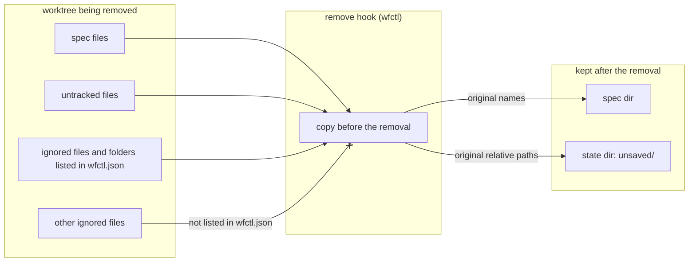

# A worktree removal copies spec files to the spec dir and other unsaved work to the state dir

## Context

Before a worktree is removed, wfctl copies out the files that would otherwise
be lost. Previously, it copied only spec files that sat inside the worktree,
and it put them in the branch's state dir as a numbered, flattened archive with
a generated index. Nobody looks for spec files there, since `wfctl` resolves
them from the spec dir everywhere else.

Currently, untracked files have no place to go at all. And some repositories
keep notes or research in a gitignored folder, which is deleted on removal
without any warning, since git doesn't report ignored files as changes.

wfctl can't tell those notes apart from generated files on its own. To git,
both are ignored files. On 2026-10-12 we measured the gitignored markdown in
the live worktrees, excluding what `install-skills` wrote and `.venv/`:

1. In `571-release-automation`, the only file left was the `.workmux/` handoff.
2. In `552-bob-command-hyphen-rename`, 124 more files came from `build/lib/`,
   which are build copies of the skills.
3. In a pfms worktree, 1,637 more files came from `node_modules/`.

None of the worktrees held a real note in an ignored folder.

## Direct baseline

The smallest change keeps the state dir's numbered archive for spec files and
adds an `unsaved/` folder beside it for untracked files. Ignored files stay
out of scope. Spec files remain somewhere nobody looks for them, and a
repository that keeps notes in an ignored folder still loses them.

## Decision

Each kind of file goes to the place you would look for it:

1. Spec files inside the worktree are copied to the branch's spec dir,
   resolved from the main checkout, with their original names. The numbered
   archive in the state dir is no longer written.
2. Untracked files that are not spec files are copied to `unsaved/` in the
   branch's state dir, at their original relative paths, so you can copy them
   back.
3. Ignored files and folders that the repository lists in `wfctl.json` are
   copied to the same `unsaved/` folder, also at their original paths. A listed
   folder that holds the spec dir is copied without it, since the spec dir is
   already copied on its own. A listed link is saved as a link, and what it
   points at is saved at its own path, since it is deleted with the worktree
   too. Every other ignored file is left alone and deleted with the worktree.

## Owns truth

wfctl decides where each kind of copied file goes. The spec dir holds spec
files because every other `wfctl` command already reads them from there. The
state dir holds the rest because it is the only per-branch location that
survives the removal and belongs to no other tool.

The repository decides which ignored files and folders hold work worth
keeping, through a list in `wfctl.json`. wfctl shouldn't guess, because
generated folders and note folders look the same to git, and the measurements
above show that a guess would copy thousands of generated files. The list lives in `wfctl.json`
rather than in an environment variable, because the folders differ from one
repository to the next. It lives there rather than under `.agents/`, because
`install-skills` rewrites `.agents/` and a setting kept there would disappear
without any warning.

## Boundary

The crossed edge means the hook doesn't copy those files, and they are deleted
with the worktree.

## Considered

- **Keep the numbered archive in the state dir for spec files.** It reads well
  as a story of the branch. We didn't choose this because you would look for
  spec files in the spec dir, and a second copy in another format drifts from
  the first.
- **Copy all gitignored markdown, except what `install-skills` wrote and
  `.venv/`.** This was the scope proposed on 2026-10-12, and it needs no setup.
  We didn't choose this because the measurements above show it copies 124
  build files in one worktree and 1,637 `node_modules/` files in another, while
  no real note turned up in any of them.
- **Skip an ignored folder that holds more than about 50 markdown files, or
  anything besides markdown.** Either rule drops generated folders without a
  list. We didn't choose this because both are guesses that fail on a large or
  mixed notes folder, while a list in `wfctl.json` is exact.
- **Keep the list of folders in an environment variable.** This matches how
  the spec dir and the state dir can be set. We didn't choose this because the
  folders differ from one repository to the next.

## Consequences

`wfctl check config` reports a listed path that points outside the repository,
the same way it reports a bad `steps` entry. It can't report a listed folder
that doesn't exist, because a notes folder is usually created inside each
worktree and is missing from the main checkout.

If the repository has no main checkout, as in a bare layout, there is no spec
dir outside the worktree to copy spec files into. In that case they are copied
to `unsaved/` with the rest of the unsaved work.

State dirs written before this change still hold their numbered archives.
Nothing moves or deletes them.

If the spec dir already holds files for the branch, the copy has to decide
whether to replace or keep them. That is a design question, and the design
document answers it.

## Log

- 2026-10-13  proposed    — #40 moves spec files to the spec dir and adds a
  place for untracked files and listed ignored folders
- 2026-10-19  amended     — #611 saves a listed file as well as a listed
  folder, and saves a listed folder that holds the spec dir without the spec
  dir instead of skipping it. A listed link is saved with what it points at
