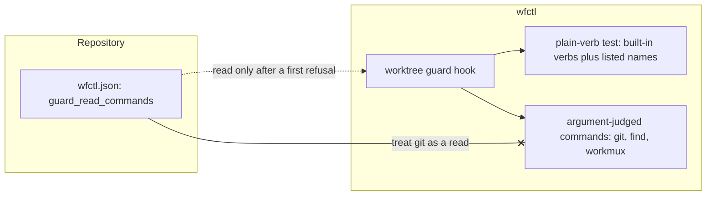

# A repository declares its own read-only commands for the worktree guard

## Context

The worktree guard blocks any command that names a path in another worktree, unless the command only reads. It decides that from a fixed list of read-only commands, such as `cat`, `grep` and `ls`. Currently, a repository that relies on another read-only tool, such as `bat`, has no way to add it, so the guard refuses `bat <other-worktree>/README.md` as "not a read command".

The `guard_read_commands` key in `wfctl.json` fixes that. It is a new setting the guard code reads, and it moves part of the guard's allowlist from wfctl to the repository.

## Direct baseline

Add the tool to the built-in list in `_guard.py` and ship a release. This draws no new structure and keeps the list in one place. It doesn't scale, though, because wfctl would have to learn every tool every repository uses, and a repository would wait for a release to unblock itself.

## Decision

The repository can list extra command names under `guard_read_commands` in the `wfctl.json` of the session's own worktree. The guard treats a listed name like a built-in read command, and only for commands that are plain verbs. `git`, `find` and `workmux` are still judged by their arguments, and a listed command still can't redirect output into another worktree.

The guard is a tripwire against an agent wandering into a sibling worktree. It isn't a sandbox. An agent can edit its own `wfctl.json` and list a command that writes, such as `sh`, so the key is trusted the way the rest of the worktree is trusted. We accept this while the only user is Andre.

## Owns truth

The repository owns "which extra commands only read in this project?". wfctl cannot compute this: it has no way to know what a tool does, and a tool of the same name can behave differently from one project to the next.

wfctl owns "which commands are judged by their arguments rather than by their name?" The repository cannot change that answer. Listing `git` is inert, since `git` is decided by its subcommand before the list is consulted.

## Boundary

A dotted edge is a file read at hook time. The `--x` edge is the claim wfctl refuses: a listed name never changes how `git`, `find` or `workmux` are judged.

When `wfctl.json` is missing, isn't valid JSON, or holds a value that isn't a list of bare command names, the hook behaves as if the key were absent.

## Considered

- Add each tool to the built-in list: equally sound, and it keeps the list in one place. It loses on fit, since wfctl would need a release for every tool a repository wants.
- Read the list from the main checkout's `wfctl.json`: an agent in a linked worktree can't edit it, which closes the self-grant. We didn't choose it because the main checkout can be on any branch, so the setting would depend on a file this session doesn't own, and it adds a git call to the path where the guard is already refusing.
- Validate that a listed command is read-only: wfctl can't tell what a command does from its name, and the check would give a false sense of safety.

## Consequences

- A malformed `guard_read_commands` is silently ignored. `wfctl check config` doesn't report it yet, and AGENTS.md says it should.
- The key is not documented in `docs/reference.md` yet.
- If wfctl gains users beyond Andre, the self-edit trust stance needs revisiting, and the main-checkout option above is the likely replacement.

## Log

- 2026-10-24  proposed    — written with the `guard_read_commands` setting, after a review panel found no record covering it
- 2026-10-24  accepted    — Andre, in session on branch 628-t032-throwaway: asked for an accepted record covering guard_read_commands
