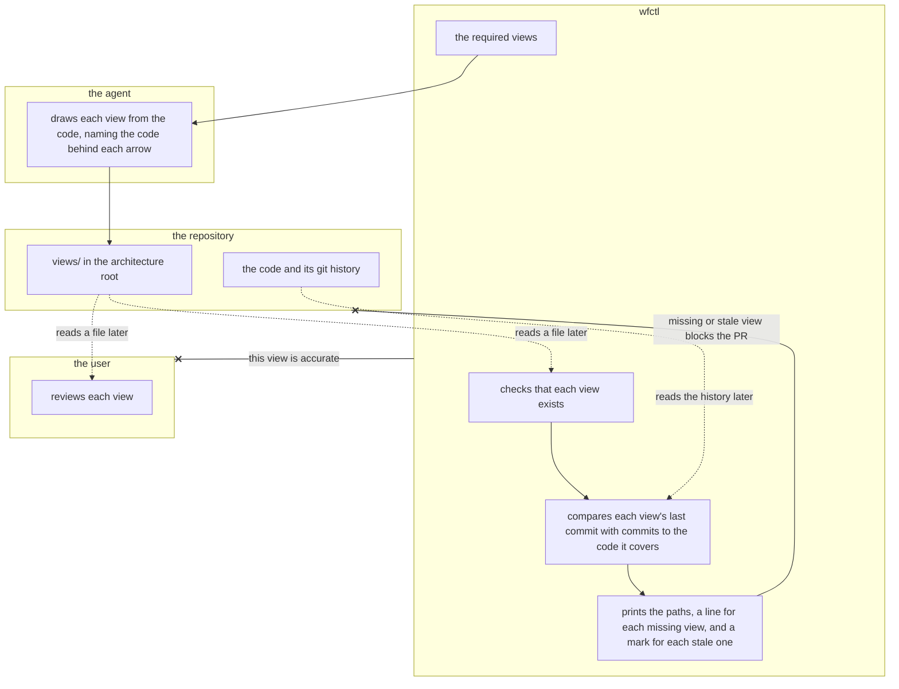

# wfctl names the architecture views every repository needs

## Decision

wfctl decides which architecture views every repository needs, following the
levels of the C4 model:

1. A system context view, in every repository.
2. A container view, in every repository.
3. A component view for each context on the domain page's `Contexts` line, at
   `views/components/<context>.md`.

A module layers view and a deployment view are optional, and wfctl never asks
for them. Views are located under `views/` in the architecture root.

The agent creates each view from the code, and the user reviews it. Each view
lists the code it draws on a `covers` line.

When a session starts, `wfctl arch context` ends with a `Views` block. It lists
the two required views and the component views for the contexts the branch
lists, and marks a view in three cases:

1. `missing:` when the view doesn't exist.
2. `stale:` when the code it covers has commits newer than the view.
3. `unchecked` when wfctl can't tell whether the view is stale. That happens
   when the view has no `covers` line, when git doesn't track a path on its
   `covers` line, when git ignores the view, or when a git call fails, such as
   for an architecture root outside the working tree.

A view with no commit yet prints as current, since it's being drawn now. None
of these marks changes the exit code, so a missing or stale view never
blocks a step or a PR.

## Boundary

A solid edge is a direct handoff, and a dotted edge reads a file or the git
history later. The crossed edges are the two things wfctl rejects: it never
confirms that a view is accurate, and it never blocks work over a missing or
stale view.

## Context

A view is one picture of the system that answers one question, with a short
summary above it. For example, one view shows who and what the system
interacts with, and another shows which parts run or store data separately.

Currently, a repository's architecture pictures come from three places that
don't fit together:

1. The domain page template asks for three diagrams and a set of wide tables.
2. Each architecture record draws one picture of one decision
   (`the-author-declares-the-diagram-kind.md`).
3. `views/current-state.md` draws wfctl's modules in layers. It's the only
   picture of the whole system.

No document specifies which views a repository should have, or which document
each picture belongs in. As a result, the user can't see the system's outline
at a glance, and every repository that uses wfctl has to work this out alone.

The agent creates these pictures, and the user reads them. The user
understands how the system should behave, but not its internal structure. The
views show the user the pieces and the boundaries between them clearly enough
to spot a bad architectural decision.

## Direct baseline

The domain page template asks the agent for three diagrams, and the
`model-the-domain` skill tells the agent to draw them. Neither names the C4
levels or says which views a repository needs. Nothing checks whether a
picture exists, and nothing mentions views when a session starts.

This leaves the rule as written guidance, even though a broken rule shows up in
the repository as a missing file. `a-rule-is-expressed-as-a-check.md` was
accepted to close that gap.

## Owns truth

wfctl decides which views every repository needs. A repository shouldn't
choose its own list, because the point is for every repository to describe
itself the same way. A per-repository list would also let a repository drop a
view without anyone noticing.

The agent draws what each view shows. wfctl can't, because what counts as a
separately running part differs in every kind of project, and wfctl reads only
Python. The user can't either, because they understand how the system should
behave but not its internal structure.

The user decides whether a view shows a sound design. wfctl's check can tell
whether a file exists and whether its covered code has changed since, but not
whether the view draws good boundaries. The agent shouldn't judge that,
since it would be grading its own drawing.

The user's review has a limit. The view templates ask the agent to draw an
arrow from a stable part to a less stable one in red. If the agent misses one
and draws it in the normal color, nothing on the page shows the problem. Each
arrow names the import or call that creates it, so the user can look any arrow
up in the code, but nothing finds the wrong-way arrow for them. That check is
tracked in #743. Until it merges, a wrong-way arrow the agent missed reaches
the user looking like any other.

A repository can test a view against its own code. wfctl's own suite does this
in `tests/test_architecture_view.py`, which fails when the module layers view
draws an import the code doesn't have, or leaves out one it does.

## Considered

- **Guidance with no check.** This is the direct baseline. We didn't choose it
  because a missing view shows up in the repository, and a rule like that is
  expressed as a check.
- **Each repository lists its own views in `wfctl.json`.** This suits a
  repository whose shape doesn't fit C4. We didn't choose it because the issue
  asks for every repository to describe itself the same way. A per-repository
  list also makes skipping a view a one-line edit that nobody reviews.
- **A missing view blocks the PR.** This makes the reminder impossible to
  ignore. We didn't choose it because a repository adopting wfctl would have
  every change blocked until it drew two views plus one per context. Views
  describe the system rather than constrain it, so a missing view is a
  reminder.
- **wfctl checks each view against the code.** This would find a box or arrow
  that has drifted from the code, which matters because the user trusts the
  picture. We left it out of this decision because it's a separate feature,
  tracked in #743. wfctl's test of its module layers view shows the check works
  for a view of Python modules, such as a component view. wfctl reads only
  Python, so other languages need their own test. The stale mark tells the user
  when to look, in any language, and #743 tells them what's wrong.
- **Stale by file modification time.** We didn't choose it because a checkout
  or a restore gives every file the same timestamp. As a result, every view
  would appear current.

## Consequences

`views/` isn't a record tier. wfctl adds it to the folders under the
architecture root that don't hold records, so it doesn't report a branch that
edits only a view as deciding anything.

The list of required views is a constant in wfctl's code. A test checks it
against the view templates, as with the spec and plan sections in
`required-sections-are-wfctls.md`.

Each view template carries a `covers` line. A view without one prints as
`unchecked`, since wfctl can't tell whether it's stale. A
commit that edits a view clears its stale mark, even an edit that doesn't
redraw it. We accept that, because the edit shows up in the PR diff, where the
user reads it.

`views/current-state.md` becomes wfctl's module layers view, which is optional.
Until wfctl's seven component views exist, its own `Views` block lists them as
`missing:`.

## Log

- 2026-11-08  proposed    — the level-2 gate for #739
- 2026-11-09  amended     — the plan walkthrough found that a view could go
  stale unnoticed, and that the user's review rests on the agent's coloring.
  Added the stale mark, the arrow labels, and the review's limit; still proposed
- 2026-11-10  accepted    — issue #739 approved Nov 10, 2026
