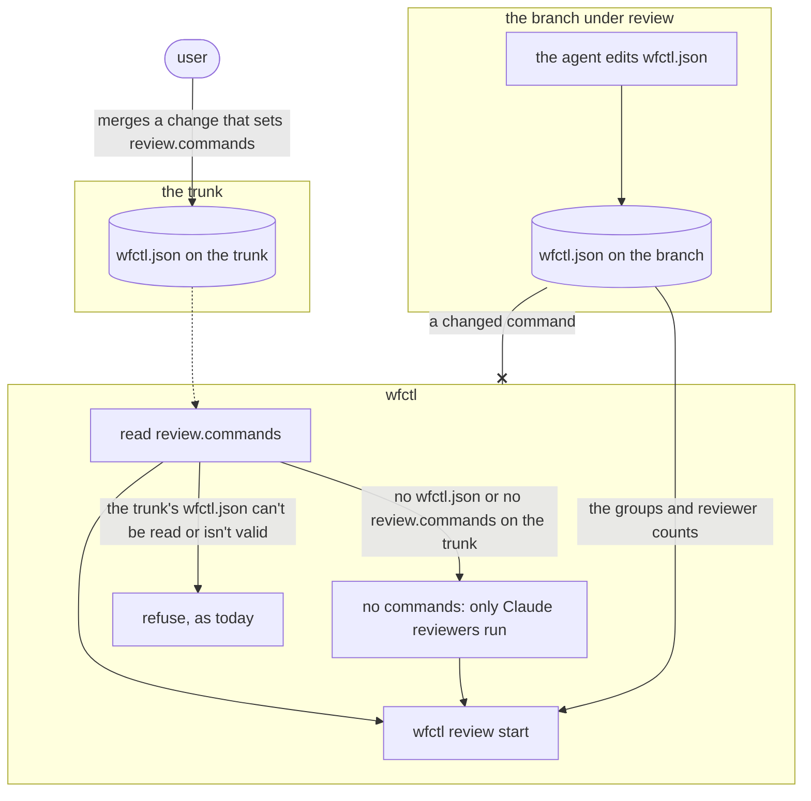

# wfctl reads reviewer commands from the trunk

## Context

A reviewer command is the shell command that starts a model other than Claude,
such as `codex exec --sandbox read-only`. A repository declares one per model
under `review.commands` in `wfctl.json`. `wfctl review start` prints each
command beside its reviewers, and the review skill runs it on the machine doing
the review.

Previously, `review start` read the commands from the working tree of the branch
under review. The agent writes that branch, so it could change a command to any
shell command. The next `review start` would then print it for the coordinating
agent to run. The same repository also ran a different reviewer depending on
which branch it was on.

This problem was found on #710. That branch added a `codex` command, and its own
review panel ran the command before the change merged. We had already moved
`review.rounds` to the trunk for the same reason (`review-round-cap.md`). We
left the groups and reviewers on the branch, since changing them doesn't let the
agent run more rounds. That reasoning doesn't hold for a command, because a
command is code the review runs.

## Direct baseline

Keep reading `review.commands` from the branch, and rely on the reviewer reading
the PR diff to notice a changed command.

By the time a reviewer reads the diff, the command has already run during the
branch's own review. The diff shows the change only after the fact, which is
why the decision below reads the commands from the trunk.

## Decision

`wfctl review start` reads `review.commands` from the copy of `wfctl.json` on
the trunk, the same trunk `review.rounds` comes from. A branch that adds or
changes a command runs it only after the change merges.

When the branch's `wfctl.json` sets a different command than the trunk, or sets
one the trunk doesn't have, `review start` prints a warning naming the model and
both values. The user sees that the branch wants a different reviewer, and the
run uses the trunk's.

`review start` leaves out a reviewer whose model has no command on the trunk,
the same way it leaves out one whose program isn't on `PATH`. The roster marks
it unavailable, and the `⚠` line names it.

A trunk with no `wfctl.json`, or no `review.commands`, has no commands, so only
Claude reviewers run. When the trunk's `wfctl.json` can't be read, or its
commands aren't valid, `review start` refuses, as it already does. The same
file lists the groups the branch must review, and `review start` checks that
list before it reads a command. CI can't read the list from a broken file
either, so a run started anyway would end in a PR that CI refuses.

The review groups and their reviewer counts stay on the branch. A branch that
adds a group or a reviewer makes its own review stricter, so it doesn't carry
the same risk. Moving the groups would also change what #709 shipped.

## Owns truth

The trunk's `wfctl.json` sets which command starts each model. wfctl reads them
from there, never from the branch under review.

The branch shouldn't set its own commands, since the agent writes the branch and
the review runs the command. A change reaches the trunk only through a merge.
The worktree guard blocks `gh pr merge` from an agent until every group has
reviewed the change or the user has signed off.

## Boundary

A solid arrow is a direct call, a dotted arrow is a file wfctl reads later, and
an arrow ending in x is a value wfctl doesn't accept from the branch.

## Considered

- Keep reading the commands from the branch, as described in the direct
  baseline. We didn't choose this because the branch's own review runs the
  command before anyone reads the diff.
- Move the whole `review` key to the trunk, groups included. We didn't choose
  this because a branch that adds a group only makes its own review stricter,
  and a person can try a new group on a branch before it's enforced, which #709
  shipped on purpose.
- Fall back to no commands, with a warning, when the trunk's `wfctl.json` can't
  be read, the way the `trunk_rounds` function falls back to its default. We
  didn't choose this because `review start` already refuses that file while
  checking the groups. Making the fallback reachable would mean changing the
  reader the worktree guard and CI share, and a run started from a file CI
  can't read ends in a PR that CI refuses.
- Refuse to start a run when the branch and the trunk disagree. We didn't choose
  this because it would block every branch that proposes a new reviewer until
  the change merged, and that change needs a review to merge.

## Consequences

- A change to `review.commands` on a branch has no effect until it merges.
  `review start` warns when the branch and the trunk disagree, so the edit
  doesn't look like it was ignored.
- A branch that adds reviewers for a new model, with its command, runs those
  reviewers only after the change merges. Until then they are left out of the
  run, and the run completes on the Claude reviewers.
- `wfctl check config` still validates `review.commands` in the working tree,
  so a bad command is caught on the branch before it reaches the trunk.
- The commands are protected only as well as the repository protects its
  trunk, the same limit described in `review-round-cap.md`. In a repository
  without a ruleset on the trunk, an agent that can push there can change the
  command.

## Log

- 2026-11-03  proposed    — #711 level 2, from the issue's proposal after the
  #710 panel ran a branch's own command
