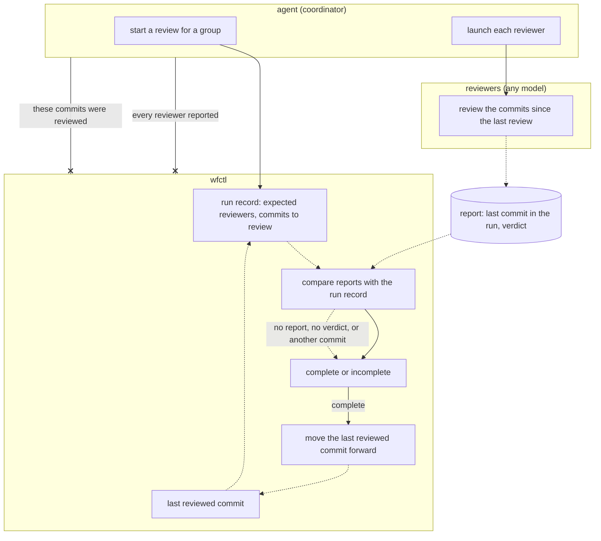

# wfctl code reviews cover all commits since the last review

## Context

A review panel has reviewers who read the same change before a pull request
opens. Sometimes, a panel wrongly reports a review as done, and there's no way
to catch it. This happens in three ways:

1. Fixes made in response to a panel are not reviewed.
2. A report may not name the commit it reviewed, so a report on an older commit
   can be accepted as a review of the current one.
3. A reviewer blocked from writing its report looks the same as one that never
   ran.

Right now, only the `fanning-out-code-review` skill checks for this. The agent
just looks for a verdict line in each report. wfctl doesn't read panel reports
or reviewer lists, and it keeps no record of which commits were reviewed. So
far, we've fixed each issue by adding more instructions to the skill.

This change adds more panels. A security group runs before the code group,
reviewers can use other models like Codex, and repositories can set their own
groups in `wfctl.json`. Each new group risks the same failures and would need
its own copy of the check.

## Direct baseline

The simplest approach keeps the check in the skill's instructions. Each
reviewer names the commit in its report, and reports about other commits are
treated as missing. A reviewer blocked from writing is marked separately. The
`opening-a-change` skill runs the check for each group, and repositories reuse
it with a different review skill in `wfctl.json`.

This needs no new code, but the coordinating agent still reports on its own
panel, and nothing tracks which commits were reviewed.

## Decision

Each review covers every commit since the last review. wfctl keeps the last
reviewed commit for each review group. When a group starts, wfctl writes a run
record with the expected reviewers and the commits to review, from the last
reviewed commit to the current one. The first review on a branch starts where
the branch left `main`.

A report only counts if it names the last commit in that run and includes a
verdict. When every expected reviewer has reported, the run is complete and
wfctl moves the group's last reviewed commit forward. If any report is missing, the run is incomplete and the
last reviewed commit stays where it was.

The agent still launches reviewers. Every group works the same way—security,
code, or custom ones a repository declares. wfctl defines the group format in
`wfctl.json`, and `wfctl check config` validates it.

## Owns truth

wfctl tracks which commits each group has reviewed, and checks that every
expected reviewer reported a verdict on them.

The agent shouldn't answer this since it would be grading its own work. wfctl's
verification already ignores self-reported test results, and the same logic
applies to reviews.

The agent can add commits while reviewers are reading, by applying findings or
merging `main`. This means it might compare reports with a commit no reviewer
actually read. This already happened once, with all three reviewers reporting
on an older commit after the pull request opened.

The agent still launches reviewers because wfctl can't start host subagents
like Claude Code's. This doesn't weaken the check—a reviewer that was never
launched writes no report, so wfctl marks the run incomplete.

## Boundary

A solid arrow is a direct call, a dotted arrow means a file read later, and an
arrow ending in x is a claim wfctl doesn't accept from the agent. A missing
report, a missing verdict, or a report about another commit makes the run
incomplete.

## Considered

- Keep the check in the skill's instructions, as described in the direct
  baseline. We didn't choose this because the coordinating agent would keep
  reporting on its own panel, and every new group would copy the check. Each
  failure so far was found only after a panel had already passed over it.
- Mark a review stale whenever new commits land, and review the whole change
  again. We didn't choose this because every round of fixes would restart a
  full review, which costs a full panel each time. Reviewing only the new
  commits still gets the fixes reviewed, and reviewers can read the rest of the
  change for context.
- Have wfctl launch every reviewer, the same way `wfctl verify` runs the test
  command. We didn't choose this because wfctl can't start a host's own
  subagents, and it would need every agent's command line and sign-in. We can
  still add it later for reviewers on other models without changing this
  record.

## Consequences

- Fixes from one review are covered by the next one. That's why the code group
  runs after the security group's fixes are committed.
- The last round's own fixes are only reviewed if another review runs. A change
  is fully reviewed when no commits come after the last reviewed commit, and a
  separate change caps this at three rounds.
- Commits that come in by merging `main` aren't the branch's work. How a run
  leaves them out, and where wfctl stores the last reviewed commit, is decided
  at level 3.
- If a reviewer is blocked from writing, it can send its report to the
  coordinator, who passes it to wfctl. The exact process is decided at level 3.
- The check detects forged reports but can't prevent them. An agent can still
  write a report file itself, which is the same limit wfctl's test
  verification has as a local tool.
- Plan review and the clarify and analyze scans don't change with this record.
  Plan review can move to it later as one more group.
- A test ensures that a missing report, a report without a verdict, or a report
  about another commit never moves the last reviewed commit forward.

## Log

- 2026-10-21  proposed    — #622 level 2, after Andre asked for one shared
  review setup across every panel
