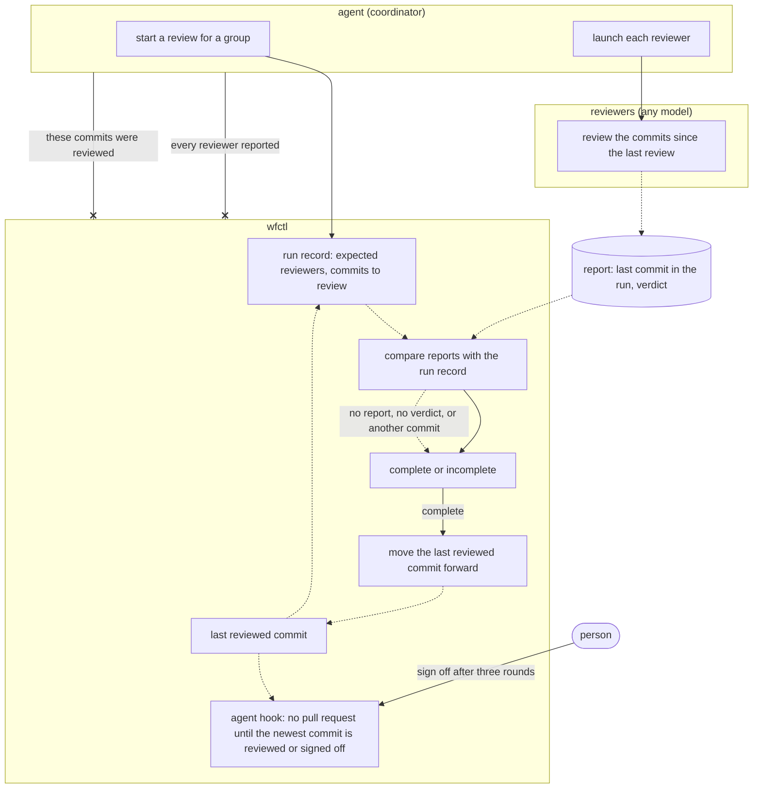

# wfctl code reviews cover all commits since the last review

## Context

A review panel has reviewers who read the same change before a pull request
opens. Sometimes, a panel wrongly reports a review as done, and there's no way
to catch it. This happens in three ways:

1. No one reviews the fixes made in response to a panel.
2. A report may not name the commit it reviewed. The coordinator can then
   accept a report on an older commit as a review of the current one.
3. A reviewer blocked from writing its report looks the same as one that never
   ran.

Right now, only the `fanning-out-code-review` skill checks for this. The agent
just looks for a verdict line in each report. wfctl doesn't read panel reports
or reviewer lists, and it doesn't record which commits a panel reviewed. So
far, we've fixed each issue by adding more instructions to the skill.

This change adds more panels. A security group runs before the code group.
Reviewers can use other models, such as Codex. Repositories can declare their
own groups in `wfctl.json`. Each new group can fail in the same ways and would
need its own copy of the check.

## Direct baseline

The simplest approach keeps the check in the skill's instructions. Each
reviewer names the commit in its report, and the coordinator treats a report
about another commit as missing. The coordinator marks a reviewer blocked from
writing separately. The `opening-a-change` skill runs the check for each group,
and repositories reuse it by naming a different review skill in `wfctl.json`.

This approach needs no new code. However, the coordinating agent still reports
on its own panel, and nothing records which commits a panel reviewed.

## Decision

Each review covers every commit since the last review. wfctl keeps the last
reviewed commit for each review group. When a group starts, wfctl writes a run
record. The run record lists the expected reviewers and the commits to review,
from the last reviewed commit to the current one. The first review on a branch
starts where the branch left `main`.

A report counts only if it names the last commit in the run and includes a
verdict. When every expected reviewer has reported, the run is complete, and
wfctl moves the group's last reviewed commit forward. If any report is missing,
the run is incomplete, and the last reviewed commit stays where it was.

An agent hook that wfctl installs enforces the final review. Before the agent
opens or merges a pull request, the hook asks wfctl whether the branch has
commits after the last reviewed commit. If it does, the hook refuses the
action. As a result, every change ends with a review of its newest commit.
After three rounds, a person can sign off on the remaining commits instead, and
the hook then allows the action. The agent shouldn't sign off, for the same
reason it shouldn't confirm that its own panel ran.

The proposed record on outward actions says wfctl never refuses an action for
reaching outside the repository. That record is about who has the authority to
act. This hook refuses because the change isn't reviewed yet, and a person's
sign-off lifts the refusal. The record on outward actions needs to allow this
hook before it is accepted.

The agent still launches the reviewers. Every group works the same way—security,
code, or custom ones a repository declares. wfctl defines the group format in
`wfctl.json`, and the `wfctl check config` command validates it.

## Owns truth

wfctl tracks which commits each group has reviewed. It also checks that every
expected reviewer reported a verdict on those commits.

The agent shouldn't answer this since it would be grading its own work. wfctl's
verification already ignores self-reported test results, and the same logic
applies to reviews.

The agent can add commits while reviewers are reading, by applying findings or
merging `main`. As a result, it might compare reports with a commit no reviewer
read. This already happened once, when all three reviewers reported on an older
commit after the pull request opened.

The agent still launches the reviewers because wfctl can't start a host's own
subagents, such as Claude Code's. This doesn't weaken the check—a reviewer that
was never launched writes no report, so wfctl marks the run incomplete.

## Boundary

A solid arrow is a direct call, a dotted arrow is a file that wfctl reads later,
and an arrow ending in x is a claim wfctl doesn't accept from the agent. A
missing report, a missing verdict, or a report about another commit makes the
run incomplete.

## Considered

- Keep the check in the skill's instructions, as described in the direct
  baseline. We didn't choose this because the coordinating agent would keep
  reporting on its own panel, and every new group would copy the check. So far,
  we found each failure only after a panel had already missed it.
- Mark a review stale whenever new commits land, and review the whole change
  again. We didn't choose this because every round of fixes would cost a full
  panel review. Reviewing only the new commits still covers the fixes, and
  reviewers can read the rest of the change for context.
- Have wfctl launch every reviewer, the same way `wfctl verify` runs the test
  command. We didn't choose this because wfctl can't start a host's own
  subagents, and it would need every agent's command line and sign-in. We can
  still add it later for reviewers on other models without changing this
  record.
- Enforce the final review with a git hook, an agent instruction, or
  `wfctl verify`. We didn't choose these because an agent can skip a git hook
  with `--no-verify`, and the other two run only when the agent follows its
  instructions. The agent hook runs whether or not the agent chooses to.
- Enforce it with a required CI check, so GitHub blocks the merge itself. This
  is the strongest option, but CI can't see review records that stay on the
  local machine. A follow-up issue covers pushing the records so CI can check
  them.

## Consequences

- The next review covers the fixes from the one before it. That's why the code
  group runs after the security group commits its fixes.
- A change isn't done until a review covers its newest commit, or a person
  signs off on the commits left after three rounds. Level 3 decides how wfctl
  records the sign-off.
- The hook works only with agents that support hooks, such as Claude Code. An
  agent without them gets no enforcement until the CI check lands.
- Commits that come in by merging `main` aren't the branch's work. Level 3
  decides how a run leaves them out, and where wfctl stores the last reviewed
  commit.
- If a reviewer is blocked from writing, it can send its report to the
  coordinator, who passes it to wfctl. Level 3 decides the exact process.
- The check catches missing or stale reports, but it can't detect a forged
  one. An agent can still write a report file itself. wfctl's test
  verification has the same limit, since it's a local tool.
- This record doesn't change plan review or the clarify and analyze scans. Plan
  review can join later as one more group.
- A test checks that a missing report, a report without a verdict, or a report
  about another commit never moves the last reviewed commit forward.

## Log

- 2026-10-21  proposed    — #622 level 2, after Andre asked for one shared
  review setup across every panel
- 2026-10-21  accepted    — Andre in the #622 brainstorm session, 2026-10-21: "accept it and commit the record"
