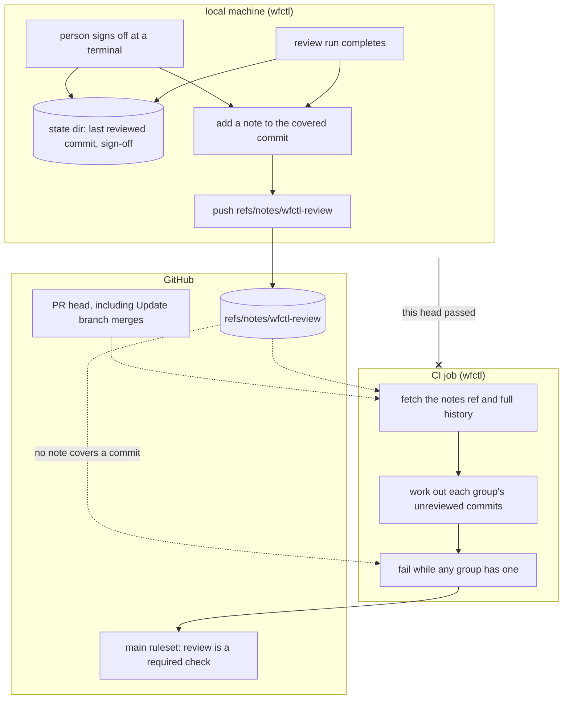

# wfctl publishes each completed review as a git note, and CI works out what is unreviewed

## Context

If a review group has unreviewed commits, the worktree guard blocks `gh pr
create` and `gh pr merge` only when the command exactly matches its rules
(`review-covers-unreviewed-commits.md`). Any alternative invocation (e.g., using
different argument formats or a git alias) bypasses the guard. #622 documents 14
explicit limitations instead of adding more rules. The guard runs as an agent
hook; agents without hook support skip the check entirely.

A required CI check blocks merges in all cases, regardless of how the command
ran. But currently, CI can't run this check because wfctl stores review data
locally (`622-review-records-in-state-dir.md`); CI only sees what was pushed.

wfctl must push a review record that CI can access. This record must include:

- Which commits each review group covered in a complete run
- Which commits a person signed off on (otherwise, signed-off PRs always fail
  CI)

## Direct baseline

One option is to reuse the spec store. wfctl would write each group's last
reviewed commit and sign-off to the branch's spec directory in `review.json`.
This file is committed and pushed to `specs-trunk`. CI fetches and checks
`<branch>/review.json` against the PR's head.

This approach keeps the existing push workflow simple, but it only works if the
spec root is its own Git repository with an upstream branch. In the other three
layouts (a plain folder, the default `specs/` inside the code repo, and a store
with no upstream), nothing gets pushed, so CI has nothing to read. CI would also
need to know where the spec store is, and that location is set only in the local
machine's configuration.

## Decision

When a review run completes, wfctl adds a git note to the run's head commit. A
git note is text that Git attaches to a commit without changing it. Each note
names the review group and the run. wfctl keeps the notes under
`refs/notes/wfctl-review` and pushes that ref to `origin`. A person's sign-off
adds a note the same way.

Only wfctl writes these notes. The worktree guard blocks an agent from running
`git notes` against `refs/notes/wfctl-review` or pushing that ref directly, the
same way it already blocks an agent from running `wfctl review sign-off`.

A CI job fetches the notes ref and finds the commits on the PR that no review
covers, using the same range rules as the local check. The job fails if any
group has an unreviewed commit, and the `main` ruleset makes it a required
check.

A note on commit C means that group reviewed every commit from where the
branch left `main` up to C, since each run starts where the last complete run
ended. A sign-off note means the same for every group. The local record stays
in the state directory, and the guard keeps reading it.

## Owns truth

On the machine that ran the review, wfctl records which commits a complete run
of each group covered and which commits a person signed off on. CI shouldn't
write it since it can't run the review panel. The reviewers are subagents of
the person's own agent, and a CI runner has neither that agent nor its
sign-in.

CI works out which commits on the PR's head no review covers. The local
machine shouldn't decide whether the check passes, because GitHub can change
the PR's head without involving the local machine. For example, GitHub's
"Update branch" button adds a merge of `main` to the branch. The range rules
drop a clean merge like that, so it needs no review. But a pass the local
machine posted for the old head doesn't apply to the new one. If the local machine decided the
result, every "Update branch" would block the PR until someone reran the
review locally.

CI trusts any note it finds on the ref. Anyone who can push to the repository
can write a note, and the agent runs with the person's own Git credentials and
keys, so signing the notes wouldn't help. The guard rule above stops an agent
from writing a note by hand, but only when the command exactly matches its
rules. An agent can still fake the reviewer reports that complete a run. As a
result, the check catches a skipped review or a merge that bypassed the guard,
but not a deliberately forged note. `wfctl verify` has the same limit, since
it's also a local tool (`wfctl-runs-the-verification.md`). Closing the gap
fully would mean running the reviewers in CI, or adding a step that only a
person can take.

## Boundary

A solid arrow is a direct call, and a dotted arrow is something read later.
The arrow ending in x is the local machine's claim that "this head passed",
which CI doesn't accept. CI works out the result itself instead. Any commit
that no note covers fails the check, including every commit on a rebased
branch.

## Considered

- Store the record on the spec store's branch with `wfctl store specs`, as the
  direct baseline describes. We didn't choose this because CI can read it in
  only one of the four spec layouts wfctl supports. CI would also need the spec
  store's location, which is set only in the local machine's configuration. A
  note lives in the code repository, which every CI checkout can already fetch.
- Post a commit status, such as `wfctl/review`, on the head from the local
  machine, and require that status instead of a CI job. This is GitHub's own
  feature for marking a commit as checked, and it needs no stored record. We
  didn't choose it for two reasons:
  1. The local machine would decide the result, so an "Update branch" merge on
     GitHub would block the PR until someone reran the review locally, as Owns
     truth describes.
  2. It ties the check to GitHub's API, but wfctl reaches PRs through tracker
     backends that also cover Gerrit and others.
- Keep the record on a ref per branch, such as `refs/wfctl/review/<branch>`,
  holding `review.json` in a commit. Parallel worktrees would never
  write to the same ref, so pushes are simpler than with one shared notes ref.
  We didn't choose it because the record would be stored by branch name instead
  of by commit. A renamed branch or a stacked PR, whose base is another feature
  branch, would then lose the reviews of commits it shares with that branch.
  Gerrit's review notes plugin records approvals under `refs/notes/review` for
  the same reason. A review applies to a commit, wherever it appears.

## Consequences

- wfctl now pushes notes, in addition to the specs it pushes with
  `wfctl store specs`. If a push fails, such as when offline, the note stays local, and CI
  fails until wfctl pushes it. The `wfctl store reviews` command pushes the
  notes ref again, next to `wfctl store specs`, which does the same for specs.
- If another machine pushed the notes ref first, `origin` rejects the push.
  wfctl then fetches the ref, merges it with
  `git notes merge -s cat_sort_uniq`, and pushes again. Worktrees on one machine share a single
  local notes ref, so they never diverge from each other.
- Pushing the branch starts a CI run on the PR, but pushing the notes doesn't.
  If the branch reaches GitHub before its review's note, the check fails. After
  wfctl pushes the notes, it reruns the PR's failed check. If that rerun fails,
  wfctl prints a warning and the user reruns the check by hand.
- A rebase gives every commit a new id, so notes on the old ids no longer
  cover anything. The check then fails until a review covers the rebased
  commits. This matches the local check, which falls back to the merge base.
- GitHub runs `main`'s copy of the CI job and `main`'s wfctl, so a PR that
  breaks the check code, even by accident, can't pass its own check. The job
  reads the PR's commits and notes only as data.
- The check requires every review group that the PR's base branch lists in
  `wfctl.json`, plus any group the PR's own `wfctl.json` adds. CI reads the
  base branch from GitHub's event, never from the PR's files. A PR that
  removes a group still needs that group's review, and the removal takes
  effect once it reaches `main`. A PR that adds a group needs that group's
  review on the same PR, since adding it means the group should run. The local
  check requires the same groups, so a PR that removes a group is blocked
  locally too.
- A local run measures the branch against both `origin/main` and the local
  `main`, while CI measures against `origin/main` only. A commit that's on the
  local `main` but was never pushed is left out of the run, and CI would read
  the run's note as covering it. So before wfctl writes a note, it works out
  the commits CI would count as reviewed, and it writes no note while any of
  them was left out of every run of that group. The run stays complete, so the
  guard allows the PR and CI fails it. `wfctl review sign-off` lists those
  commits too, so a person sees them before signing off, and the note is
  written once the sign-off covers them. If wfctl can't work out those
  commits, the sign-off refuses rather than covering them unseen. A trunk the
  working tree's `wfctl.json` declares, and that `origin` has, is trusted for
  this check. An agent could push such a branch on purpose, but an agent
  can also write the reviewer reports that complete a run, which Owns truth
  already accepts, so this adds no new way past the check.
- The ruleset pins the `review` check to the GitHub Actions app, so a status
  someone posts by hand doesn't satisfy it. But a PR can add its own job named
  `review` to a workflow that runs the PR's copy, such as `ci.yml`, and that
  job reports under the same app. A repository owned by a person can't make a
  ruleset require one specific workflow file, so this stays a limit, like a
  forged note. Quickstart step 4 checks how GitHub treats the two check runs.
- The guard rule also blocks a push of the short name `notes/wfctl-review`, a
  wildcard refspec such as `refs/*:refs/*`, `git update-ref` or `git fetch`
  into a notes ref, and setting a remote's `push` or `mirror` with `-c` or
  `git config`. These are the plain commands, not every one. Git has more
  ways to write a ref or change what a push carries, such as `symbolic-ref`,
  a remote's `fetch` setting, `git remote add --mirror`, and config set
  through environment variables, and a git alias or a script runs any of
  them out of sight of a rule that reads the command's text. Each round of
  review found more, so the rule stops at the plain route, and a forged note
  through any other route is the limit Owns truth accepts.
- A test runs the CI check against a scratch repository. It fails if an
  unreviewed commit passes, or if a commit that a note or a sign-off covers
  fails. The test makes sure CI and the local check agree on what is
  unreviewed.

## Log

- 2026-10-24  proposed    — #627 level 2, unattended run. Waiting on Andre,
  including whether CI should trust any pushed note, which his comment on #627
  left as a decision for this issue.
- 2026-10-24  revised     — Andre accepted that CI can't catch a forged note,
  and added the guard rule that blocks an agent from writing one by hand.
- 2026-10-25  accepted    — Andre in the 627-ci-review-check session, 2026-10-24: approved the record after the trust answer, the guard rule, and the wfctl store reviews name
- 2026-10-25  revised     — Andre in the #627 plan session and plan walkthrough:
  CI runs `main`'s job and wfctl rather than the PR's, so a PR can't weaken
  its own check by accident. CI requires `main`'s review groups plus any the
  PR adds. wfctl reruns the failed check after pushing notes, and a failed
  rerun is the user's to retry.
- 2026-10-25  revised     — Andre after the second #627 plan review: the local
  check requires the same groups as CI, and CI measures against the PR's base
  branch from GitHub's event, so a `trunk` key in the PR's own `wfctl.json`
  can't skip review.
- 2026-10-26  revised     — Andre after the #627 security review: wfctl writes
  no note that would cover a commit no run reviewed, a PR's own `review` job is
  a stated limit, and the guard blocks more ways to write or push the notes
  ref. After the code review, a sign-off lists the commits the note check
  found, so that check has a way out.
