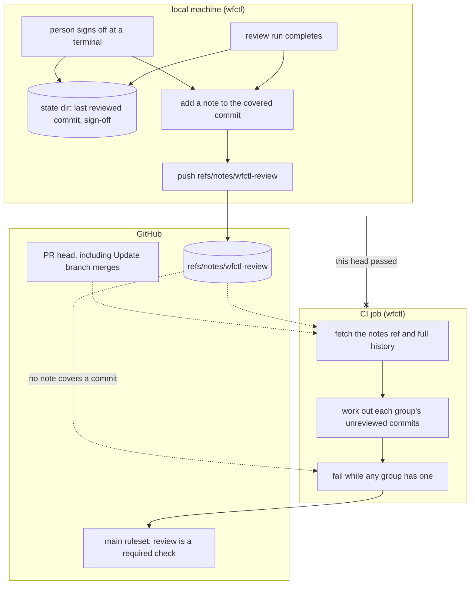

# wfctl publishes each completed review as a git note, and CI works out what is unreviewed

## Context

The worktree guard refuses `gh pr create` and `gh pr merge` while a review group
has commits it hasn't reviewed (`review-covers-unreviewed-commits.md`). The guard
reads the command's text, so a command spelled another way gets past it. #622's
spec lists 14 such spellings as known limits, from `xargs gh` to a git alias in
`.git/config`. An agent that has no hooks gets no check at all.

A required CI check closes all of them, because GitHub blocks the merge however
the command was typed. Currently, CI can't run one. wfctl keeps the last
reviewed commit and any sign-off in the branch's state directory on the local
machine (`622-review-records-in-state-dir.md`), and CI sees only what was
pushed.

So wfctl has to push a review record somewhere CI can read it. The record has
to carry two things:

1. Which commits a complete run of each review group covered.
2. Which commits a person signed off on. Without it, a signed-off PR fails CI
   forever.

## Direct baseline

The smallest change reuses the spec store. wfctl writes a `review.json` with
each group's last reviewed commit and the sign-off into the branch's spec
directory. The `wfctl store specs` command commits it to `specs-trunk` and
pushes, the same way specs already travel. A CI job fetches `specs-trunk`, reads
`<branch>/review.json`, and checks the PR's head against it.

This adds no new push path. However, it works only in the one layout where the
spec root is its own git checkout with an upstream branch.
`spec-storage-read-from-git.md` names three layouts where wfctl commits nothing:
a plain folder, the default `specs/` inside the code repository, and a store
with no upstream. In each of them, CI has nothing to read. CI would also need to
know which branch, and possibly which repository, holds the spec store, and that
lives in the local machine's configuration rather than in the code repository.

## Decision

When a review run completes, wfctl adds a git note to the run's head commit
under `refs/notes/wfctl-review`, naming the group and the run, and pushes that
ref to `origin`. A person's sign-off adds a note the same way. A CI job fetches
the notes ref and works out, with the same range rules the local check uses,
which commits on the PR have no review covering them. The job fails when any
group has one, and it is a required check in the `main` ruleset.

A note on commit C means every commit from where the branch left `main` up to C
was reviewed by that group, because each run starts where the last complete one
ended. A sign-off note means the same for every group. The local record in the
state directory stays where it is, and the guard keeps reading it.

## Owns truth

wfctl, on the machine that ran the review, writes "which commits did a complete
run of each group cover, and which did a person sign off on?". CI shouldn't
write this since it can't run the panel. The reviewers are subagents of the
person's own agent, and a CI runner has neither the agent nor its sign-in.

CI works out "which commits on this PR's head does no review cover?". The local
machine shouldn't answer this as a pass or fail, because the head can change on
GitHub without it. For example, GitHub's "Update branch" button adds a merge of
`main` to the branch. The range rules drop a clean merge like that, so it needs
no review, but a pass the local machine posted for the old head says nothing
about the new one. If the local machine owned the verdict, every "Update branch"
would block the PR until someone reran the review locally.

CI trusts any note it finds on the ref. Anyone who can push to the repository
can write one, so the check catches a review that was skipped or a merge that
got past the guard, not a record forged on purpose. `wfctl verify` has the same
limit, since it is also a local tool (`wfctl-runs-the-verification.md`).

## Boundary

A solid arrow is a direct call, and a dotted arrow is something read later. The
arrow ending in x is a claim CI doesn't accept from the local machine: CI works
out the verdict itself rather than reading one. A commit no note covers,
including every commit on a rebased branch, fails the check.

## Considered

- Store the record on the spec store's branch with `wfctl store specs`, as the
  direct baseline describes. We didn't choose this because CI can read it in
  only one of the four spec layouts wfctl supports, and CI would have to learn
  the spec store's location from configuration that exists only on the local
  machine. A note lives in the code repository, which every CI checkout can
  already fetch.
- Post a commit status, such as `wfctl/review`, on the head from the local
  machine, and require that status instead of a CI job. This is GitHub's own
  feature for marking a commit as checked, and it needs no stored record. We
  didn't choose it for two reasons:
  1. The local machine would own the verdict, so an "Update branch" merge on
     GitHub would block the PR until someone reran the review locally, as
     Owns truth describes.
  2. It ties the check to GitHub's API, while wfctl reaches PRs through tracker
     backends that also cover Gerrit and others.
- Keep the record on a ref per branch, such as `refs/wfctl/review/<branch>`,
  holding a `review.json` commit. Parallel worktrees would never write the same
  ref, which makes pushes simpler than with one shared notes ref. We didn't
  choose it because the record would be keyed by branch name rather than by
  commit. A renamed branch or a stacked PR, whose base is another feature
  branch, would then lose the reviews of commits it shares with that branch.
  Gerrit's review notes plugin records approvals under `refs/notes/review` for
  the same reason: a review is about a commit, wherever it appears.

## Consequences

- wfctl gains a second push path beside `wfctl store specs`. A push that fails,
  such as offline, leaves the note local, and CI fails until the note is
  pushed. wfctl needs a command that pushes the notes ref again.
- A push of the notes ref is rejected when another machine pushed first. wfctl
  then fetches the ref, merges it with `git notes merge -s cat_sort_uniq`, and
  pushes again. Worktrees on one machine share a single local notes ref, so
  they never diverge from each other.
- A CI run on the PR starts when the branch is pushed, not when the notes are.
  If the branch reaches GitHub before its review's note does, the check fails
  and has to be rerun. Its failure message says so.
- A rebase gives every commit a new id, and notes on the old ids no longer
  cover anything. The check then fails until the rebased commits are reviewed,
  which matches how the local check falls back to the merge base.
- The CI job runs the PR's own copy of wfctl and reads the PR's own
  `wfctl.json` for its review groups. A PR can therefore weaken the check, the
  same way it can edit `ci.yml`, since GitHub runs a PR's own workflow file.
- A test runs the CI check against a scratch repository, and fails when an
  unreviewed commit passes or a commit covered by a note or a sign-off fails.
  It guards the rule that CI and the local check agree on what is unreviewed.

## Log

- 2026-10-24  proposed    — #627 level 2, unattended run. Waiting on Andre,
  including whether CI should trust any pushed note, which his comment on #627
  left as a decision for this issue.
