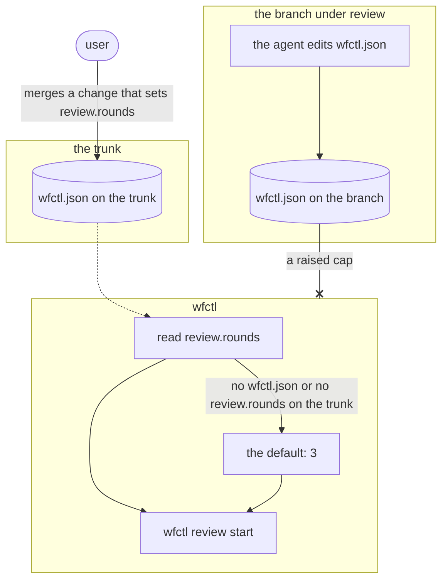

# wfctl reads the round cap from the trunk

## Context

wfctl stops a review group after a set number of rounds on one branch
(`review-round-count.md`). A repository should be able to choose that number.
The `review` key in `wfctl.json` is where a repository already declares its
review groups and reviewers, so the cap belongs there too.

Currently, wfctl reads `wfctl.json` from the working tree of the branch under
review. The agent can edit that file on its own branch, so a cap read from
there is one the agent can raise without asking. The cap exists to stop the
agent's loop, so the agent shouldn't be the one who sets it.

## Direct baseline

Hard-code the cap at 3 in wfctl, with no `wfctl.json` key. This is the number
`opening-a-change` states today, and the one Anthropic uses for its own
reviewer.

The agent can't change a constant in the installed wfctl. However, a repository
that wants a different number has to wait for a wfctl release, and wfctl's
defaults are meant to be a starting point a repository can change.

## Decision

A repository sets the cap as `review.rounds` in `wfctl.json`, and the default
is 3. wfctl reads the value from the copy of `wfctl.json` on the trunk, not
from the branch under review. If the trunk has no `wfctl.json`, or the file has
no `review.rounds`, wfctl uses the default.

So raising the cap is a change merged to the trunk. On one branch, the way past
the cap is the user's sign-off.

## Owns truth

The trunk holds how many rounds a branch may run. wfctl reads it from there,
and the branch under review has no say.

The branch shouldn't set its own cap, since the agent writes the branch and the
cap exists to stop the agent. A change reaches the trunk only through a merge,
and the worktree guard refuses `gh pr merge` from an agent until every group
has reviewed the change or the user has signed off.

## Boundary

A solid arrow is a direct call, a dotted arrow is a file wfctl reads later, and
an arrow ending in x is a value wfctl doesn't accept from the branch.

## Considered

- Hard-code the cap at 3, as described in the direct baseline. We didn't
  choose this because Andre wants the cap configurable, so a repository can
  pick its own number without a wfctl release.
- Read `review.rounds` from the branch, the way every other `review` setting
  is read. We didn't choose this because the agent writes the branch and could
  raise its own cap. The groups and reviewers can stay on the branch, since
  changing them doesn't let the agent run more rounds.
- Let the user grant more rounds on one branch with a command in their own
  terminal. We didn't choose this because sign-off already lets a change
  through, and Andre wasn't convinced a second command earns its place.

## Consequences

- A change to `review.rounds` on a branch has no effect until it merges.
  `wfctl review start` says so when the branch and the trunk disagree, so the
  edit doesn't look like it was ignored.
- `wfctl check config` validates `review.rounds` in the working tree, the same
  way it validates the rest of the `review` key. Level 3 decides what
  `review start` does with a value on the trunk that `check config` would
  reject.
- The trunk is protected only as well as the repository protects it. This
  repository's ruleset refuses every direct push to `main`. In a repository
  with no such rule, an agent that can push to the trunk can raise the cap, and
  the push shows up as a commit on the trunk.
- The cap is also not unforgeable locally. An agent can move a local ref, the
  same tamper-evident limit the run records have.

## Log

- 2026-10-25  proposed    — #626 level 2, after Andre asked for a configurable
  cap and wasn't convinced by a per-branch grant command
- 2026-10-25  accepted    — Andre in the #626 session chat, 2026-10-25, after clarify
