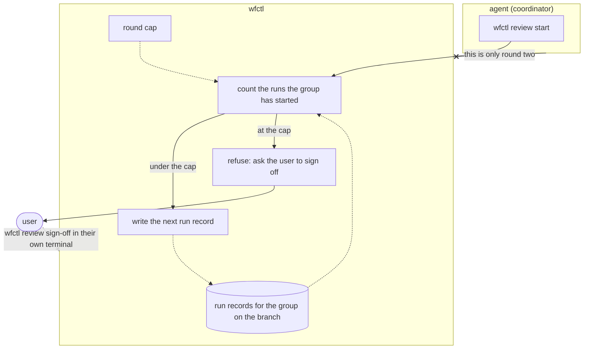

# wfctl counts each group's review rounds

## Context

A review round is one run of every review group, in order: security reviews
the commits it hasn't seen, and then code reviews the commits it hasn't seen.
Each fix a group commits is a new commit, so it starts another round, and #294
shows that a second panel finds new problems in the first panel's fixes. In an
unattended run, nobody is there to stop that loop, and each round launches
every reviewer in every group. In this repository that is eight reviewers per
round.

Currently, the cap is only an instruction. Step 1 of `opening-a-change` tells
the agent to stop after three rounds and count them itself. wfctl numbers each
group's runs but doesn't count them, and nothing refuses a fourth.

The same step also tells the security group to run again over its own fixes
before code starts. That makes security run more often than code, so a round
has no fixed number of runs, and counting runs doesn't count rounds.

## Direct baseline

Keep the cap as an instruction. The agent counts rounds in its own
conversation and stops after the third, as `opening-a-change` says today.

This needs no new code. However, the count lives only in the conversation, and
an unattended run is the one most likely to be cleared or restarted partway.
After a restart, the count starts again at zero at the point where the cap
should apply.

## Decision

Each group runs once per round. Security no longer runs again over its own
fixes before code starts, and those fixes wait for security's next run, which
covers every commit since its last review as before. So a group's run count on
a branch is the branch's round count.

`wfctl review start <group>` counts the runs the group has started on the
branch and refuses to start one past the cap. The refusal tells the agent to
stop and ask the user to sign off with `wfctl review sign-off`, which is still
the way past the cap. The cap is read from the trunk
(`review-round-cap.md`).

## Owns truth

wfctl counts how many rounds a group has run on the branch, and decides
whether it may start another.

The agent shouldn't count, since it's the party whose loop the cap exists to
stop. And the agent can't keep the count reliably, because a cleared or
restarted conversation loses the count at the point where it matters. The run
records are on disk in the branch's state directory, and wfctl counts them the
same way on the tenth run as on the first.

## Boundary

A solid arrow is a direct call, a dotted arrow is a file wfctl reads later, and
an arrow ending in x is a claim wfctl doesn't accept from the agent.

## Considered

- Keep the cap as an instruction, as described in the direct baseline. We
  didn't choose this because the count is lost when the conversation is
  cleared or restarted, which is when an unattended run needs it most.
  `wfctl-counts-the-passes.md` rejects the same baseline for the pipeline loop
  for this reason.
- Keep security's extra run over its own fixes, and count full rounds of the
  panel instead of runs. We didn't choose this because wfctl would have to
  decide where one round ends and the next begins, from runs whose number per
  round varies. Running each group once per round makes a round something
  wfctl can count from the run records it already writes. In a worked example,
  the same change took five runs the old way and four this way.
- Count only completed runs. We didn't choose this because the cost of a run
  is spent when the reviewers launch, not when they report. A loop that starts
  runs and never completes them would never reach the cap.
- Add a command the user runs to grant more rounds on one change, such as
  `wfctl review extend 2`. We didn't choose this because the user wasn't
  convinced it earns a second command beside the sign-off. Sign-off already
  lets the change through, and a repository that wants more rounds raises the
  cap.

## Consequences

- `opening-a-change` drops the instruction to run security again over its own
  fixes, and the sentence that says wfctl doesn't count rounds yet.
- A run started and abandoned before its reports arrive still counts as a
  round. Level 3 decides whether `review start` reuses an incomplete run at the
  same head rather than starting another.
- Rounds count across the whole branch, before and after the PR opens. A fix
  for a review comment on an open PR uses a round like any other fix.
- A sign-off doesn't reset the count. A commit added after a sign-off is
  unreviewed again, and once the cap is reached it needs another sign-off.
- The count is tamper-evident, not unforgeable. An agent can delete run
  records in the state directory, the same limit `review-covers-unreviewed-commits.md`
  accepts for forged reports.

## Log

- 2026-10-25  proposed    — #626 level 2, after Andre chose one run per group
  per round and sign-off as the way past the cap
- 2026-10-25  accepted    — Andre in the #626 session chat, 2026-10-25, after clarify
