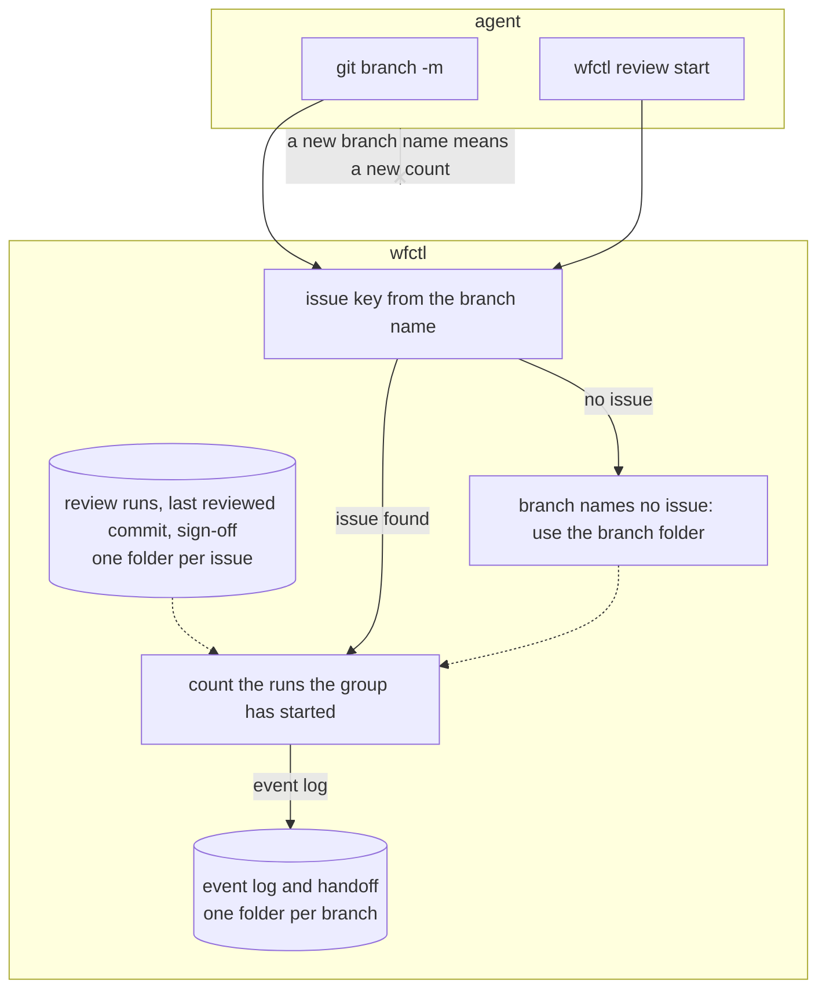

# wfctl counts review rounds by issue, not by branch name

## Context

`review-round-count.md` makes wfctl count each group's review rounds, so an agent
that reaches the cap needs a person's sign-off to continue. Currently, wfctl
keeps those counts in the branch's state folder, which is named after the full
branch name, such as `626-review-round-cap`. The same folder holds the last
reviewed commit and the sign-off.

When an agent runs `git branch -m 626-round-cap`, wfctl looks for a state folder
under the new name and finds none. The count starts again at zero, and the agent
gets three more rounds without anyone being asked. A rename is an ordinary git
command that leaves no sign it was used to get past the cap. A user who
renames a branch to shorten it loses their sign-off the same way.

## Direct baseline

Leave the state folder keyed by branch name and accept that a rename resets the
count. This requires no code changes. However, anyone who runs `git branch -m`
can then get past the round cap, which is what the cap exists to stop in an
unattended run.

## Decision

wfctl keeps each review group's run records, its last reviewed commit, and the
sign-off in a folder named after the branch's issue, not the branch. A
branch that names no issue, such as `main`, keeps the folder named after the
branch. A `WFCTL_STATE_DIR` override still pins one folder for every branch.

Two branches that name the same issue share one folder. This means a stacked PR
with a different slug starts with the rounds the first branch used. The user
signs off to continue past the cap.

The event log and the session handoff stay in the branch's own folder. wfctl
doesn't read runs recorded in a branch folder before this change, so each
branch's count restarts once. wfctl has one user right now, so we accept this
cost while that holds.

## Owns truth

wfctl counts how many rounds a change has used and records whether the user
has signed off on it. It keeps both under the issue key, which it takes from
the branch name using the repository's `key_pattern`.

The agent shouldn't keep this count, because it controls the branch name. If
the count were keyed on the branch name, the agent could reset it with one git
command.

## Boundary

A solid arrow is a direct call, a dotted arrow is a file wfctl reads later, and
an arrow ending in x is a claim wfctl doesn't accept from the agent.

## Considered

- Give each branch its own count even when branches share an issue, as the
  direct baseline does. We didn't choose this because a new branch on the same
  issue would then be another way past the cap. The cap exists to limit the
  rounds on one change.
- Move the whole state folder to the issue key. We didn't choose this because
  the folder also holds the session handoff and the event log, and `wfctl start`
  already derives those from the branch. Moving them would change more than
  the bug needs.
- Detect a rename and move the folder to the new name. We didn't choose this
  because git doesn't record a rename, so wfctl would have to detect it. A new
  branch with a copied name would be another case to handle.
- Carry the old branch folders forward the first time wfctl reads them. We
  didn't choose this because it adds a second place that reads state wfctl no
  longer writes. The cost it would avoid is one reset for a single user.

## Consequences

- A stacked PR for an issue starts with the rounds an earlier branch on that
  issue used. The user signs off to continue.
- When wfctl refuses a run at the cap, the message says the group ran its
  rounds "on this branch". That is no longer accurate for a second branch on
  the same issue. The wording is left for a follow-up.
- The count stays tamper-evident, not unforgeable, as `review-round-count.md`
  already accepts. An agent can still rename a branch to name a different issue
  number, or delete the run records.

## Log

- 2026-10-27  proposed    — #666 level 2, after Andre chose one count per issue shared by every branch that names it
