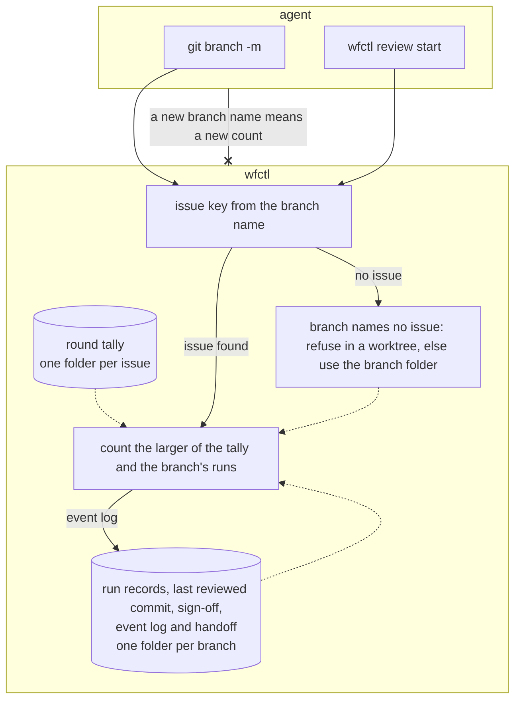

# wfctl counts review rounds by issue, not by branch name

## Context

`review-round-count.md` makes wfctl count each group's review rounds, so an agent
that reaches the cap needs a person's sign-off to continue. Currently, wfctl
keeps those counts in the branch's state folder, which is named after the full
branch name, such as `626-review-round-cap`. The same folder holds the last
reviewed commit and the sign-off.

When an agent runs `git branch -m 626-round-cap`, wfctl looks for a state folder
under the new name and finds none. The count starts again at zero, and the agent
gets three more rounds without anyone being asked. A rename is an ordinary git
command that leaves no sign it was used to get past the cap. A user who
renames a branch to shorten it loses their sign-off the same way.

## Direct baseline

Leave the state folder keyed by branch name and accept that a rename resets the
count. This requires no code changes. However, anyone who runs `git branch -m`
can then get past the round cap, which is what the cap exists to stop in an
unattended run.

## Decision

wfctl keeps a tally of the rounds each review group has run in a folder named
after the branch's issue, not the branch. Each round adds one empty folder to
the tally. The run records, the last reviewed commit, and the sign-off stay in
the branch's own state folder. A branch that names no issue, such as `main`,
keeps its tally in the folder named after the branch. A `WFCTL_STATE_DIR`
override still pins one folder for every branch.

When a group starts a round, wfctl counts the larger of the issue's tally and
the branch's own run records. A rename can't lower the count, and a branch whose
runs were recorded before the tally existed keeps its count.

In a worktree of a repository with a tracker, `wfctl review start` refuses a
branch that names no issue. Otherwise `git branch -m 626-x scratch` would
restart the count in an empty folder. This is the same test `wfctl start`
applies, so the main checkout, the trunk branch, and a repository with no
tracker are not refused.

Two branches that name the same issue share one tally. This means a stacked PR
with a different slug starts with the rounds the first branch used. The user
signs off to continue past the cap.

The coverage stays with the branch because CI reads it that way. CI decides
which commits a group reviewed from git notes reachable from the branch under
review. If two stacked branches shared a last reviewed commit, finishing a
review on the child would make the guard treat the parent's commits as covered,
and CI would still reject the parent, since it can't see a note on the child.

The event log and the session handoff stay in the branch's own folder. wfctl
doesn't read the tally for rounds run before this change, so each issue's count
restarts once, except for a branch whose own run records still show them. wfctl
has one user right now, so we accept this cost while that holds.

## Owns truth

wfctl counts how many rounds a change has used. It keeps that count under the
issue key, which it takes from the branch name using the repository's
`key_pattern`. wfctl also records which commits a branch had reviewed and
whether the user has signed off on it, and it keeps those under the branch.

The agent shouldn't keep this count, because it controls the branch name. If
the count were keyed on the branch name, the agent could reset it with one git
command.

## Boundary

A solid arrow is a direct call, a dotted arrow is a file wfctl reads later, and
an arrow ending in x is a claim wfctl doesn't accept from the agent.

## Considered

- Give each branch its own count even when branches share an issue, as the
  direct baseline does. We didn't choose this because a new branch on the same
  issue would then be another way past the cap. The cap exists to limit the
  rounds on one change.
- Keep the run records, last reviewed commit, and sign-off under the issue as
  well. We first chose this, and the Codex review on #673 showed the problem.
  Two stacked branches on one issue would share a last reviewed commit, so the
  child's review would cover the parent locally while CI rejected the parent.
  We didn't keep it because the tally is all the cap needs.
- Move the whole state folder to the issue key. We didn't choose this because
  the folder also holds the session handoff and the event log, and `wfctl start`
  already derives those from the branch. Moving them would change more than
  the bug needs.
- Detect a rename and move the folder to the new name. We didn't choose this
  because git doesn't record a rename, so wfctl would have to detect it. A new
  branch with a copied name would be another case to handle.
- Carry the old branch folders forward the first time wfctl reads them. We
  didn't choose this because it adds a second place that reads state wfctl no
  longer writes. The cost it would avoid is one reset for a single user.

## Consequences

- A stacked PR for an issue starts with the rounds an earlier branch on that
  issue used. The user signs off to continue.
- A rename leaves the branch's run records, last reviewed commit, and sign-off
  behind. The renamed branch is reviewed again from the trunk, and at the cap the
  user signs off a second time. The count still holds, so a rename opens no way
  past the cap.
- When wfctl refuses a run at the cap, the message says the group ran its
  rounds "on this branch". That is no longer accurate for a second branch on
  the same issue. The wording is left for a follow-up.
- In the main checkout and in a repository with no tracker, a rename to a name
  with no issue still restarts the count. Neither has an issue to count under.
- The count stays tamper-evident, not unforgeable, as `review-round-count.md`
  already accepts. An agent can still rename a branch to name a different issue
  number, or delete the run records.

## Log

- 2026-10-27  proposed    — #666 level 2, after Andre chose one count per issue shared by every branch that names it
- 2026-10-27  accepted    — Session on #666, 2026-10-27: approved one shared round count per issue, then reviewed the record in chat
- 2026-10-27  proposed    — #666, after the Codex review on #673 found stacked branches would share coverage; only the round count stays shared
