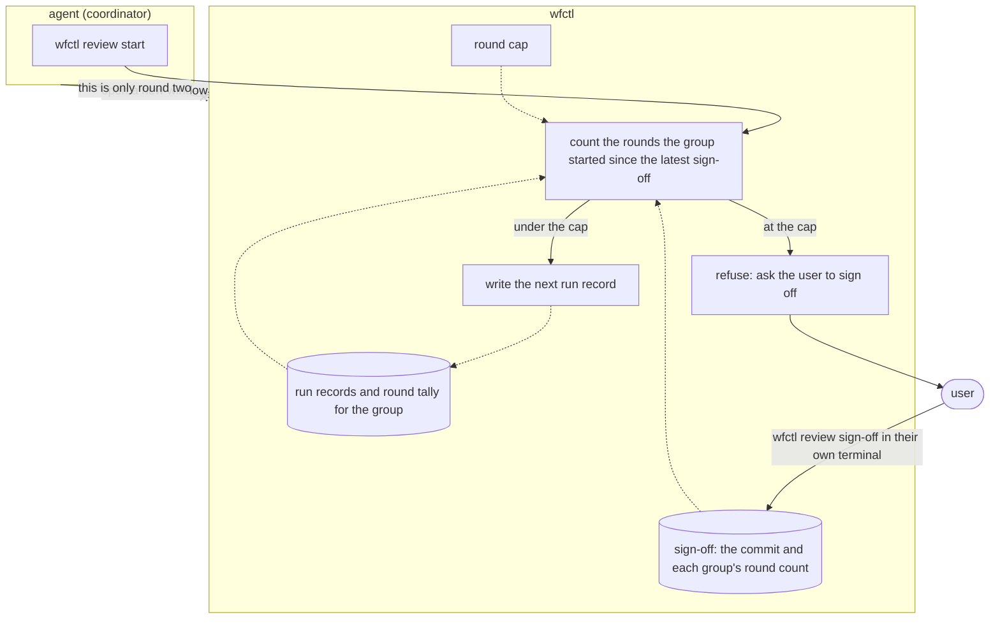

# A sign-off opens a new window of review rounds

## Context

A review round is one run of every review group, in order. Each fix a group
commits is a new commit, so it starts another round. In an autonomous run,
nobody is there to stop that loop, so wfctl counts each group's runs on the
branch and refuses to start one past the cap (`review-round-count.md`). The
user gets past the cap by signing off with `wfctl review sign-off`.

Currently, a sign-off doesn't reset the count. It covers the commits it lists,
and any commit added after it is unreviewed. Once a group is at the cap,
`wfctl review start` refuses every later commit until the user signs off again.
As a result, every commit after the third round needs its own sign-off,
including a one-line fix for a PR review comment, and no reviewer looks at any
of them.

For example, a branch reaches its third round, and a PR reviewer then leaves
four comments. The agent fixes each one in its own commit, B to E. Today the
user signs off four times, and the panel reviews none of the four fixes. A run
that keeps hitting the cap gets reviewed less, which defeats the purpose of the
panel.

## Direct baseline

Keep `review-round-count.md` as it is. The user signs off on each commit past
the cap, and a repository that wants more rounds raises `review.rounds` on the
trunk.

This needs no new code. However, each sign-off still lets a commit through
unreviewed. The cap also doesn't stop the loop, since it asks the user to
approve each pass instead.

## Decision

Each group runs once per round, and wfctl counts the rounds each group has
started, as `review-round-count.md` decided. A sign-off now also opens a new
window: each group can start up to the cap's number of rounds again, counted
from the latest sign-off. When a group has used its window, `wfctl review
start` refuses as it does today and asks the user to sign off again.

The sign-off still covers the commits it lists, so the user can sign off and
merge right away. This keeps the release flow working, since a release PR gets
no panel and merges on a sign-off alone.

A sign-off doesn't move a group's last reviewed commit. As a result, the first
round in a new window reviews every commit since the group's last review,
including the ones the sign-off covered. In practice, the user signs off at the
commit `review start` just refused, and the next round reviews that commit.

The window size is the cap `review start` reads when it runs. The sign-off
records each group's round count at the time it was given, not the cap. So when
#723 lets the user approve a branch's own cap, the window follows that cap, and
there's no second setting to keep in sync.

In the example above, the user signs off at B. Rounds 4, 5, and 6 review B, C,
and D. At E, `review start` refuses until the user signs off again. The user
signs off twice, and every fix gets a review.

## Owns truth

wfctl counts how many rounds each group has started since the latest sign-off,
and decides whether the group may start another. The user decides when a new
window opens, by signing off in their own terminal.

The agent shouldn't keep the count, since the cap exists to stop the agent's
loop. The agent also can't keep the count reliably, because clearing or
restarting the conversation loses it right when it matters.

The agent shouldn't open a window either, because then the cap would stop
nothing. The worktree guard refuses `wfctl review sign-off` from an agent, and
the command requires a person at an interactive terminal.

## Boundary

A solid arrow is a direct call, a dotted arrow is a file wfctl reads later, and
an arrow ending in x is a claim wfctl doesn't accept from the agent. With no
sign-off on the branch, the window starts at the branch's first round, which
matches today's count.

## Considered

- Keep the cap as it is, as described in the direct baseline. We didn't choose
  this because each commit past the cap gets a sign-off and no review, so the
  run that hits the cap most often is the one reviewed least.
- Count one window for the whole branch rather than per group. We didn't choose
  this because today's count is per group, and per group is the smaller change.
  Since each group runs once per round, the two counts agree in practice.
- Have the sign-off only open the window and stop covering its commits, so the
  panel has to review them before merge. We didn't choose this because a user
  who signs off to merge right away would have to run another round first. That
  breaks the release flow, where a release PR merges on a sign-off alone.
- Add a command the user runs to grant more rounds, such as
  `wfctl review extend 2`. We didn't choose this because the sign-off already
  serves as the user's approval to continue, and `review-round-count.md`
  rejected the same command for the same reason.
- Store the cap in the sign-off, so a window keeps the size it had when it
  opened. We didn't choose this because a branch would then carry a cap the
  trunk no longer sets, and #723's approved branch cap would have a second value
  to disagree with.

## Consequences

- The `review-round-count.md` consequence that "a sign-off doesn't reset the
  count" no longer holds. Its other decisions and consequences carry over
  unchanged: one run per group per round, a run that's started and abandoned
  still counts, rounds count across the whole branch before and after the PR
  opens, and the count is tamper-evident rather than unforgeable.
- Signing off twice in a row doesn't stack windows. The window is counted from
  the latest sign-off, so a second sign-off with no rounds in between leaves the
  same window.
- Renaming a branch after a sign-off closes its window, and the user signs off
  again. The sign-off stays in the branch's own state folder
  (`review-round-issue-key.md`), while the round tally is kept by issue, so the
  new folder has no sign-off. This errs toward fewer rounds.
- `wfctl review sign-off` still says "nothing unreviewed" when every commit has
  been reviewed, so the user can't open a window before one is needed. The user
  signs off at the next refusal.
- `wfctl status` counts the window the same way `review start` does, so the
  status screen and the refusal always agree. #665's status row shows
  each group's rounds against the cap, and with this decision that count is the
  rounds since the latest sign-off.
- The round counts in the sign-off are tamper-evident, not unforgeable. An
  agent can edit the sign-off file in the state folder, the same limit the run
  records have.

## Log

- 2026-11-05  proposed    — #725 level 2, after Andre agreed a sign-off opens a
  per-group window, still covers its commits, and leaves the window size to the
  cap `review start` reads
- 2026-11-06  accepted    — #725 level-2 design session, 2026-11-05: Andre agreed a sign-off opens a per-group window, still covers its commits, and leaves the window size to the cap
