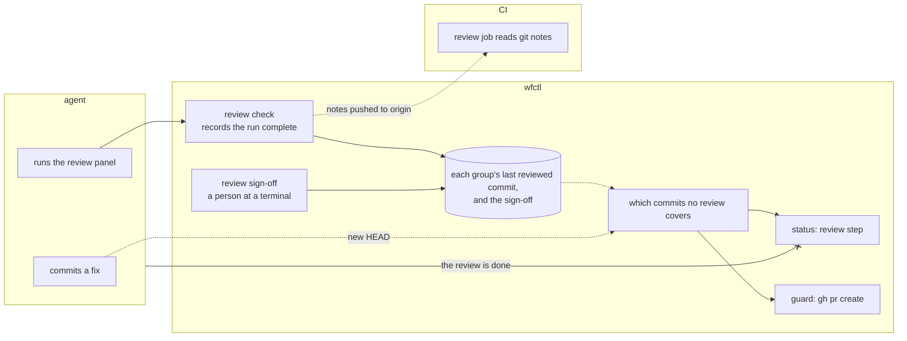

# The review step reads the PR guard's files

## Context

After `implement` finishes, `wfctl status` reports the story complete and
names no next command. As a result, the review panel runs only when someone
remembers it. On pfms #919, every step reported done, and the panel ran only
because the user asked for it.

The worktree guard is the only place wfctl enforces the panel. It blocks `gh pr
create` while any review group has commits it hasn't reviewed. This means
`wfctl status` and the guard already disagree. Status reports the work
finished, and the guard blocks the PR that finishing was supposed to allow.

A repository can't close this gap by declaring its own pass in `wfctl.json`. A
declared pass is done once its evidence file exists, and it stays done after
later commits. As a result, a review pass would report done after the first
round, even when nobody reviewed the newest commits.

## Direct baseline

Leave the pipeline as it is and rely on the guard. The `opening-a-change` skill
already runs every review group before it opens a PR, and the guard blocks the
PR if it didn't.

This costs nothing, but it fails in the case #679 describes. An agent that
reads `wfctl status` to decide what to do next sees nothing left to do. It
either ends the session, or opens a PR and the guard blocks it after the work
was reported as finished.

## Decision

wfctl adds `review` as a built-in step after `implement`. The step is done when
every required review group has reviewed the current HEAD, or a person has signed
off. wfctl checks this using the same files and the same function as the PR
guard.

Those files already exist, so this decision adds no new record. `wfctl review
check` writes each group's last reviewed commit when a run completes, and `wfctl
review sign-off` writes the sign-off. If the branch gets a new commit after the
last review, the step reports pending again.

## Owns truth

wfctl checks whether every review group has reviewed the current HEAD. It reads
only the files that `wfctl review check` and `wfctl review sign-off` write. A
group counts as reviewed only when every expected reviewer has filed a report
naming the run's head commit.

The agent shouldn't mark its own review done, since it would be grading its own
work. That's why the step has no completion command. The agent can run the
panel, but only `wfctl review check` can record the run as complete, and only a
person at a terminal can sign off.

The step reads the guard's local files, not the git notes that CI reads.
Because the guard is the check right after this step, `wfctl status` and the
guard have to give the same answer for the same branch. The notes reach
`origin` only when a push succeeds. If status read the notes, a failed push
would leave status reporting the review pending while the guard allows the PR.

## Boundary

Solid edges are calls. Dotted edges are values read later: the files on disk,
the branch's HEAD, and the notes CI fetches. The crossed edge is the claim wfctl
never accepts from the agent.

## Considered

- **The direct baseline above.** We didn't choose it because `wfctl status`
  would then report the work finished while the guard blocks its PR, which is
  what happened on pfms #919.
- **Read the git notes, the way CI does.** This would make status agree with CI
  rather than the guard, and since the notes are on `origin`, they aren't lost
  with the local machine. We didn't choose it because the notes depend on a
  push that can fail without stopping the run. Status would then disagree with
  the guard, which is the check the agent reaches next.
- **A new completion record that the step reads.** #679 proposed one that names
  the commit a run covered. We didn't choose it because `wfctl review check`
  already writes that commit for each group. A second copy could disagree with
  the first, and the guard would keep reading the first.
- **A declared pass under `implement` in `wfctl.json`.** We didn't choose it
  because a declared pass reports done once its file exists, and stays done
  after later commits.

## Consequences

Every repository gets the step, since `security` and `code` run by default when
`wfctl.json` declares no `review` key. If a repository sets `review.rounds` to
0, every change needs a sign-off. The same holds for a group that has used all
its rounds. The step blocks with a reason naming the group, so an unattended
run stops and asks the user to sign off instead of starting a panel that
`review start` refuses.

A new commit after the review makes `implement` stale as well, because `wfctl
verify` recorded an older HEAD. So the next command is `wfctl verify`, and the
review step comes after it.

While groups have unreviewed commits, the step's status line lists each group
and how many commits it has left, so the agent knows which groups to run.

## Log

- 2026-10-31  proposed    — #679: the pipeline reports a branch complete
  before the review panel runs, and only the PR guard notices
- 2026-10-31  accepted    — Andre in the #679 session, 2026-10-31: accepted after the plan review fixes, including blocking on a capped review group and leaving the guard's record check outside the review step
