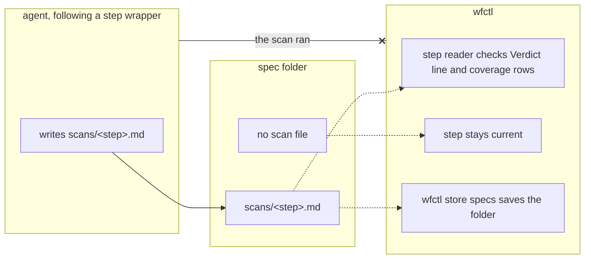

# Scan files live in the spec folder, and wfctl reads them

## Decision

Clarify, plan review, and analyze write their scan file to the feature's spec
folder as `scans/<step>.md`, next to the files they review. The code repository
doesn't commit it, and the PR doesn't link to it. Each step stays current in
`wfctl status` until its scan file is there with a `Verdict` line and at least
one coverage row with a status. That check replaces the PR reviewer as the way
to find a skipped scan.

An evaluation scan, written by a spike that runs no pipeline step, keeps the old
path, `<arch-root>/scans/<issue>-evaluation.md`, and is still committed.

## Boundary

A dotted edge is a file wfctl reads later. The crossed edge is what wfctl never
takes as evidence: the agent saying it ran the scan.

## Context

A scan file records what a review step checked and what it found. Since #307,
each one is committed to the code repository under `<arch-root>/scans/`, while
the spec, plan, and tasks it reviews stay in the spec folder outside the
repository. In pfms, specs are stored in their own repository, so a PR that
changes one file of code also carries three scan commits.

The PR reviewer judges the code. A scan is evidence about the spec, plan, and
tasks, and the PR carries none of them. Linking to the scans from the PR
doesn't work either, since the spec folder doesn't have to be a Git repository.

The record this one replaces made one more argument. An agent told to choose its
own answers stops generating clarification questions, so a thorough scan and a
skipped one both leave an empty clarify result. The committed scan was how a
reviewer told them apart. If the scans move out of the PR, something else has
to tell them apart.

## Direct baseline

Move the scan files to the spec folder and change nothing else. The wrappers
write there, and the step readers keep reading only their own artifacts:
`## Clarifications` in `spec.md`, `analysis-report.md`, and `plan-review.md`.

This costs one edit per wrapper. However, it drops the old record's argument
instead of answering it. A run that skipped the scan shows as `done`, and
nobody checks the spec folder to notice. That's why the decision has wfctl read
the scan file.

## Owns truth

wfctl checks whether each review step left a scan file with a verdict and a
coverage table, before the pipeline moves on.

The agent shouldn't answer this, since it would be grading its own work. The PR
reviewer can't answer it anymore, because the scan isn't in the PR.

## Considered

- **The worktree guard reads the scan files before `gh pr create`**, the way it
  reads review notes. We didn't choose this because it finds a skipped scan
  only after the implement step has built on an unscanned spec. Also, the guard
  can't import the `_evidence` module, so the check for a `Verdict` line and
  coverage rows would be written twice.
- **Keep the scans in the code repository.** We didn't choose this because the
  PR reviewer is judging the code, and the scans describe files the PR doesn't
  carry.
- **Paste the scan into the PR body.** We didn't choose this for the reason the
  replaced record gave: nothing can check a PR body.
- **Also hold the step when the verdict is `unsatisfied`.** We didn't choose this
  because it's a gate on what a scan found, not on whether it ran. That question
  is tracked in #100.
- **Move the evaluation scan to the spec folder too.** We didn't choose this
  because an evaluation doesn't review a spec. Its result is the branch's deliverable,
  so the PR reviewer is its reader, and a spike may have no spec folder.

## Consequences

`wfctl store specs` saves the scan files with the rest of the spec folder, so
they reach the spec store the same way `spec.md` does.

The step readers for clarify, analyze, and plan review each read the scan file.
A missing or incomplete scan holds the step without blocking it, so an
unattended run is sent back to the step's own command. A feature planned before this change has its scans under the arch root, so each
reader passes the step with a warning once the next step's artifact exists:
`plan.md` for clarify, `tasks.md` for plan review, and `delivery.md` for
analyze. Analyze also passes with a warning when every task in `tasks.md` is
closed, since decompose then reads skipped and writes no `delivery.md`. This
means an in-flight or finished feature isn't sent back to a step it already
ran.

`wfctl step sign-off plan.plan-review` writes its section to the spec folder's
scan file and no longer asks git whether the branch changes it. An agent's
sign-off can clear an open BLOCKER, and the PR used to be where a person read
it. Its reason now goes in the PR body, and `wfctl check-body` reports one the
body leaves out, as it does for a design exception's reason.

The scans already committed in wfctl and pfms stay where they are. `scans/`
stays on the `_paths.non_record_subtrees` list, because those files and new evaluation
scans are still under the arch root.

## Log

- 2026-11-11  proposed    — #598. Scans review files the PR doesn't carry, so
  they move to the spec folder, and wfctl reads them in place of the PR
  reviewer.
- 2026-11-11  accepted    — agreed in session on 2026-11-11
