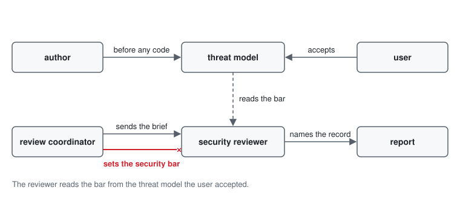

# A security control change writes its threat model before code

## Decision

A change that adds, removes, loosens, or tightens a security control writes a
threat model before any code. The threat model is a `## Threat model` section in
the change's level-2 record, and it names who the control defends against, which
forms it must keep catching, and what it accepts. The user accepts the record.

The security reviewers find that section themselves, judge findings against it,
and say which record they judged against. The review coordinator doesn't set a
security bar of its own in the brief, and doesn't name the record.

A tightening counts as well as a loosening, because a stricter control can
refuse ordinary work. #769 made the guard's accept check stricter, and #792 is
the commit messages and file copies it then refused.

## Boundary

A solid arrow is a step that waits on the one before it. A dotted arrow is a
record read later.

## Context

A security control is a check that keeps an action with a person or keeps an
untrusted input out. In wfctl, the controls are:

1. The worktree guard's refusals, such as the check on `gh pr create` while a
   review group has unreviewed commits, and the checks on git notes.
2. The terminal checks on `wfctl review sign-off`, `wfctl arch accept`, and
   `wfctl arch approve-imports`, along with the guard's text checks in front of
   them.
3. The `review` job on GitHub and the import check it runs from `main`.
4. Reading `review.commands` and `review.rounds` from the trunk rather than the
   branch under review.

Previously, the only threat-model step wfctl shipped ran at review time.
`security-and-hardening` opens with "Threat Model First", but only
`reviewing-security` loads it, so it runs after the code exists. The design
skills had no security step. Step 1 of `design-passes` mentions safety under
its second question, but nothing asked for a threat model. As a result, #792
recorded "no significant design decision" for a change that narrowed the
guard's check on `wfctl arch accept`.

Without a threat model, the coordinator wrote the bar into each review brief.
On #792 it told the security panel that the guard must not let any real accept
through. The guard's threat model, research note R-013, already said no text
rule can promise that. The panel treated every narrowing as a regression, each
fix led to the next finding, and the loop ran until the round cap asked the
user to sign off.

## Direct baseline

Add a line to the review brief telling the security panel to look for a threat
model in the spec folder and judge against it. That draws no new structure and
changes one skill. It fails in two ways:

1. The threat model still gets written after the code, or not at all, since no
   design step asks for it.
2. The spec folder isn't printed at session start and isn't part of the PR, so
   the next change to the same control starts without it, the same way #792
   started without R-013.

## Owns truth

The user decides what a control must keep catching and what it gives up, by
accepting the record that holds the threat model. The author writes the threat
model before code. The security reviewers read the bar from the record.

The author shouldn't decide the bar alone, because they would be grading their
own work. The coordinator shouldn't write it into the brief, because a bar
written for each run can be stricter or looser than the one the user accepted.
That's what led #792's panels to flag forms the guard had already given up.
The coordinator shouldn't name the record either, since a coordinator that
names one record can leave out another, and a reviewer that finds the record
itself checks that none was left out. The reviewers can't work the bar out
from the diff, since the diff shows what the code does and not what the
control was meant to stop.

## Considered

- Edit `security-and-hardening` so the design skills load its threat-model
  step. We didn't choose this because the skill is vendored from another
  project, and the next upstream pull reverts the edit
  (`vendor-upstream-skills.md`). Its threat model is also written for web
  applications, with STRIDE over HTTP boundaries, and doesn't ask which forms a
  control must keep catching.
- Add a fourth spec question to step 1 of `design-passes`. We didn't choose
  this because `every-change-answers-spec-question.md` is accepted with three
  questions, and a change to a security control already answers the second one
  yes: it changes what has to stay true about safety, and a narrowed control
  can let an action through that can't be undone, such as an accepted record or
  a merged PR.
- A threat model as its own file under the arch root, beside the records. We
  didn't choose this because `wfctl arch context` prints records, not other
  files, and the user would have a second kind of document to accept.
- A check in wfctl that refuses a branch changing a control's files without a
  threat model. We didn't choose this because whether a change loosens or
  tightens a control is a judgment of what the code means, and no artifact records whether the
  threat model came before the code. The security reviewers report a control
  change with no threat model instead, the same way the code reviewers report a
  design decision no record covers (`a-rule-is-expressed-as-a-check.md`).

## Consequences

- `design-passes` step 1 says a change to a security control answers the
  design-decision question yes, so it goes through the spec pipeline.
- `design-levels` level 2 sends a security control change to
  `architecture-decisions`, whose threat-model reference says how to fill the
  section.
- `reviewing-security` tells the reviewer to find the threat model for each
  control the commits change, judge against it, and report a control change
  with no threat model as a finding.
- `fanning-out-code-review` tells the coordinator not to write a security bar
  into the brief or name the record.
- A form the change lets through that's in none of the record's lists is
  judged by the "Defends against" part: a finding if that agent could reach
  it, a note otherwise. Either way the reviewer asks for it to be added to a
  list, so the lists grow with each review.
- The accept check's threat model moves out of R-013 into
  `accept-check-threat-model.md`. The other controls listed above have none
  yet, and each one gets its threat model the next time a change loosens or
  tightens it.

## Log

- 2026-11-18  proposed    — #799 level 2, after the #792 review loop ran three
  security rounds against a bar the coordinator wrote.
- 2026-11-19  accepted    — agreed by the maintainer on #799, after the security and code review panels · drawing drawings/security-change-needs-threat-model-data-flow.svg sha256:28700222f0e1
