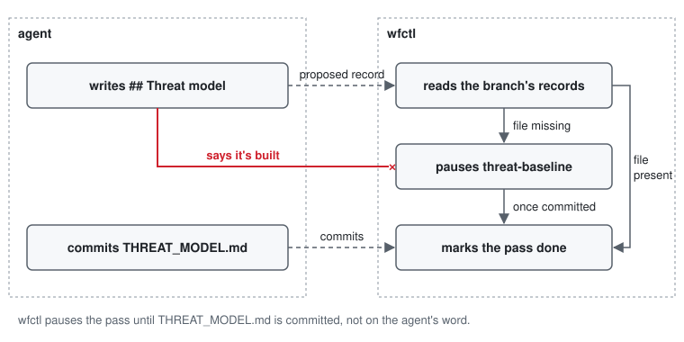

# A security record waits for a whole-system threat model

## Decision

If a branch adds or changes a level-2 record with a `## Threat model` section,
and the repository has no `THREAT_MODEL.md` committed at its root, wfctl pauses
brainstorm on a new `threat-baseline` pass. The pass is done once the file is
committed on the branch, or once the user declares it doesn't apply (using
`wfctl step none brainstorm.threat-baseline --reason "…"`). On a branch with no
such record, the pass is skipped.

The `/threat-baseline` skill writes the file by running upstream's
`threat-model` skill, and `design-levels` tells the agent to run it before
writing the control's own threat model. This check catches a
run that skips that instruction.

## Boundary

The agent writes the record with its `## Threat model` section, and wfctl reads
the branch's records from disk. If the file is missing, wfctl pauses the
threat-baseline pass and names `/threat-baseline` as the next command. Once the
agent commits `THREAT_MODEL.md`, wfctl marks the pass done. If the file is
present from the start, the pass is done on the first read. wfctl doesn't
accept the agent saying it's built.

## Context

A security control is a check that keeps an action with a person or keeps an
untrusted input out. Since #799, a change to a security control adds a threat
model for that control to its record before any code is written
(`security-change-needs-threat-model.md`).
That threat model covers one control, and it assumes someone already knows
what the rest of the system exposes.

Currently, nothing builds that picture. wfctl's own repository has three
per-control threat models and no whole-system one, so each of the three was
written without a map of the attack surface around it. A repository adopting
wfctl starts from the same place.

#818 ships Anthropic's `threat-model` skill to fill the gap. It reads the code
and git history, works through the four questions from Shostack's framework,
and writes `THREAT_MODEL.md` with a table of threats, their actors, and their
controls. The open question was when it runs. The user decided it runs before
the first per-control threat model in a repository, whether or not auto-approve
is on.

A missing baseline leaves a trace in files the branch already produces: a
record with a `## Threat model` heading, and no `THREAT_MODEL.md` at the
repository root. As a result, the rule needs a check rather than an instruction
alone (`a-rule-is-expressed-as-a-check.md`).

## Direct baseline

Add one paragraph to the security-control part of `design-levels`: if the
repository has no `THREAT_MODEL.md` at its root, run `/threat-model` before
writing the record's threat model. This adds no new pass or evidence reader,
and it doesn't change `wfctl status`.

This works whenever the agent reads and follows the paragraph. When it doesn't,
nothing notices. The brainstorm step reports done, the per-control threat model
is written without a baseline, and the security reviewers judge the change
against that threat model anyway.

## Owns truth

wfctl checks whether a branch that writes a per-control threat model has a
committed whole-system threat model to build on. It reads both facts from the
branch: the record's heading and the file at the repository root.

The agent shouldn't answer this, since it would be grading its own work. A
bootstrap run takes several minutes and spawns a batch of subagents, so the
session writing the record is the one most tempted to skip it, and its word
that the file exists can't be checked.

The user decides when the pass doesn't apply, such as a repository whose
whole-system threat model is kept somewhere else. That answer goes in the PR
body, where the reviewer reads it.

## Considered

- The direct baseline, an instruction in `design-levels` alone. We didn't
  choose this because a missing baseline is visible in the branch's own files,
  and `a-rule-is-expressed-as-a-check.md` says a rule like that ships as a
  check.
- Have the worktree guard block opening the PR. We didn't choose this because
  the guard runs after implementation, and the baseline has to exist before the
  per-control threat model and the code are written against it.
- Ask every repository for a baseline, through `wfctl doctor` or a pass on
  every branch. We didn't choose this because most branches in a repository
  never change a security control, and `doctor` reports drift in what wfctl
  installed, not gaps in a repository's own documents.
- Check the file's contents against upstream's schema. We didn't choose this
  because wfctl would then own upstream's format, and every upstream schema
  change would become a wfctl release. The skill already enforces its own
  schema when it writes the file.
- Count an uncommitted `THREAT_MODEL.md`. We didn't choose this because the PR
  wouldn't carry it, so the reviewer judging the per-control threat model
  couldn't read the baseline it cites.

## Consequences

The pass belongs to the brainstorm row, so a branch that recorded "no spec"
skips it with the rest of that row. A change to a security control writes a
level-2 record, which already sends it through the spec pipeline, so no such
change should record "no spec".

wfctl's own repository gets its baseline on the branch that adds this record,
since that branch's last step runs `/threat-baseline` from an installed tree and
commits the result.

## Log

- 2026-11-21  proposed    — a per-control threat model needs a whole-system
  one to build on, and nothing checked that one existed (#818)
- 2026-11-22  accepted    — Andre in chat, 2026-11-22 · drawing drawings/security-record-needs-baseline-data-flow.svg sha256:6985fd4c81b0
