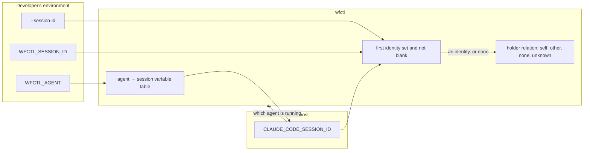

# wfctl reads the session id from the agent named in `WFCTL_AGENT` when the caller presents none

## Context

The check from #200 that stops a second conversation from taking over a branch has never run on this machine. `wfctl start` records whatever `WFCTL_SESSION_ID` holds, and later commands such as `wfctl resume` and `wfctl end` refuse a caller whose id differs. Nothing sets `WFCTL_SESSION_ID`, though. `session-identity-comes-from-the-caller.md` left it to each developer to add a line to their shell profile copying the host's own variable into it, and no profile here has that line.

As a result, every comparison reads `unknown`, and the gates let every conversation through. On 2026-10-24, in this branch's worktree:

- `WFCTL_AGENT`: `claude`
- `CLAUDE_CODE_SESSION_ID`: `57e9be11-488c-44c6-9ee0-0bfe72bcecff`, the id of the conversation running the command
- `WFCTL_SESSION_ID`: unset
- `wfctl status --json`: `"session_holder": "unknown"`

The protection only works for someone who found the instruction in the `/start-session` skill and edited their profile. Andre wrote both the record and the skill, and his profile doesn't have the line. That's the evidence the per-developer step doesn't happen in practice.

## Direct baseline

Keep `session-identity-comes-from-the-caller.md` as it is and make the profile line harder to miss. `/start-session` already prints `WFCTL_SESSION_ID` unset as the reason the holder is `unknown`. The baseline would turn that into a `⚠` line in `wfctl doctor` and print the exact line to paste into the profile.

That adds no structure, and it keeps wfctl free of any host's variable name. It still needs every developer on every machine to act, and the current skill already asks for the same action on every session start without it happening. A louder notice changes how often the request is shown, not whether anyone acts on it.

## Decision

The caller still supplies its own session identity, and wfctl still records it verbatim, compares it, and never parses it. wfctl takes the first of these that is set and not blank:

1. The `--session-id` flag on `wfctl start`.
2. `WFCTL_SESSION_ID` in the environment.
3. The session variable of the agent named in `WFCTL_AGENT`, looked up in a table in wfctl's own code.

When none of them is set, wfctl presents no identity, and the gates report `unknown` and refuse nothing, exactly as before.

The table starts with one entry, `claude` → `CLAUDE_CODE_SESSION_ID`, since that's the only one measured on the version running today. Another agent gets an entry once someone measures which variable it exports. Until then, it behaves as an unknown agent does.

wfctl still never derives the id from its own process tree, and never probes for a host by checking which variables happen to be set.

## Owns truth

The agent host owns "which conversation is this?". wfctl can't compute it, for the same reason the earlier record gave. The shell wfctl runs in is replaced on every call, and one agent process serves many conversations. Only the host knows where one conversation ends and the next begins, and it hands that out through its own environment variable.

The developer owns "which agent am I running?", and says so in `WFCTL_AGENT`. wfctl shouldn't guess it from which variables are set, because a nested agent carries its parent's variable alongside its own. Guessing would make the order of a lookup decide which conversation a command belongs to.

wfctl owns "which variable does this agent export its session id in?". The developer shouldn't have to answer that, because the answer is the same on every machine running that agent. Asking each developer to copy it into a profile turns one fact into a step everyone has to repeat, and the evidence above shows nobody repeats it.

wfctl also still owns "is the caller of this command inside the session recorded on this branch?". The agent shouldn't answer that, since it would be grading its own work.

## Boundary

The solid edges are reads made by the command that is running. The crossed edge is what wfctl refuses: a host variable being set is not evidence of which agent is running, so wfctl never looks one up without `WFCTL_AGENT` naming its agent. When `WFCTL_AGENT` is unset or names an agent with no entry, the table yields nothing, and the holder relation reads `unknown`.

## Considered

- **Keep the profile line and make the notice louder.** This is the direct baseline. We didn't choose it because it depends on the same per-developer step that hasn't happened since #200 shipped in September, on the one machine whose owner wrote the instruction.
- **Probe every known host variable without `WFCTL_AGENT`.** wfctl would check `CLAUDE_CODE_SESSION_ID`, then the next host's variable, and take the first one set. This covers a developer who never set `WFCTL_AGENT`. We didn't choose it because a nested agent carries both its own variable and its parent's. The earlier record measured this with a Codex run and a Copilot run launched from a Claude conversation, and a probe would pick whichever variable comes first in the list, not whichever host is innermost. A wrong pick gives a wrong answer rather than an error, which is the failure `no-hardcoded-agent.md` was written to avoid.
- **Put the table in the repo's `wfctl.json` or in a committed hook.** This would let a repo add an agent without a wfctl release. We didn't choose it because `no-hardcoded-agent.md` forbids committed config from naming an agent, since the agent is per-developer. A variable name keyed by agent name is a fact about the agent, not about the repo, so wfctl's code is where it belongs.

## Consequences

`/start-session` no longer tells the developer to set `WFCTL_SESSION_ID`. Its session-identity bullet names the real cause when the holder is `unknown`: `WFCTL_AGENT` is unset, or it names an agent wfctl has no session variable for.

`WFCTL_SESSION_ID` keeps working as an override, so a host wfctl has no entry for can still be wired by hand.

A nested agent that inherits the parent's `WFCTL_AGENT` presents the parent's id. For example, a Codex reviewer started from a Claude conversation would present that Claude conversation's id. The hand-written profile line had the same weakness, because the nested shell copies the same parent variable, so this decision doesn't make it worse. Today it doesn't matter in practice, since a Codex reviewer runs read-only and never calls `start`, `resume`, or `end`. A host that sets `WFCTL_AGENT` for its own children would fix it with no change here.

Adding an agent to the table is a wfctl release. The earlier record measured `CODEX_SESSION_ID` for Codex and `COPILOT_AGENT_SESSION_ID` for Copilot on 2026-09-13. The Codex binary installed on 2026-10-24 carries both `CODEX_SESSION_ID` and `CODEX_THREAD_ID`, so that measurement needs repeating before either agent gets an entry.

A test in wfctl's suite pins the resolution order, so a later change can't put the agent's variable ahead of `WFCTL_SESSION_ID` without that test failing.

## Log

- 2026-10-24  proposed    — #629 level 2; the profile line the earlier record relied on was never written, so the #200 gates have never run
