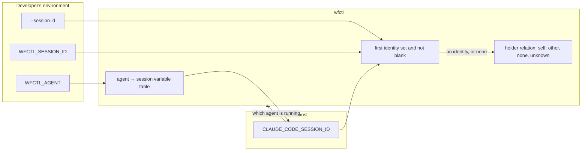

# wfctl reads the session id from the agent named in `WFCTL_AGENT` when the caller presents none

## Context

#200 added gates that stop a second conversation from taking over a branch, but they have never run on this machine. `wfctl start` records whatever `WFCTL_SESSION_ID` holds, and later commands such as `wfctl resume` and `wfctl end` refuse a caller whose id differs. But nothing sets `WFCTL_SESSION_ID`. Under `session-identity-comes-from-the-caller.md`, each developer adds a line to their shell profile that copies the host's own variable into it, and no profile here has that line.

As a result, wfctl can't tell whether the caller holds the session recorded on the branch. The holder relation is always `unknown`, and the gates let every conversation through. On 2026-10-24, this branch's worktree showed:

- `WFCTL_AGENT`: `claude`
- `CLAUDE_CODE_SESSION_ID`: `57e9be11-488c-44c6-9ee0-0bfe72bcecff`, the id of the conversation running the command
- `WFCTL_SESSION_ID`: unset
- `wfctl status --json`: `"session_holder": "unknown"`

The gates work only for a developer who found the instruction in the `/start-session` skill and edited their profile. Andre wrote both the record and the skill, and his profile doesn't have the line. This shows the per-developer step doesn't happen in practice.

## Direct baseline

The baseline would keep `session-identity-comes-from-the-caller.md` as it is and make the profile line harder to miss. `/start-session` already reports `WFCTL_SESSION_ID` unset as the reason the holder is `unknown`. The baseline would turn that into a `⚠` line in `wfctl doctor` that prints the exact line to paste into the profile.

That adds no structure, and wfctl's code still names no host's variable. But every developer on every machine still has to act. The current skill already asks for that on every session start, and it hasn't happened. A louder notice shows the request more often but doesn't make anyone act on it.

## Decision

The caller still supplies its own session identity, and wfctl still records it verbatim, compares it, and never parses it. wfctl takes the first of these that is set and not blank:

1. The `--session-id` flag on `wfctl start`.
2. `WFCTL_SESSION_ID` in the environment.
3. The session variable of the agent named in `WFCTL_AGENT`, looked up in a table in wfctl's own code.

When none of them is set, the caller presents no identity, and the gates report `unknown` and refuse nothing, as they do today.

The table starts with one entry, `claude` → `CLAUDE_CODE_SESSION_ID`, since that's the only one measured on the version running today. Another agent gets an entry once someone measures which variable it exports. Until then, wfctl finds no variable for it.

wfctl still never derives the id from its own process tree, and never probes for a host by checking which variables are set.

## Owns truth

The agent host owns the identity of the conversation. wfctl can't compute it, for the same reason the earlier record gave. The shell wfctl runs in is replaced on every call, and one agent process serves many conversations. Only the host knows where one conversation ends and the next begins, and it passes the conversation's id through its own environment variable.

The developer owns which agent they're running, and says so in `WFCTL_AGENT`. wfctl shouldn't guess the agent from which variables are set, because a nested agent carries its parent's variable alongside its own. If wfctl guessed, the order it checks variables in would decide which conversation a command belongs to.

wfctl owns which variable each agent exports its session id in. The developer shouldn't have to know that, because the answer is the same on every machine running that agent. Asking each developer to copy it into a profile turns one fact into a step everyone has to repeat, and the Context above shows nobody repeats it.

wfctl also still decides whether the caller of a command is inside the session recorded on this branch. The agent shouldn't answer that, since it would be grading its own work.

## Boundary

The solid edges are what the running command reads. The crossed edge is what wfctl refuses. A host variable being set doesn't show which agent is running, so wfctl reads a host variable only when `WFCTL_AGENT` names that agent. When `WFCTL_AGENT` is unset or names an agent with no entry, the table yields nothing. Unless the flag or `WFCTL_SESSION_ID` supplies an id, the holder relation is then `unknown`.

## Considered

- **Keep the profile line and make the notice louder.** This is the direct baseline. We didn't choose it because it depends on the same per-developer step that hasn't happened since #200 shipped in September, on the one machine whose owner wrote the instruction.
- **Probe every known host variable without `WFCTL_AGENT`.** wfctl would check `CLAUDE_CODE_SESSION_ID`, then the next host's variable, and take the first one set. This would cover a developer who never set `WFCTL_AGENT`. We didn't choose it because a nested agent carries both its own variable and its parent's. The earlier record measured this with a Codex run and a Copilot run launched from a Claude conversation. A probe would pick whichever variable comes first in the list, not whichever host is innermost. A wrong pick gives a wrong answer rather than an error, which is the failure `no-hardcoded-agent.md` was written to avoid. The chosen design can pick the parent's variable too, as Consequences describes, but there the pick follows `WFCTL_AGENT`, a value the developer set and can see. Setting `WFCTL_AGENT` for the nested agent fixes it. With a probe, the order of a list in wfctl's code decides, and the developer can only override it by setting `WFCTL_SESSION_ID` by hand.
- **Put the table in the repo's `wfctl.json` or in a committed hook.** This would let a repo add an agent without a wfctl release. We didn't choose it because committed config shouldn't name an agent, since the choice of agent is per-developer (`no-hardcoded-agent.md`). The variable an agent exports is a fact about the agent, not the repo, so it belongs in wfctl's code.

## Consequences

`/start-session` no longer tells the developer to set `WFCTL_SESSION_ID`. When the holder is `unknown`, its session-identity bullet names the real cause: `WFCTL_AGENT` is unset, or it names an agent wfctl has no session variable for.

`WFCTL_SESSION_ID` keeps working as an override, so you can still wire a host wfctl has no entry for by hand.

A nested agent that inherits the parent's `WFCTL_AGENT` presents the parent's id. For example, a Codex reviewer started from a Claude conversation would present that Claude conversation's id. The hand-written profile line had the same weakness, because the nested shell copies the same parent variable. This decision doesn't make it worse. It doesn't matter today, since a Codex reviewer runs read-only and never calls `start`, `resume`, or `end`. A host that sets `WFCTL_AGENT` for its own children would fix it with no change to wfctl.

Adding an agent to the table takes a wfctl release. The earlier record measured `CODEX_SESSION_ID` for Codex and `COPILOT_AGENT_SESSION_ID` for Copilot on 2026-09-13. Running `strings` on the Codex binary installed on 2026-10-24 finds both `CODEX_SESSION_ID` and `CODEX_THREAD_ID`. That shows the names are in the binary, not which one a running Codex exports to its shell, so that measurement needs repeating before either agent gets an entry.

A test in wfctl's suite pins the resolution order, so a later change can't put the agent's variable ahead of `WFCTL_SESSION_ID` without that test failing.

## Log

- 2026-10-24  proposed    — #629 level 2; nobody wrote the profile line the earlier record relied on, so the #200 gates have never run
- 2026-10-25  accepted    — Andre, in the #629 session on 2026-10-24 — https://claude.ai/code/session_01T5vDFWnEvWfJHuatbHYFRH
