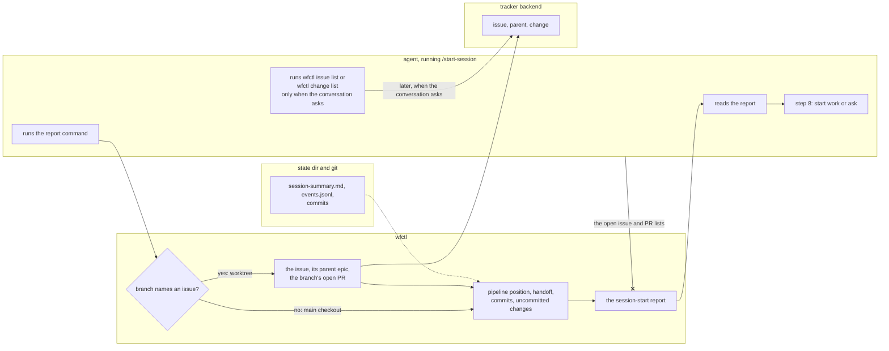

# wfctl builds the session-start report for the skill

## Context

`/start-session` is how an agent recovers its context at the start of a
session. Currently, the skill tells the agent to take ten steps one at a time and
write the report itself. They are `wfctl start`, `doctor`, `arch context`,
`status --json`, a read of the handoff, a grep of the event log, `git log`,
`git status`, `wfctl issue list`, and `wfctl change list`. The agent then
checks the branch's commits against every open issue.

Measured in this repository on 2026-11-01, a session that runs `/start-session`
holds 19.2k more tokens of context than one that only replies to a one-word
prompt. The skill's instructions account for 8.4k of that, because
`start-session/SKILL.md` grew from 15.8 KB to 25.2 KB and nobody noticed. It has
grown to 26.2 KB since. Most
of the rest is repository-wide context.

Previously, the tracker was Linear, and a session had to rebuild the picture of
all open work itself. Currently, each worktree exists for one issue, and GitHub
holds the epics. As a result, a worktree session rarely uses the open issue and
PR lists. Sessions on the `main` checkout are usually exploratory and not tied
to one issue, so a list loaded before anyone asks for it often goes unused there
too.

On 2026-11-01, the user decided that session start loads no repository-wide
list in either place:

- A worktree session loads its own issue, the issue's parent epic, and the
  branch's open PR.
- A `main` session loads none of those. The agent runs `wfctl issue list` or
  `wfctl change list` when the conversation needs one.

## Direct baseline

The direct baseline would edit the skill's instructions in three ways:

1. Remove the steps that run the issue and PR lists.
2. Add a step that runs `wfctl issue view` for the branch's issue.
3. Move the doctor repair guidance to a reference file the agent opens only
   when `doctor` reports a finding.

The agent would still run each command and write the report.

This meets the token target. However, the rule about what to load stays in the
instructions. The agent can follow an older installed copy, skip a step, or add
one back, and the only trace is in a transcript nobody reads. This is the
problem `a-rule-is-expressed-as-a-check.md` describes, where a rule is broken
and no artifact shows it. That's why the decision below moves the rule into
wfctl.

## Decision

One wfctl command builds the session-start report. It reads the branch, the
pipeline position, the handoff, the commits, and the tracker, and prints the
finished report.

- In a worktree whose branch names an issue, the report carries that issue, its
  parent epic, and the branch's open PR.
- On a branch that names no issue, it carries none of the three.

The skill runs the command and reports what it printed. It then decides what to
do next with the step 8 table, which is unchanged. That table is the part of the
skill that chooses between starting work and asking what to work on.

## Owns truth

wfctl decides which context a session on this branch starts with.

The agent shouldn't decide this, for two reasons:

1. The agent is the party the rule constrains, and the instructions are its
   only copy of the rule. If the agent loads the issue list anyway, the only
   account of what it loaded is its own report, and nothing outside the
   transcript records it. When wfctl prints the report, the agent runs no list
   command at session start, so it has no rule left to break.
2. Every instruction the agent follows costs tokens on every session, including
   the ones where it changes nothing. A rule in wfctl's code costs nothing until
   it prints a line.

The agent still decides what happens next. The step 8 decision uses the report
to choose between starting work and asking what to work on. It stays in the
skill because it depends on the conversation, which wfctl can't see.

## Boundary

The `--x` edge shows the decision. The report never carries the
repository-wide lists, whichever branch it runs on. The agent loads them only
when the conversation asks. A solid edge is a call, and a dotted edge is
something wfctl reads from the state dir or from git.

## Considered

- **Edit the instructions only (the direct baseline).** We didn't choose this
  because the rule about what to load stays in prose. A skipped or reordered
  step leaves no trace outside the transcript. It also cuts fewer tokens, since
  the agent still reads instructions for every command it runs.
- **Keep the repository-wide view on the `main` checkout, with the open issues
  ranked instead of cut off at the tracker's first 20 (#296).** #432 planned
  this until 2026-11-01. We didn't choose this because sessions on `main` are
  usually exploratory, so a list loaded before anyone asks for it often goes
  unused. When needed, the agent can run it in one command.
- **Add the issue lines to `wfctl status --json`, and have the skill read
  them.** This would work, and `status` already carries the pipeline position.
  We didn't choose this because `status` runs on every pipeline step and in the
  supervisory screen. A tracker call there would add network time to every
  command that reads status, not only to session start.

## Consequences

wfctl needs two new tracker reads, one for an issue's parent and one for the
branch's open PR with its check state. Who owns them is decided in
`backend-tracker-reads-parent-and-change.md`.

`start-session/SKILL.md` now runs one command, reports its output, and keeps the
step 8 table. The doctor repair guidance moves to a reference file the agent
opens only when `doctor` reports a finding.

A test fails when the skill grows past a size limit, because the growth from
15.8 KB to 25.2 KB went unnoticed.

`/start-session` makes the same decisions as before, since the step 8 table,
the doctor repair policy, and the freshness rules stay the same.

## Log

- 2026-11-01  proposed    — #432 cuts session start to the branch's own context
