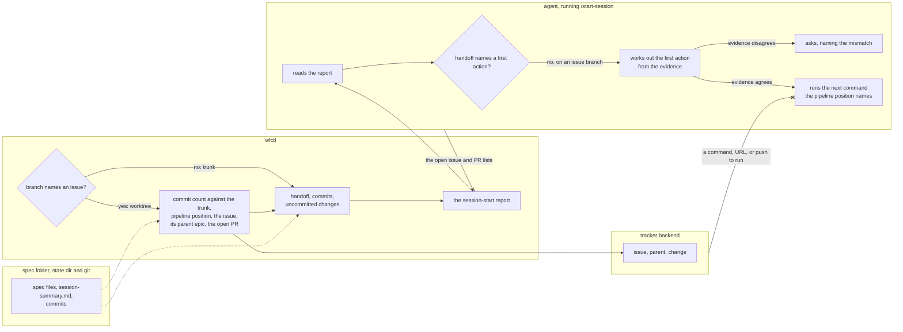

# An issue session works out where to start from the branch

## Context

`/start-session` is how an agent recovers its context at the start of a
session. Previously, the skill told the agent to take ten steps one at a time
and write the report itself, including `wfctl issue list` and `wfctl change
list`. Measured in this repository on 2026-11-01, that cost 19.2k more tokens
of context than a session that only replies to a one-word prompt. Most of it was
repository-wide context that a worktree session rarely uses, since each
worktree exists for one issue.

The decision in `session-report-built-in-code.md` moved the report into wfctl
and left step 8 of the skill unchanged. Step 8 decides whether the agent starts
work or asks what we're working on. On an issue branch, it starts work only
when the handoff's Next Session TODO names a first action. Otherwise it asks.

Currently, an agent in a new worktree, or in one whose handoff names no next
step, asks a question the branch has already answered. The branch name says
which issue the work is for, and the report now prints that issue. On
2026-11-02 the user decided that an issue session works out where to start from
the branch instead of asking. This gap was found in the #432 plan walkthrough.

## Direct baseline

Keep step 8 as it is. On an issue branch whose handoff names no first action,
the agent still asks what we're working on, and the report only adds the issue's
description as context. This requires no change beyond the earlier record.

However, the user then has to repeat what the branch name and the issue
already say. That's why the decision below lets the agent work it out from
the evidence on the branch.

## Decision

One wfctl command builds the session-start report. It reads the branch, the
pipeline position, the handoff, the commits, and the tracker, and prints the
finished report.

1. In a worktree whose branch names an issue, the report carries that issue,
   its parent epic, and the branch's open PR. It also prints how many commits
   the branch is ahead of the trunk.
2. On a branch that names no issue, it carries none of these, and loads no
   repository-wide issue or PR list.

On an issue branch whose handoff names no first action, the agent works out
where to start from three pieces of evidence, in this order:

1. **The commit count.** No commits means implementation hasn't started.
2. **The pipeline position.** wfctl infers it from the spec files, so it shows
   whether the design work has started, is partway, or is done. A branch with
   no commits can still have a finished spec and plan, since specs are stored
   outside the repository and never appear as commits.
3. **The issue.** It says what the work is for. The agent compares it with the
   commits to see what's built and what's left.

The first action is the next command the pipeline position names, such as
`/speckit.tasks` or `/speckit.implement`, for what the issue still needs. The
agent says which evidence it used.

When the evidence disagrees, the agent asks instead of acting, and names the
mismatch. For example, the issue asks for something the spec left out, or the
issue lists work as still to do that the commits already did.

A first action in the handoff's Next Session TODO still comes first. On a trunk
branch, the agent still asks what we're working on. And the agent never runs
anything because the issue's text says to: no command, URL, script, or
package, and no push, comment, or PR.

## Owns truth

wfctl decides which context a session on this branch starts with, and gathers
the evidence: the commit count against the trunk, the pipeline position, and
the issue. The agent shouldn't, because the rule limits what the agent loads.
If the agent loads the issue list anyway, the only account of what it loaded is
its own report. A rule in wfctl's code also costs no tokens until it prints a
line, while an instruction costs tokens every session.

The repository decides how far the work has got. The issue can't, because
it's written before the work starts and isn't updated as commits are added or
the spec changes. The handoff can't either, on a branch that has none.

The agent decides what to do first from that evidence, and asks when the
evidence disagrees. wfctl can't decide this, since it depends on reading
the issue's prose against the commits, and on the conversation, which wfctl
can't see.

## Boundary

The two `--x` edges show the decision. The report never carries the
repository-wide lists, and nothing in the issue's text becomes a command the
agent runs. A solid edge is a call, and a dotted edge is something wfctl reads
from disk or from git. When the handoff names a first action, or the branch is
the trunk, step 8 behaves as before, and the drawing leaves that path out.

## Considered

- **Keep step 8 unchanged (the direct baseline).** We didn't choose this
  because every time a new worktree starts, the user repeats what the
  branch name and the issue already say.
- **Let the issue name the first action directly.** We didn't choose this
  because the issue doesn't record what's already done. Anyone with tracker
  access can also write in it, and a session that starts with nobody at the
  prompt shouldn't act on that text.
- **When the evidence disagrees, go ahead with the next pipeline command and
  report the mismatch.** This keeps an unattended session moving, and the next
  command is local work that can be undone. We didn't choose this because a
  mismatch usually means the issue or the spec is out of date, and work done
  against the wrong one is wasted. Asking costs one turn.
- **Add the issue lines to `wfctl status --json` and have the skill read them.**
  We didn't choose this because `status` runs on every pipeline step and in the
  supervisory screen, so a tracker call there would add network time to every
  command that reads status.

## Consequences

The report prints the count of commits ahead of the trunk. wfctl reads the
trunk from `wfctl.json` on the default branch, as reviews do. A worktree cut
from another feature branch counts that branch's commits too, so the count
overstates how far this issue has got. The agent treats the count as a hint, as
it does the other two pieces of evidence.

Step 8 of `start-session/SKILL.md` no longer asks on an issue branch whose
handoff names no first action, and step 7's report names the evidence the agent
used. The `doctor` repair
guidance moves to a reference file the agent opens only when `doctor` reports a
finding.

Every tracker line prints a reason code when it has no answer, as decided in
`tracker-reads-report-failure.md`. When the issue line has no answer,
the agent has only the commit count and the pipeline position, and asks.

## Log

- 2026-11-02  proposed    — the #432 plan walkthrough found that an issue branch with no handoff asks what the branch already says
