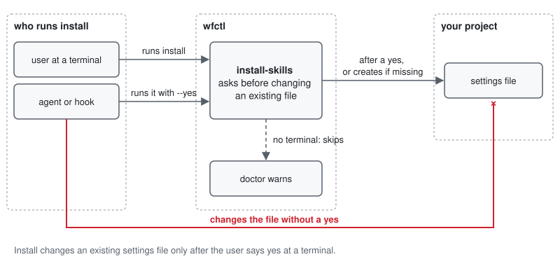

# Install asks before changing a settings file

## Decision

`install-skills` changes an existing settings file only after the user says yes
at a terminal. This covers Claude Code's `.claude/settings.json` and Bob Shell's
`.bob/settings.json`, and every change wfctl makes there, whether it adds a rule
or hook, updates one, or removes one wfctl no longer ships. The `--yes` flag
doesn't answer the question.

If no terminal is attached, such as when the agent or a worktree hook runs
install, the existing settings file is left alone. Install names the changes it
skipped, and `wfctl doctor` reports them until the user runs install in their
own terminal. Creating a settings file that doesn't exist yet needs no question.

## Boundary

A solid arrow is a command the sender waits on. The dotted arrow is a pending
change that `wfctl doctor` reports later.

## Context

Previously, `install-skills` merged wfctl's entries into your project's
settings file without asking. That was deliberate, since a merge adds or
replaces only wfctl's own entries and leaves the user's alone, and the summary
named each edit afterwards.

Currently, most installs run with nobody watching. The worktree creation hook
runs install in every new worktree, and `/start-session` runs it with `--yes`
to repair what `wfctl doctor` reports. A summary printed in those runs reaches
nobody, so the user never sees what changed.

#859 showed the problem. Fixing an ask rule that Claude Code read wrong meant
removing the old rule from settings files that already had it. The first
version of the fix removed it during those unattended runs. The security
reviewers pointed out that wfctl was now deleting entries from a file the user
owns, with nobody asked. The user decided that wfctl shouldn't change a
settings file without asking first, for adds as well as removals.

The entries matter because they control what the agent may do. A rule decides
whether Claude Code asks before a command runs, and a hook runs a command on
every prompt or tool call. An edit nobody saw changes the agent's permissions
without the user knowing.

## Threat model

### Defends against

The control stops an install the user isn't watching from changing an existing
settings file. That install can come from the agent running `install-skills`,
from the worktree creation hook, or from the `/start-session` repair, and the
change can add, update, or remove an entry. It stops each one, with or without
`--yes`.

The control doesn't stop the agent from editing the settings file with its own
tools, without running install. Claude Code's permission prompts cover that
path, so this control doesn't try to.

### Must keep catching

In each of these the settings file already exists and install would change it.
After the run, the file is byte-identical to what it was before.

1. Install with the confirmation skipped: `wfctl install-skills --yes --agent claude`
2. Install with no terminal attached: `wfctl install-skills --agent claude < /dev/null`
3. The repair `/start-session` runs: `wfctl install-skills --prune --yes --agent claude`
4. Install re-asserting a rule the repo removed, unattended: `wfctl install-skills --force --yes --agent claude`
5. Removing a rule wfctl no longer ships, unattended: `wfctl install-skills --yes --agent claude`
6. Bob Shell's settings file, unattended: `wfctl install-skills --yes --agent bob`

Items 1 and 5 differ in what install would change. Item 1 adds or updates an
entry, and item 5 removes one, so each gets its own test.

### Accepts

1. Creating a settings file that doesn't exist: `wfctl install-skills --agent claude`
2. The agent editing the file with its own tools: `sed -i '' 's/on:\*/on*/' .claude/settings.json`
3. The agent faking a terminal and answering yes: `yes | script -q /dev/null wfctl install-skills --agent claude`
4. Uninstall removing wfctl's entries: `wfctl uninstall-skills --agent claude --yes`
5. The user answering yes without reading the list: `wfctl install-skills --agent claude`

We accept item 1 because a new file holds none of the user's entries. If
install asked there, a new worktree would come up without the worktree guard's
hook and the ask rules, since nobody is there to answer. Those are protections
in their own right.

We accept item 2 because Claude Code's permission prompts already govern the
agent's own file edits, and install can't see an edit it didn't make.

We accept item 3 for the same reason the accept check accepts a hidden
command (`accept-check-threat-model.md`). A terminal check can't tell a person
from a program pretending to be one, and the agent would have to build that
deliberately. The agent still gets only the change wfctl ships, and install
prints each one.

We accept item 4 because running uninstall is itself the request to remove
wfctl's entries, and uninstall removes only the entries the manifest says wfctl
added.

We accept item 5 because install lists every change before it asks, so the user
has what they need to decide.

### Must let through

1. The user at a terminal, answering yes: `wfctl install-skills --agent claude`
2. A new worktree, whose settings file doesn't exist yet: `uv run wfctl install-skills --agent claude`
3. An unattended install that changes no settings file, which still copies the skills: `wfctl install-skills --yes`
4. Reporting the pending changes without making them: `wfctl doctor`

## Direct baseline

Keep merging without a question, as today, and make the summary line louder.
That draws no new structure. It fails because the unattended runs are the
problem, and a louder line in a terminal nobody reads still reaches nobody.

## Owns truth

The user decides whether their settings file changes, by answering install's
question at a terminal. wfctl decides what the change would be, meaning which
entries are its own and which are out of date, since the manifest records what
wfctl added.

wfctl shouldn't decide whether to apply the change. The file holds the user's
own rules and hooks, and every edit changes what the agent may do. The `--yes`
flag can't stand in for the user either, because the worktree hook and
`/start-session` pass it as easily as the user does. The agent shouldn't
decide, since it would be approving a change to its own permissions.

## Considered

- Ask only before removing an entry. We didn't choose this because an added
  rule or hook also changes what the agent may do, and the user asked for every
  edit to be confirmed.
- Treat `--yes` as the user's yes. We didn't choose this because `/start-session`
  and the worktree hook pass `--yes` with nobody watching, so it isn't evidence
  that a person agreed.
- Ask before creating a missing settings file too. We didn't choose this
  because a new worktree would then come up without the worktree guard's hook
  and the ask rules, since nobody is there to answer.
- Let the agent apply the change once the user approves it at Claude Code's
  permission prompt, the way `wfctl arch accept` works
  (`prompt-approves-person-commands.md`). This is sound, and #860 tracks it. We
  kept it out of this change because it adds a command that waits on the user,
  which is a security control with its own threat model and worktree guard
  checks.

## Consequences

- An unattended install leaves an existing settings file unchanged, and says
  which changes it skipped.
- `wfctl doctor` reports a pending settings change as a warning, with the
  install command for the user to run in their own terminal. It doesn't fail
  the run, because the `/start-session` repair can't apply the change, and a
  failure it can never clear would repeat at every session start.
- After a wfctl release changes a rule or hook, an existing worktree keeps the
  old entry until the user runs install. If the release renames a hook's
  subcommand, the old hook calls a command that no longer exists until then.
- If a repo commits `.claude/settings.json`, every new worktree starts with
  an existing settings file, so an unattended install adds no worktree guard
  hook and no ask rules there. To cover that case, `wfctl start`, `wfctl
  auto-approve on`, and the three person-only commands refuse to run under
  Claude Code when the repo's `.claude/settings.json` lacks the guard hook or
  any ask rule wfctl ships. Each prints the install command for the user to
  run in their own terminal. As a result, a wfctl release that adds an ask
  rule stops new sessions in every existing worktree until the user runs that
  install. The same commands also refuse when the file sets `disableAllHooks`,
  since Claude Code then runs no hooks, the guard included, and install doesn't
  change that setting.
- A repo that commits `.bob/settings.json` has the same gap under Bob Shell,
  so the same commands refuse under Bob Shell when that file lacks the guard
  hook. Bob Shell can't ask the user first, so its file carries no ask rules,
  and the guard hook is the only thing the check requires. wfctl detects Bob
  Shell from `BOBSHELL_CLI`, which Bob Shell sets in every shell its tools
  start. Each agent started from the other inherits the other's marker, so
  wfctl can't tell which one is running the command. When both markers are
  set, it checks both settings files, and treats the host as one that can't
  ask.
- A Codex marker turns both checks off, since Codex reads neither settings
  file, and a Codex reviewer started from either agent would otherwise be
  refused in a repo with no layer for that agent. A Claude Code or Bob Shell
  started from Codex inherits the marker too, so its settings go unchecked.
  We accept this gap for the same reason as the `cd` gap below: the check
  stops a mistake, and starting an agent from inside Codex is a deliberate
  setup.
- That check reads the checkout the command runs in, because Claude Code
  tells hooks which folder it launched from but doesn't tell the agent's
  shell. An agent in an unprotected worktree can `cd` into a protected
  checkout and pass the check, while Claude Code still applies the launch
  folder's rules and doesn't ask. We accept this gap because the check stops
  a mistake, not a deliberate bypass, the same way `CLAUDECODE` set by hand
  is accepted in `prompt-approves-person-commands.md`.
- The no-question merge described in `install-modes.md` now asks first. The
  units of ownership it draws don't change.
- The line added to `auto-approve-grant-asks-first.md` for #859, saying the
  next install removes a rule wfctl no longer ships, now reads that the next
  install asks before removing it.

## Log

- 2026-11-22  proposed    — #859 level 2. The user decided that wfctl asks
  before changing a settings file, after the security reviewers flagged the
  first fix removing an entry unattended.
- 2026-11-22  accepted    — approved at the permission prompt · drawing drawings/settings-edit-asks-first-data-flow.svg sha256:74dffb0b71b0
- 2026-11-24  amended     — #859 security review. A committed settings file
  left new worktrees without the guard hook and ask rules, so the user chose
  to have `wfctl start` and the prompted commands refuse until both are there.
  The code review found the check can't see the launch folder, and the user
  accepted the `cd` gap that leaves.
- 2026-11-24  amended     — #864 review. Accepts item 4 named the base layer's
  uninstall, which doesn't touch the Claude settings file. It now names
  `--agent claude`.
- 2026-11-24  amended     — #864 security review. A committed
  `.bob/settings.json` left new Bob Shell worktrees without the guard hook,
  and the user chose to extend the refusal to Bob Shell. The reviewers also
  found the `disableAllHooks` refusal documented nowhere, so Consequences now
  names it.
- 2026-11-24  accepted    — approved at the permission prompt · drawing drawings/settings-edit-asks-first-data-flow.svg sha256:74dffb0b71b0
- 2026-11-24  amended     — #864 security review, run 005. A Claude Code
  started from Bob Shell inherits Bob Shell's marker, so the check read only
  `.bob/settings.json`. When both markers are set, it now reads both files. A
  Codex agent started from Claude Code still has neither file checked.
- 2026-11-24  amended     — #864 code review, run 003. A Codex marker now
  turns the Bob Shell check off as well as the Claude Code one, and
  Consequences names the gap that leaves for an agent started from Codex.
- 2026-11-25  accepted    — approved at the permission prompt · drawing drawings/settings-edit-asks-first-data-flow.svg sha256:74dffb0b71b0
