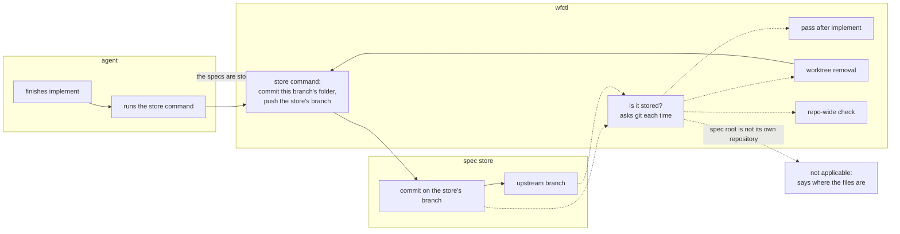

# wfctl stores a branch's spec dir and asks git whether it was stored

## Context

A spec dir holds everything the pipeline wrote for one branch: the design, the
spec, the plan, the tasks, and the review reports. In this repository and in
pfms, the spec root is a separate checkout of an orphan branch, `specs-trunk`,
outside the working tree. That keeps spec files out of every pull request, so
the only way they reach a remote is a commit and a push inside the spec store.

Previously, nothing in wfctl made that commit or that push. Each branch's agent
had to remember to do it by hand, and the end-of-session instructions told it
to report uncommitted spec files and not to commit them.

Currently, that convention has failed twice. A sweep found 58 spec dirs that
had never been committed, and they were recovered by hand. Within weeks, 59
entries were untracked again, including whole dirs for most issues since then
and review reports for branches whose spec was otherwise committed. Both spec
stores on this machine also had local commits that were never pushed.

Nobody noticed because worktree removal printed `✓ spec dir is durable —
nothing there was at risk` over a dir that had never been committed. That
message is true about one thing: removing the worktree does not delete a spec
dir that lives outside it. A reader takes it to mean the spec dir is backed up,
and it was not.

## Direct baseline

The smallest change keeps the convention and fixes the words. The
end-of-session instructions say "commit and push the spec dir" instead of
"report only", and the removal message stops saying "durable". No new command,
no new check, and nothing in the pipeline changes.

With this baseline, storing still depends on the agent following a sentence. An
unattended run has nobody to notice when it does not, which is how the two
backlogs above built up.

## Decision

wfctl stores a branch's spec dir, and wfctl decides whether it is stored by
asking git, never the agent.

1. wfctl's store command commits only this branch's folder in the spec store,
   then pushes the spec store's checked-out branch to its upstream. wfctl never
   names `specs-trunk`, so the same command works for a separate clone and for
   a worktree of the code repository.
2. A spec dir counts as stored when git says every file in it is committed and
   the commit is on the upstream branch. wfctl reads this from git every time
   it is asked, and keeps no record of its own.
3. Three places read that answer. A pass after `implement` reads done only when
   the spec dir is stored, so an unattended run is handed the store command as
   its next step. Worktree removal runs the store command, and when the push
   fails it warns and goes ahead, because the commit is already in the spec
   store outside the worktree. A repo-wide check lists every spec dir that is
   not stored.

This applies only when the spec root is the top of its own git repository with
an upstream branch. In every other layout wfctl commits nothing and says
plainly where the files are:

1. A plain folder outside any repository is not backed up anywhere, and removal
   says so instead of calling it durable.
2. A spec root inside the code repository, such as the default `specs/`, is
   never committed, because the commit would land on the feature branch.
   At removal the store command copies it out to the main checkout before the
   worktree is deleted, as removal does today, and says the copy is not backed
   up.
3. A spec store with no upstream branch gets the commit, and wfctl reports that
   it is committed but not backed up.

## Owns truth

wfctl owns "is every file in this branch's spec dir committed and on the spec
store's upstream branch?".

The agent shouldn't answer it, because a self-report reads the same whether the
push happened or not. The agent saying "I pushed the specs" and the agent
forgetting to produce the same transcript, and the two backlogs show the second
is common. Git can answer the question locally at any moment, so wfctl asks git
each time instead of recording the answer.

wfctl also owns the act of storing, for two reasons.

Because worktree removal has to store the spec dir with no agent present, the
store has to be a command a hook can run, and the pipeline should hand the
agent that same command rather than a second way of doing it.

Because the spec store is shared by every branch, a commit has to include only
this branch's folder. Other branches' untracked files sit in the same checkout,
and a hand-typed `git add .` there commits them under the wrong branch's name.

## Boundary

A solid edge is a command that runs now. A dotted edge is an answer read from
git when it is asked. The crossed edge is the claim wfctl never accepts from the
agent.

## Considered

- **The direct baseline: change the end-of-session instructions.** It costs one
  sentence. We didn't choose this because it is the same convention that has
  already failed twice, and an unattended run has nobody to catch it.
- **Store only at worktree removal.** It catches every branch that is removed.
  We didn't choose this because removal runs after the pull request has merged,
  and a worktree that is never removed never stores its specs at all. It is
  still one of the three places that read the answer, as a final pass for files
  written after the run's last store.
- **A store command with no pipeline pass.** It is explicit and easy to build.
  We didn't choose this because the agent still has to remember to run it, and
  nothing tells a person when it did not.
- **Report unstored spec dirs from `wfctl doctor`.** It is a surface people
  already run. We didn't choose this because doctor reports drift between the
  skills wfctl installed and the ones it now ships, and a spec store is neither.
  It would also turn doctor red over 59 dirs that have nothing to do with an
  install.

## Consequences

Worktree removal stops only when it would delete something that could not be
saved. In the default layout the spec dir is inside the worktree, so a failed
copy-out stops the removal, because once the worktree is gone that copy is the
only one. When the spec dir lives in a spec store, removal can't delete it, so
a failed push prints a warning and the removal goes ahead. The commit stays in
the spec store on disk, the repo-wide check lists it as not pushed, and the
next store from any branch pushes it, since a push sends every local commit on
the spec store's branch. This also means you can remove a worktree while
GitHub is unreachable.

The push at removal runs from the removal hook in your own shell, not through
the agent. Your agent's permission layer is the only thing that gates outward
actions, and it never sees this push. Andre approved pushing at removal with
that in mind, and the push only ever sends commits to the spec store's own
branch.

A push sends every local commit on the spec store's branch, not only this
branch's. If another branch committed its specs and never pushed, its commit
goes up too. Every commit on that branch belongs on the remote, so we accept
this.

The end-of-session instruction "Report only. Do not stage, commit, push, or
delete anything in the spec root" no longer holds for a spec store with an
upstream branch, and changes with this decision.

Removal no longer prints "durable" for any layout. It says the spec dir is
stored, that it was just stored, or where the files are when nothing can store
them.

## Log

- 2026-10-14  proposed    — #359: nothing stored a spec dir, and removal called an uncommitted one durable
- 2026-10-14  revised     — a failed push at removal warns instead of stopping, and the store command takes over the copy-out from `archive specs` (agreed with #40)
- 2026-10-18  accepted    — Andre accepted it in the #359 session on 2026-10-18, after a plain summary of the decision, while getting PR #601 ready to merge
